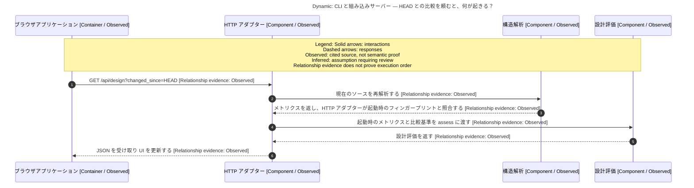

# HEAD との比較を頼むと、何が起きる？

[All views](README.md) · [Diagram source](compare_request.mmd) · [Evidence](evidence.md)

Web の比較が成功する経路では、まずサーバーが起動時からソースが変わっていないことを確かめます。その後、起動時のメトリクスと HEAD を共通の設計評価処理へ渡し、ブラウザに表示する結果を JSON で返します。

- Kind: Dynamic
- Scope: CLI と組み込みサーバー

## Reading notes

ブラウザからの GET /api/design?changed\_since=HEAD をたどります。構造解析から結果が戻る箇所に注目してください。HTTP アダプターは、現在のソースのフィンガープリントを起動時のものと照合してから、設計評価を要求します。再解析したメトリクスはこの確認に使い、設計評価には起動時のメトリクスを渡します。

比較対象、対象モジュール、深さをすべて省略すると、起動時の評価結果を返します。再評価では、起動後にソースや設計コンテキストが変わると HTTP 409、別の評価が実行中なら HTTP 503、評価パラメーターが不正なら HTTP 400 を返します。

Web の比較処理を追う開発者向けに、src/web/design.rs:31-62 のコードから順序を整理しました。実行中の要求を記録したトレースではありません。spawn\_blocking は同じプロセス内で動きます。設計評価の内部で行う比較基準の解析は、この図では省略しています。

## Elements

| Name | Kind | Technology | Responsibility | Evidence |
| --- | --- | --- | --- | --- |
| ブラウザアプリケーション | Container | HTML / CSS / JavaScript | 解析結果とリビジョン間の比較を表示する | Observed: [web-assets/js/design-view.js:124–146](../../web-assets/js/design-view.js#L124-L146) |
| HTTP アダプター | Component | Rust / Axum / RustEmbed | UI を配信し、共通の設計評価処理を公開する | Observed: [src/web/routes.rs:27–100](../../src/web/routes.rs#L27-L100); [src/web/design.rs:19–74](../../src/web/design.rs#L19-L74) |
| 構造解析 | Component | Rust / syn / Cargo metadata | 対象ソースを解析し、各機能が使うメトリクスを生成する | Observed: [src/analyzer.rs:1284–1305](../../src/analyzer.rs#L1284-L1305) |
| 設計評価 | Component | Rust | 構造、履歴、設定された設計上の背景を組み合わせる | Observed: [src/design/assessment.rs:34–139](../../src/design/assessment.rs#L34-L139) |

## Scenario

Step order and scenario wording are authored by the agent and require review. Evidence below supports the referenced static interaction; it does not prove execution order.

| Step | From → To | Interaction | Relationship evidence |
| --- | --- | --- | --- |
| 1 | ブラウザアプリケーション → HTTP アダプター | GET /api/design?changed\_since=HEAD | Observed: [web-assets/js/design-view.js:124–142](../../web-assets/js/design-view.js#L124-L142); [src/web/design.rs:19–74](../../src/web/design.rs#L19-L74) |
| 2 | HTTP アダプター → 構造解析 | 現在のソースを再解析する | Observed: [src/web/design.rs:49–59](../../src/web/design.rs#L49-L59) |
| 3 | 構造解析 → HTTP アダプター | メトリクスを返し、HTTP アダプターが起動時のフィンガープリントと照合する | Observed: [src/web/design.rs:49–59](../../src/web/design.rs#L49-L59) |
| 4 | HTTP アダプター → 設計評価 | 起動時のメトリクスと比較基準を assess に渡す | Observed: [src/web/server.rs:87–109](../../src/web/server.rs#L87-L109); [src/web/design.rs:60–74](../../src/web/design.rs#L60-L74) |
| 5 | 設計評価 → HTTP アダプター | 設計評価を返す | Observed: [src/web/server.rs:87–109](../../src/web/server.rs#L87-L109); [src/web/design.rs:60–74](../../src/web/design.rs#L60-L74) |
| 6 | HTTP アダプター → ブラウザアプリケーション | JSON を受け取り UI を更新する | Observed: [web-assets/js/design-view.js:124–142](../../web-assets/js/design-view.js#L124-L142); [src/web/design.rs:19–74](../../src/web/design.rs#L19-L74) |
