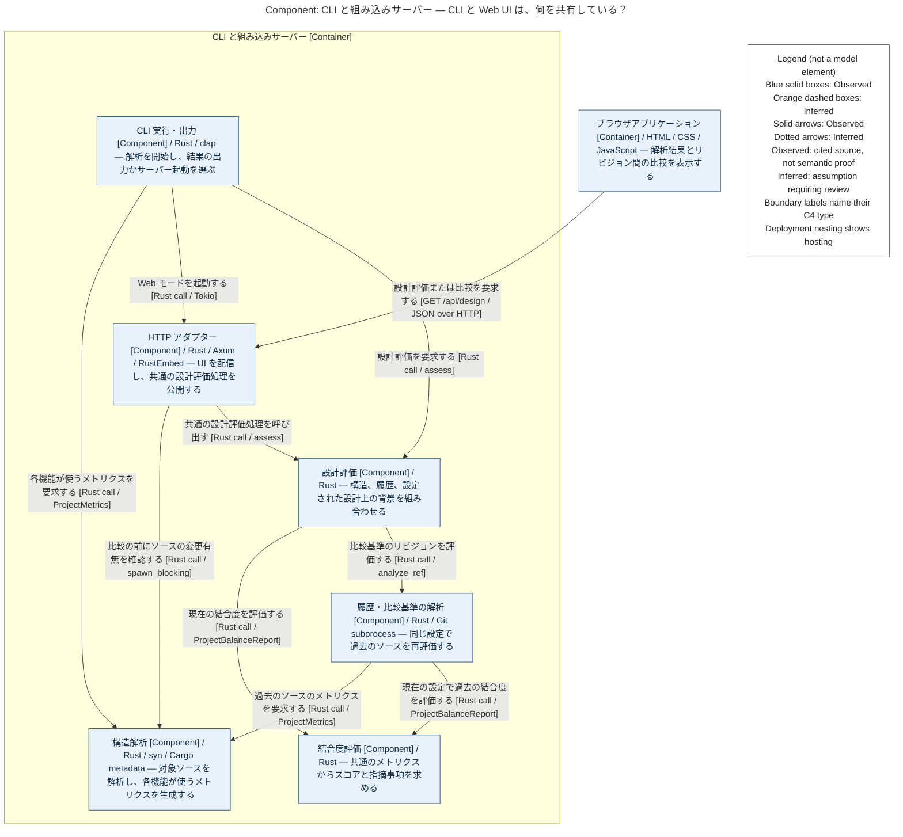

# CLI と Web UI は、何を共有している？

[All views](README.md) · [Diagram source](components.mmd) · [Evidence](evidence.md)

どちらの入口も、同じ設計評価処理を呼び出します。この処理が結合度の評価とリビジョンの比較をまとめているため、評価の動作を変更するときの出発点になります。

- Kind: Component
- Scope: CLI と組み込みサーバー

## Reading notes

「設計評価」を見つけ、「CLI 実行・出力」と「HTTP アダプター」から入る矢印をたどってください。続いて、「結合度評価」と「履歴・比較基準の解析」へ出る矢印を見ます。2 つの使い方が、ここで同じ処理につながります。

評価の動作を変えるなら src/design/assessment.rs、HTTP の応答を変えるなら src/web/design.rs、ターミナルへの出力を変えるなら src/main.rs が入口です。下の要素と関係の表から、確認したソースの範囲を参照できます。責務と実装の詳しい対応は docs/c4doc-review.md に記載しています。

矢印は選んだ呼び出しを示し、すべての import やデータの流れは網羅しません。通常のレポート出力、履歴一覧、Git の変更頻度の収集は省略しています。ProjectMetrics はデータ型、AppState は保持する状態であり、独立した Component には数えません。

## Elements

| Name | Kind | Technology | Responsibility | Evidence |
| --- | --- | --- | --- | --- |
| CLI 実行・出力 | Component | Rust / clap | 解析を開始し、結果の出力かサーバー起動を選ぶ | Observed: [src/main.rs:335–517](../../src/main.rs#L335-L517) |
| 構造解析 | Component | Rust / syn / Cargo metadata | 対象ソースを解析し、各機能が使うメトリクスを生成する | Observed: [src/analyzer.rs:1284–1305](../../src/analyzer.rs#L1284-L1305) |
| HTTP アダプター | Component | Rust / Axum / RustEmbed | UI を配信し、共通の設計評価処理を公開する | Observed: [src/web/routes.rs:27–100](../../src/web/routes.rs#L27-L100); [src/web/design.rs:19–74](../../src/web/design.rs#L19-L74) |
| 設計評価 | Component | Rust | 構造、履歴、設定された設計上の背景を組み合わせる | Observed: [src/design/assessment.rs:34–139](../../src/design/assessment.rs#L34-L139) |
| 履歴・比較基準の解析 | Component | Rust / Git subprocess | 同じ設定で過去のソースを再評価する | Observed: [src/history.rs:325–374](../../src/history.rs#L325-L374) |
| 結合度評価 | Component | Rust | 共通のメトリクスからスコアと指摘事項を求める | Observed: [src/balance/project.rs:19–57](../../src/balance/project.rs#L19-L57) |
| ブラウザアプリケーション | Container | HTML / CSS / JavaScript | 解析結果とリビジョン間の比較を表示する | Observed: [web-assets/js/design-view.js:124–146](../../web-assets/js/design-view.js#L124-L146) |

## Relationships

| From → To | Interaction | Technology | Evidence |
| --- | --- | --- | --- |
| CLI 実行・出力 → 構造解析 | 各機能が使うメトリクスを要求する | Rust call / ProjectMetrics | Observed: [src/main.rs:335–339](../../src/main.rs#L335-L339) |
| CLI 実行・出力 → HTTP アダプター | Web モードを起動する | Rust call / Tokio | Observed: [src/main.rs:414–442](../../src/main.rs#L414-L442) |
| CLI 実行・出力 → 設計評価 | 設計評価を要求する | Rust call / assess | Observed: [src/main.rs:485–505](../../src/main.rs#L485-L505) |
| ブラウザアプリケーション → HTTP アダプター | 設計評価または比較を要求する | GET /api/design / JSON over HTTP | Observed: [web-assets/js/design-view.js:124–142](../../web-assets/js/design-view.js#L124-L142); [src/web/design.rs:19–74](../../src/web/design.rs#L19-L74) |
| HTTP アダプター → 構造解析 | 比較の前にソースの変更有無を確認する | Rust call / spawn\_blocking | Observed: [src/web/design.rs:49–59](../../src/web/design.rs#L49-L59) |
| HTTP アダプター → 設計評価 | 共通の設計評価処理を呼び出す | Rust call / assess | Observed: [src/web/server.rs:87–109](../../src/web/server.rs#L87-L109); [src/web/design.rs:60–74](../../src/web/design.rs#L60-L74) |
| 設計評価 → 結合度評価 | 現在の結合度を評価する | Rust call / ProjectBalanceReport | Observed: [src/design/assessment.rs:114–117](../../src/design/assessment.rs#L114-L117) |
| 設計評価 → 履歴・比較基準の解析 | 比較基準のリビジョンを評価する | Rust call / analyze\_ref | Observed: [src/design/assessment.rs:117–133](../../src/design/assessment.rs#L117-L133) |
| 履歴・比較基準の解析 → 構造解析 | 過去のソースのメトリクスを要求する | Rust call / ProjectMetrics | Observed: [src/history.rs:325–343](../../src/history.rs#L325-L343) |
| 履歴・比較基準の解析 → 結合度評価 | 現在の設定で過去の結合度を評価する | Rust call / ProjectBalanceReport | Observed: [src/history.rs:364–369](../../src/history.rs#L364-L369) |

Continue reading: [HEAD との比較を頼むと、何が起きる？](compare_request.md).
