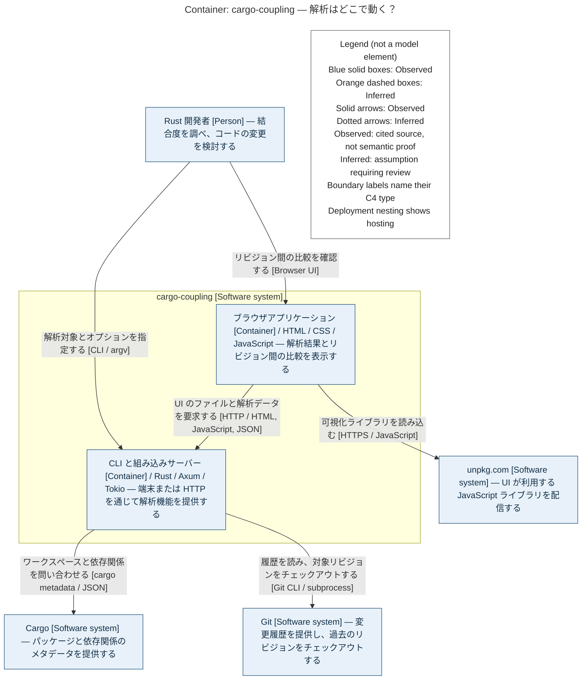

# 解析はどこで動く？

[All views](README.md) · [Diagram source](containers.mmd) · [Evidence](evidence.md)

ネイティブアプリケーション内の Rust がプロジェクトを解析し、ブラウザは HTTP で受け取った結果を表示します。--web に切り替えると、そのアプリケーション内で組み込みサーバーが起動します。

- Kind: Container
- Scope: cargo-coupling

## Reading notes

ネイティブアプリケーションから出る矢印を見ると、Cargo はワークスペースのメタデータを、Git は履歴の取得とリビジョンのチェックアウトを担います。ブラウザからの矢印もたどってください。解析結果は HTTP API に、可視化ライブラリは unpkg.com に要求します。

2 つの Container は、実行環境の異なるネイティブの Rust アプリケーションとブラウザアプリケーションです。ここでの Container は C4 の用語で、Docker を指しません。CLI とサーバーは一つのネイティブアプリケーションの動作モードであり、Rust ライブラリもその中にリンクされています。

起動処理や通信を調べる開発者向けの図です。API の接続先は既定値を前提とします。ソースファイル、TOML、Git 履歴、レポート、一時 worktree は別々のサービスとして描かず、docs/c4doc-review.md の入出力表で説明しています。

## Elements

| Name | Kind | Technology | Responsibility | Evidence |
| --- | --- | --- | --- | --- |
| Rust 開発者 | Person | — | 結合度を調べ、コードの変更を検討する | Observed: [README.md:7–21](../../README.md#L7-L21) |
| CLI と組み込みサーバー | Container | Rust / Axum / Tokio | 端末または HTTP を通じて解析機能を提供する | Observed: [src/main.rs:335–442](../../src/main.rs#L335-L442) |
| ブラウザアプリケーション | Container | HTML / CSS / JavaScript | 解析結果とリビジョン間の比較を表示する | Observed: [web-assets/js/design-view.js:124–146](../../web-assets/js/design-view.js#L124-L146) |
| unpkg.com | Software system | — | UI が利用する JavaScript ライブラリを配信する | Observed: [web-assets/index.html:10–13](../../web-assets/index.html#L10-L13) |
| Cargo | Software system | — | パッケージと依存関係のメタデータを提供する | Observed: [src/workspace.rs:65–75](../../src/workspace.rs#L65-L75) |
| Git | Software system | — | 変更履歴を提供し、過去のリビジョンをチェックアウトする | Observed: [src/volatility.rs:174–217](../../src/volatility.rs#L174-L217); [src/history.rs:418–461](../../src/history.rs#L418-L461) |

## Relationships

| From → To | Interaction | Technology | Evidence |
| --- | --- | --- | --- |
| Rust 開発者 → CLI と組み込みサーバー | 解析対象とオプションを指定する | CLI / argv | Observed: [README.md:40–55](../../README.md#L40-L55) |
| Rust 開発者 → ブラウザアプリケーション | リビジョン間の比較を確認する | Browser UI | Observed: [web-assets/js/design-view.js:130–146](../../web-assets/js/design-view.js#L130-L146) |
| ブラウザアプリケーション → CLI と組み込みサーバー | UI のファイルと解析データを要求する | HTTP / HTML, JavaScript, JSON | Observed: [src/web/routes.rs:83–100](../../src/web/routes.rs#L83-L100) |
| ブラウザアプリケーション → unpkg.com | 可視化ライブラリを読み込む | HTTPS / JavaScript | Observed: [web-assets/index.html:10–13](../../web-assets/index.html#L10-L13) |
| CLI と組み込みサーバー → Cargo | ワークスペースと依存関係を問い合わせる | cargo metadata / JSON | Observed: [src/workspace.rs:65–75](../../src/workspace.rs#L65-L75) |
| CLI と組み込みサーバー → Git | 履歴を読み、対象リビジョンをチェックアウトする | Git CLI / subprocess | Observed: [src/volatility.rs:174–217](../../src/volatility.rs#L174-L217); [src/history.rs:418–461](../../src/history.rs#L418-L461) |

Continue reading: [CLI と Web UI は、何を共有している？](components.md).
