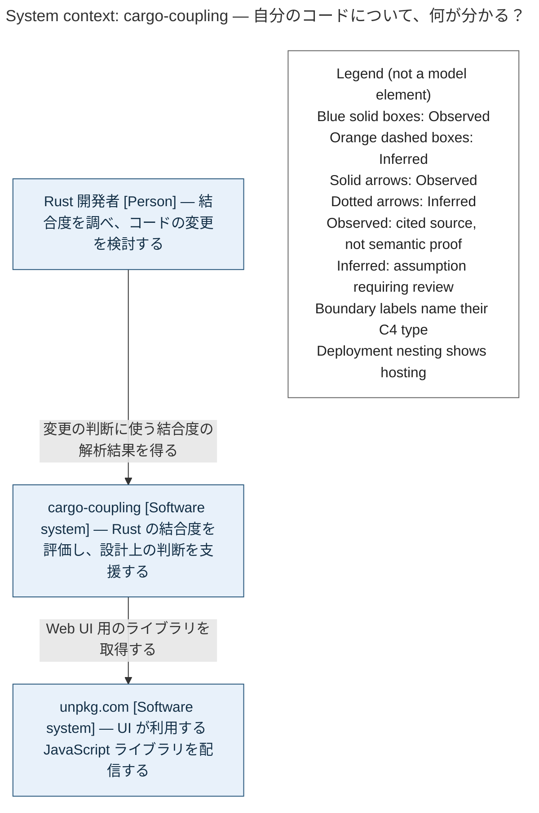

# 自分のコードについて、何が分かる？

[All views](README.md) · [Diagram source](context.mmd) · [Evidence](evidence.md)

cargo-coupling は、構造上の結合と変更履歴を調べ、リファクタリングする場所を考えるためのツールです。CLI でレポートを読むことも、Web UI で結果を探索することもできます。

- Kind: System context
- Scope: cargo-coupling

## Reading notes

Rust 開発者から cargo-coupling への矢印をたどってみてください。ソースの解析と Git の履歴を組み合わせることで、プロジェクトのどの部分がつながり、どのように変わってきたかを調べられます。

CDN への矢印は、Web の可視化ライブラリを unpkg.com から取得する要求です。解析結果のアップロードを表してはいません。次の図では、ブラウザと Rust アプリケーションを分け、Cargo と Git とのやり取りも見ていきます。

このガイドは、0.4.0、リビジョン 5b019b2642f7dd7275d742d308b898b9047d2e6c のローカル CLI と Web の利用を扱います。CI と第三者のアプリケーションへのライブラリ組み込みは対象外です。説明は確認したコードと文書に基づき、Web の経路を実行テストしたものではありません。比較条件と詳しい実装との対応は docs/c4doc-review.md に記載しています。

## Elements

| Name | Kind | Technology | Responsibility | Evidence |
| --- | --- | --- | --- | --- |
| Rust 開発者 | Person | — | 結合度を調べ、コードの変更を検討する | Observed: [README.md:7–21](../../README.md#L7-L21) |
| cargo-coupling | Software system | — | Rust の結合度を評価し、設計上の判断を支援する | Observed: [README.md:1–9](../../README.md#L1-L9) |
| unpkg.com | Software system | — | UI が利用する JavaScript ライブラリを配信する | Observed: [web-assets/index.html:10–13](../../web-assets/index.html#L10-L13) |

## Relationships

| From → To | Interaction | Technology | Evidence |
| --- | --- | --- | --- |
| Rust 開発者 → cargo-coupling | 変更の判断に使う結合度の解析結果を得る | — | Observed: [README.md:7–21](../../README.md#L7-L21) |
| cargo-coupling → unpkg.com | Web UI 用のライブラリを取得する | — | Observed: [web-assets/index.html:10–13](../../web-assets/index.html#L10-L13) |

Continue reading: [解析はどこで動く？](containers.md).
