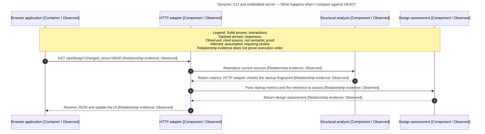

# What happens when I compare against HEAD?

[All views](README.md) · [Diagram source](compare_request.mmd) · [Evidence](evidence.md)

For a successful Web comparison, the server first checks that the source still matches its startup snapshot. It then passes startup metrics and HEAD to the shared assessment and returns JSON for the browser to display.

- Kind: Dynamic
- Scope: CLI and embedded server

## Reading notes

Trace GET /api/design?changed\_since=HEAD from the browser. The return from Structural analysis is a checkpoint: the HTTP adapter compares the current source fingerprint with the startup fingerprint before requesting design assessment. Freshly collected metrics support this check; the assessment receives the startup metrics.

A request without a revision, focus or depth returns the cached startup assessment. A new assessment returns HTTP 409 if the source or design context changed after startup, HTTP 503 if another assessment is running, or HTTP 400 for invalid assessment parameters.

For developers tracing the Web comparison path: ordering was reconstructed from src/web/design.rs:31-62, not captured from a running request. spawn\_blocking runs in the same process. Revision-baseline analysis inside design assessment is omitted from this sequence.

## Elements

| Name | Kind | Technology | Responsibility | Evidence |
| --- | --- | --- | --- | --- |
| Browser application | Container | HTML / CSS / JavaScript | Explores analysis results and revision comparisons | Observed: [web-assets/js/design-view.js:124–146](../../web-assets/js/design-view.js#L124-L146) |
| HTTP adapter | Component | Rust / Axum / RustEmbed | Serves the UI and exposes shared assessment | Observed: [src/web/routes.rs:27–100](../../src/web/routes.rs#L27-L100); [src/web/design.rs:19–74](../../src/web/design.rs#L19-L74) |
| Structural analysis | Component | Rust / syn / Cargo metadata | Parses selected sources into shared metrics | Observed: [src/analyzer.rs:1284–1305](../../src/analyzer.rs#L1284-L1305) |
| Design assessment | Component | Rust | Combines structure, history, and declared context | Observed: [src/design/assessment.rs:34–139](../../src/design/assessment.rs#L34-L139) |

## Scenario

Step order and scenario wording are authored by the agent and require review. Evidence below supports the referenced static interaction; it does not prove execution order.

| Step | From → To | Interaction | Relationship evidence |
| --- | --- | --- | --- |
| 1 | Browser application → HTTP adapter | GET /api/design?changed\_since=HEAD | Observed: [web-assets/js/design-view.js:124–142](../../web-assets/js/design-view.js#L124-L142); [src/web/design.rs:19–74](../../src/web/design.rs#L19-L74) |
| 2 | HTTP adapter → Structural analysis | Reanalyze current sources | Observed: [src/web/design.rs:49–59](../../src/web/design.rs#L49-L59) |
| 3 | Structural analysis → HTTP adapter | Return metrics; HTTP adapter checks the startup fingerprint | Observed: [src/web/design.rs:49–59](../../src/web/design.rs#L49-L59) |
| 4 | HTTP adapter → Design assessment | Pass startup metrics and the reference to assess | Observed: [src/web/server.rs:87–109](../../src/web/server.rs#L87-L109); [src/web/design.rs:60–74](../../src/web/design.rs#L60-L74) |
| 5 | Design assessment → HTTP adapter | Return design assessment | Observed: [src/web/server.rs:87–109](../../src/web/server.rs#L87-L109); [src/web/design.rs:60–74](../../src/web/design.rs#L60-L74) |
| 6 | HTTP adapter → Browser application | Receive JSON and update the UI | Observed: [web-assets/js/design-view.js:124–142](../../web-assets/js/design-view.js#L124-L142); [src/web/design.rs:19–74](../../src/web/design.rs#L19-L74) |
