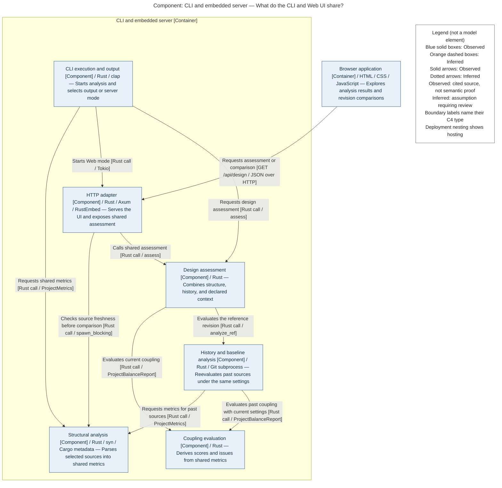

# What do the CLI and Web UI share?

[All views](README.md) · [Diagram source](components.mmd) · [Evidence](evidence.md)

Both entry points call the same design assessment. That shared responsibility coordinates coupling evaluation and revision comparison, so developers can begin there when changing assessment behavior.

- Kind: Component
- Scope: CLI and embedded server

## Reading notes

Find Design assessment and follow its incoming arrows from CLI execution and output and from the HTTP adapter. Then follow its outgoing arrows to Coupling evaluation and History and baseline analysis. This is where the two user experiences meet.

For a change to assessment behavior, start at src/design/assessment.rs. For an HTTP response change, start at src/web/design.rs. For terminal output, start at src/main.rs. The element and relationship tables below provide the inspected source ranges; docs/c4doc-review.md contains the full responsibility-to-code mapping.

Arrows show selected calls, not every import or data-flow edge. Ordinary reporting, history listing, and Git volatility collection are omitted. ProjectMetrics is a data type and AppState holds state; neither is a separate Component.

## Elements

| Name | Kind | Technology | Responsibility | Evidence |
| --- | --- | --- | --- | --- |
| CLI execution and output | Component | Rust / clap | Starts analysis and selects output or server mode | Observed: [src/main.rs:335–517](../../src/main.rs#L335-L517) |
| Structural analysis | Component | Rust / syn / Cargo metadata | Parses selected sources into shared metrics | Observed: [src/analyzer.rs:1284–1305](../../src/analyzer.rs#L1284-L1305) |
| HTTP adapter | Component | Rust / Axum / RustEmbed | Serves the UI and exposes shared assessment | Observed: [src/web/routes.rs:27–100](../../src/web/routes.rs#L27-L100); [src/web/design.rs:19–74](../../src/web/design.rs#L19-L74) |
| Design assessment | Component | Rust | Combines structure, history, and declared context | Observed: [src/design/assessment.rs:34–139](../../src/design/assessment.rs#L34-L139) |
| History and baseline analysis | Component | Rust / Git subprocess | Reevaluates past sources under the same settings | Observed: [src/history.rs:325–374](../../src/history.rs#L325-L374) |
| Coupling evaluation | Component | Rust | Derives scores and issues from shared metrics | Observed: [src/balance/project.rs:19–57](../../src/balance/project.rs#L19-L57) |
| Browser application | Container | HTML / CSS / JavaScript | Explores analysis results and revision comparisons | Observed: [web-assets/js/design-view.js:124–146](../../web-assets/js/design-view.js#L124-L146) |

## Relationships

| From → To | Interaction | Technology | Evidence |
| --- | --- | --- | --- |
| CLI execution and output → Structural analysis | Requests shared metrics | Rust call / ProjectMetrics | Observed: [src/main.rs:335–339](../../src/main.rs#L335-L339) |
| CLI execution and output → HTTP adapter | Starts Web mode | Rust call / Tokio | Observed: [src/main.rs:414–442](../../src/main.rs#L414-L442) |
| CLI execution and output → Design assessment | Requests design assessment | Rust call / assess | Observed: [src/main.rs:485–505](../../src/main.rs#L485-L505) |
| Browser application → HTTP adapter | Requests assessment or comparison | GET /api/design / JSON over HTTP | Observed: [web-assets/js/design-view.js:124–142](../../web-assets/js/design-view.js#L124-L142); [src/web/design.rs:19–74](../../src/web/design.rs#L19-L74) |
| HTTP adapter → Structural analysis | Checks source freshness before comparison | Rust call / spawn\_blocking | Observed: [src/web/design.rs:49–59](../../src/web/design.rs#L49-L59) |
| HTTP adapter → Design assessment | Calls shared assessment | Rust call / assess | Observed: [src/web/server.rs:87–109](../../src/web/server.rs#L87-L109); [src/web/design.rs:60–74](../../src/web/design.rs#L60-L74) |
| Design assessment → Coupling evaluation | Evaluates current coupling | Rust call / ProjectBalanceReport | Observed: [src/design/assessment.rs:114–117](../../src/design/assessment.rs#L114-L117) |
| Design assessment → History and baseline analysis | Evaluates the reference revision | Rust call / analyze\_ref | Observed: [src/design/assessment.rs:117–133](../../src/design/assessment.rs#L117-L133) |
| History and baseline analysis → Structural analysis | Requests metrics for past sources | Rust call / ProjectMetrics | Observed: [src/history.rs:325–343](../../src/history.rs#L325-L343) |
| History and baseline analysis → Coupling evaluation | Evaluates past coupling with current settings | Rust call / ProjectBalanceReport | Observed: [src/history.rs:364–369](../../src/history.rs#L364-L369) |

Continue reading: [What happens when I compare against HEAD?](compare_request.md).
