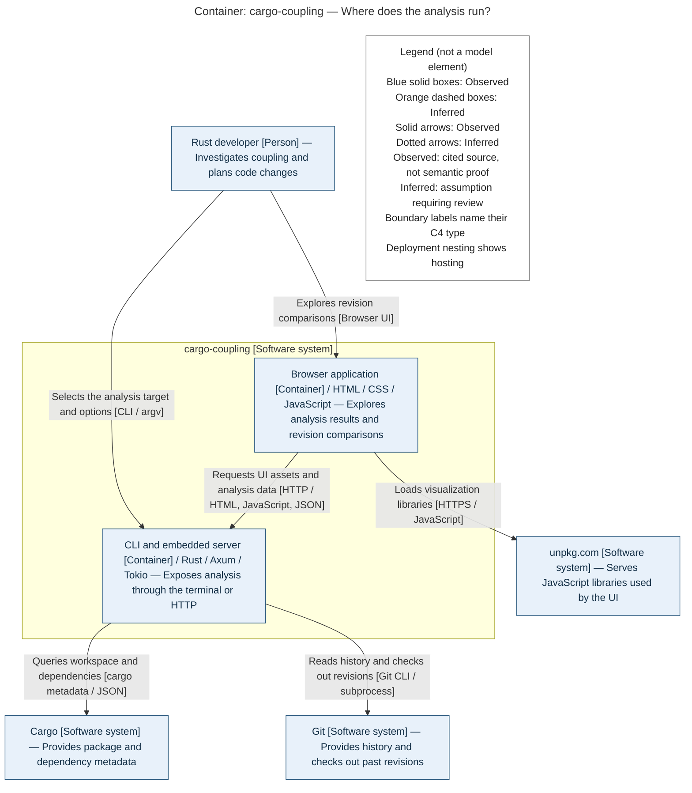

# Where does the analysis run?

[All views](README.md) · [Diagram source](containers.mmd) · [Evidence](evidence.md)

Rust analyzes the project in the native application; the browser displays its results over HTTP. Switching to --web starts the embedded server in that same application.

- Kind: Container
- Scope: cargo-coupling

## Reading notes

Follow the native application's outgoing arrows: Cargo supplies workspace metadata, and Git supplies history and revision checkout operations. Follow the browser separately: it requests analysis results from the HTTP API and visualization libraries from unpkg.com.

The two Containers are applications with different execution environments: the native Rust application and the browser application. Container is a C4 term here; it does not mean Docker. The CLI and server are modes of one native application, with its Rust library linked into it.

This view helps developers investigate startup and communication. It assumes the default API destination. Source files, TOML, Git history, reports, and temporary worktrees are described in the I/O table in docs/c4doc-review.md rather than drawn as separate services.

## Elements

| Name | Kind | Technology | Responsibility | Evidence |
| --- | --- | --- | --- | --- |
| Rust developer | Person | — | Investigates coupling and plans code changes | Observed: [README.md:7–21](../../README.md#L7-L21) |
| CLI and embedded server | Container | Rust / Axum / Tokio | Exposes analysis through the terminal or HTTP | Observed: [src/main.rs:335–442](../../src/main.rs#L335-L442) |
| Browser application | Container | HTML / CSS / JavaScript | Explores analysis results and revision comparisons | Observed: [web-assets/js/design-view.js:124–146](../../web-assets/js/design-view.js#L124-L146) |
| unpkg.com | Software system | — | Serves JavaScript libraries used by the UI | Observed: [web-assets/index.html:10–13](../../web-assets/index.html#L10-L13) |
| Cargo | Software system | — | Provides package and dependency metadata | Observed: [src/workspace.rs:65–75](../../src/workspace.rs#L65-L75) |
| Git | Software system | — | Provides history and checks out past revisions | Observed: [src/volatility.rs:174–217](../../src/volatility.rs#L174-L217); [src/history.rs:418–461](../../src/history.rs#L418-L461) |

## Relationships

| From → To | Interaction | Technology | Evidence |
| --- | --- | --- | --- |
| Rust developer → CLI and embedded server | Selects the analysis target and options | CLI / argv | Observed: [README.md:40–55](../../README.md#L40-L55) |
| Rust developer → Browser application | Explores revision comparisons | Browser UI | Observed: [web-assets/js/design-view.js:130–146](../../web-assets/js/design-view.js#L130-L146) |
| Browser application → CLI and embedded server | Requests UI assets and analysis data | HTTP / HTML, JavaScript, JSON | Observed: [src/web/routes.rs:83–100](../../src/web/routes.rs#L83-L100) |
| Browser application → unpkg.com | Loads visualization libraries | HTTPS / JavaScript | Observed: [web-assets/index.html:10–13](../../web-assets/index.html#L10-L13) |
| CLI and embedded server → Cargo | Queries workspace and dependencies | cargo metadata / JSON | Observed: [src/workspace.rs:65–75](../../src/workspace.rs#L65-L75) |
| CLI and embedded server → Git | Reads history and checks out revisions | Git CLI / subprocess | Observed: [src/volatility.rs:174–217](../../src/volatility.rs#L174-L217); [src/history.rs:418–461](../../src/history.rs#L418-L461) |

Continue reading: [What do the CLI and Web UI share?](components.md).
