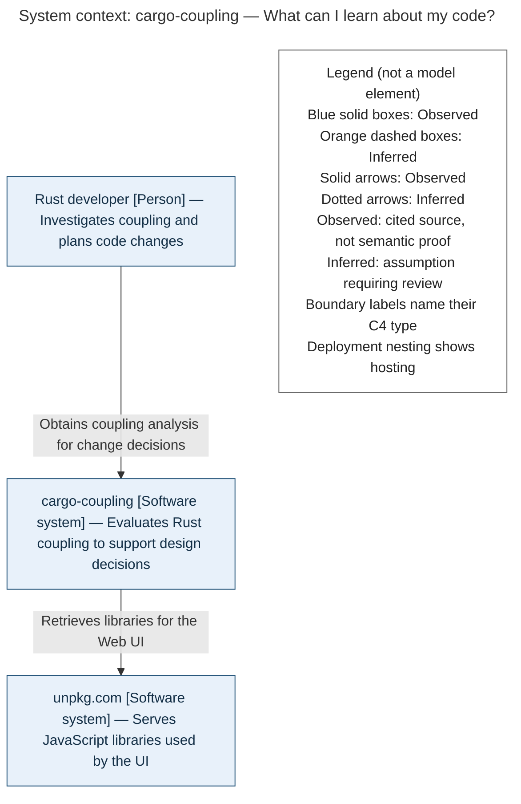

# What can I learn about my code?

[All views](README.md) · [Diagram source](context.mmd) · [Evidence](evidence.md)

cargo-coupling helps you inspect structural coupling and change history when deciding where to refactor. Use the CLI for reports or open the Web UI to explore the results.

- Kind: System context
- Scope: cargo-coupling

## Reading notes

Start with the Rust developer and follow the request to cargo-coupling. The tool combines source analysis with Git history to help you investigate which parts of a project are connected and how they change.

The CDN arrow represents a request for Web visualization libraries from unpkg.com. It does not represent an upload of analysis results. The next view separates the browser from the Rust application and shows Cargo and Git.

This guide covers local CLI and Web use in 0.4.0 at revision 5b019b2642f7dd7275d742d308b898b9047d2e6c. CI and third-party library embedding are outside this view. The explanations come from inspected source and documentation; the Web paths were not exercised as runtime tests. Comparison conditions and detailed mappings are recorded in docs/c4doc-review.md.

## Elements

| Name | Kind | Technology | Responsibility | Evidence |
| --- | --- | --- | --- | --- |
| Rust developer | Person | — | Investigates coupling and plans code changes | Observed: [README.md:7–21](../../README.md#L7-L21) |
| cargo-coupling | Software system | — | Evaluates Rust coupling to support design decisions | Observed: [README.md:1–9](../../README.md#L1-L9) |
| unpkg.com | Software system | — | Serves JavaScript libraries used by the UI | Observed: [web-assets/index.html:10–13](../../web-assets/index.html#L10-L13) |

## Relationships

| From → To | Interaction | Technology | Evidence |
| --- | --- | --- | --- |
| Rust developer → cargo-coupling | Obtains coupling analysis for change decisions | — | Observed: [README.md:7–21](../../README.md#L7-L21) |
| cargo-coupling → unpkg.com | Retrieves libraries for the Web UI | — | Observed: [web-assets/index.html:10–13](../../web-assets/index.html#L10-L13) |

Continue reading: [Where does the analysis run?](containers.md).
