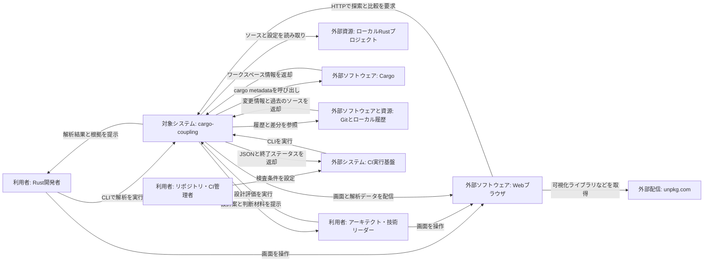

# プロジェクト概要

生成後に、CLI・Webの共通評価と外部CDN依存をコードで照合して補足しました。[実行条件と確認範囲](../litho-run.md)も参照してください。

## 1. プロジェクト概要

### 1.1 システムの目的

**cargo-coupling** は、Rustプロジェクトの結合度を解析し、変更影響の調査と設計レビューを支援するCargoサブコマンドである。単一クレートから複数クレートのワークスペースまでを対象に、ソースコードの静的構造、Git履歴、利用者が明示した設計情報を組み合わせ、CLIとWeb画面で判断材料を提供する。

中心となる評価軸は、結合の**強さ・距離・変動性**である。依存関係の存在だけでなく、その関係が設計上どのような問題につながり得るか、変更がどの利用側へ波及し得るかを、根拠と解析条件を添えて示す。

### 1.2 提供する価値

| 目的 | 提供する情報 | 利用者の判断 |
|---|---|---|
| 既存構造を理解する | モジュール階層、依存行列、依存グラフ、公開APIの露出 | 変更前に確認すべき境界を見つける |
| 改修リスクを把握する | 変更要素、複数段階の影響経路、候補テスト | 調査と検証の範囲を決める |
| 設計案を比較する | 現状維持、知識の隠蔽、責務の近接化・分離、宣言されたシナリオ | 前提とトレードオフを比較する |
| 改善作業を選ぶ | 問題の重大度、影響範囲、業務価値、明示された工数 | 相対的な優先順位を決める |
| 品質の悪化を検出する | 基準リビジョンからの新規・解消・悪化した問題 | CIで変更を受け入れる条件を確認する |
| 既存判断を見直す | 判断理由、見直し条件、再検討・保持・不明の状態 | 判断の前提が維持されているか確認する |

評価値と優先順位は意思決定を補助する相対的な指標であり、削減工数や障害発生確率を予測するものではない。業務上の意味や変更の必要性の最終判断は利用者が担う。

### 1.3 技術的な特徴

- Rust製の解析ライブラリとCLIを中心とする。
- 組み込みHTTPサーバーとHTML・CSS・JavaScriptのWeb画面を備える。
- CLIとWebの変更計画機能は、共通のRust設計評価を利用する。
- テキスト、Markdown、JSONのレポートと、品質ゲートの終了ステータスを提供する。
- Webでは構造カード、依存行列、2D・3Dグラフ、履歴、変更計画を探索できる。
- 外部の実行時監視基盤から自動収集するのではなく、ローカルのソース・履歴と明示された情報を分析する。

### 1.4 本書の根拠と対象範囲

本書は、提供されたシステムコンテキスト調査、ドメインモジュール分析、および `docs/design-analysis.md` の内容に基づく。

C4のSystem Contextレベルとして、cargo-coupling全体を一つのソフトウェアシステムとして扱い、利用者、外部システム、入出力、責務の境界を説明する。内部の機能領域は、その責務を理解するための補足として示す。

生成時点では主にコードの要約と設計資料を参照している。生成後のコード照合は上記の記録に示す範囲で行った。実装と文書の完全な一致や、未文書化機能の網羅的な確認は行っていない。

## 2. 利用者と利用シナリオ

### 2.1 利用者の役割

| 利用者 | 主な関心 | 代表的な利用 |
|---|---|---|
| Rust開発者 | 変更が影響する箇所、依存の根拠、必要な検証 | モジュールから影響経路を追い、ソース位置と候補テストを確認する |
| ソフトウェアアーキテクト・技術リーダー | 責務の分割、業務ルール、チーム間の調整 | 設計案を比較し、担当者やリリース単位を踏まえて判断する |
| リポジトリ・CI管理者 | 自動検査の条件、既存問題と悪化の区別 | 基準リビジョンと重大度を指定し、JSONと終了ステータスを処理する |

これらの役割は利用目的の分類であり、アプリケーション内の権限ロールを示すものではない。

### 2.2 代表的な利用シナリオ

#### プロジェクト全体の状態を確認する

`cargo coupling .` を実行し、プロジェクト構造、依存関係、結合バランス、問題、健全性を確認する。開発者は指摘とその根拠から、詳細に調査するモジュールを選ぶ。

#### 変更前に影響を調べる

`cargo coupling --changed-since main --impact-depth 4 .` のように、変更基準と探索深度を指定する。選択範囲内のコミット済み・ステージ済み・未ステージ・未追跡の変更を対象に、変更要素と到達可能な利用側を調べる。

削除された要素も元のリビジョンと行番号を保持するため、レビュー時に変更前の根拠を参照できる。

#### 設計案と組織上の前提を比較する

`--design` や `--context` を使い、構造上の観測に担当者、共有業務ルール、変更予定、ビルド・テスト・リリース単位などを加える。利用者は仮想シナリオの評価と前提を読み、設計案を選ぶ。

シナリオは評価上の仮定を変更するものであり、ソースコードを書き換えない。

#### CIで品質の悪化を検出する

`cargo coupling --check --baseline <基準リビジョン> .` により、現在と基準側を同じ解析条件で評価する。指定重大度以上の新規・悪化した問題があれば品質ゲートを失敗させる。継続している既存問題は比較結果に残り、それだけを理由にこの基準付き検査を失敗させない。

#### Webで変更レビューを進める

`cargo coupling --web --context ./design-context.toml --no-open .` でWeb画面を提供する。利用者は **Structure** で構造を確認し、**Plan a change** で影響追跡、Git比較、設計案、既存判断を調べ、結果をJSONで取得する。

## 3. システム境界

### 3.1 境界の定義

cargo-couplingの責務は、**解析対象から観測できる情報と利用者が宣言した情報を評価し、設計判断に必要な根拠を提示すること**である。

CLI、解析ライブラリ、レポート生成、組み込みHTTPサーバー、配信するWeb画面はシステム境界内に含める。解析対象プロジェクト、Cargo、Git、ブラウザ実行環境、CI実行基盤は境界外とする。

Web画面の資産と表示ロジックはcargo-couplingの一部であり、それを実行するブラウザ製品は外部ソフトウェアである。

### 3.2 境界内の責務

| 機能領域 | 含まれる責務 |
|---|---|
| 構造・結合の把握 | 解析範囲の特定、ソース探索、Rust構文解析、依存関係の抽出・分類、指標の集約 |
| 結合バランス・健全性評価 | 強さ・距離・変動性の評価、問題検出、重大度付与、健全性グレードと理由の生成 |
| 変更履歴・品質差分管理 | 変更頻度と同時変更の分析、変更要素の特定、基準比較、履歴情報の提供 |
| 変更影響・設計判断支援 | 影響経路、候補テスト、公開API露出、担当者・業務上の前提、設計案、優先順位、既存判断の評価 |
| 分析結果の活用・品質ゲート | CLI実行制御、各形式のレポート、検査の成否判定、HTTPによる画面とデータの提供 |

これらは機能上の分類であり、独立したサービスやDDDの境界づけられたコンテキストを表さない。例えば、変更履歴の処理は複数モジュールに分散し、品質ゲートは実行制御と出力処理にまたがる。

### 3.3 境界外の責務

| 対象外 | 境界上の意味 |
|---|---|
| 解析対象アプリケーションの実行・運用 | アプリケーションの本番動作を管理しない |
| ソースコードの自動修正 | 提案やシナリオ比較を提示し、実装変更は利用者が行う |
| Web画面からの設計コンテキスト編集 | TOMLを読み取るが、画面から更新しない |
| 完全なRust意味解析 | 型解決、マクロ展開、有効な`cfg`分岐、動的ディスパッチ、再エクスポートの解決には制限がある |
| 実行時トレースの収集 | 実行順序やトランザクションなどは、供給された根拠に基づいて評価する |
| 業務ドメインや共有要件の自動確定 | 構文上の類似性やディレクトリだけでは業務上の意味を決定しない |
| 候補テストの実行 | テスト候補を提示するが、実行や検証結果の保証は担わない |
| Gitホスティング・CI基盤の提供 | 既存の履歴と実行基盤を利用する |

## 4. 外部システムとの相互作用

### 4.1 接続先と情報の流れ

| 外部システム・資源 | 相互作用 | 受け取る情報・返す情報 | 依存する機能 |
|---|---|---|---|
| 解析対象のローカルRustプロジェクト | ローカルファイルの読み取り | ソース、Cargoマニフェスト、解析設定、設計コンテキスト、CODEOWNERS | 構造解析と設計評価の基礎 |
| Cargo | `cargo metadata`の呼び出し | ワークスペース所属クレート、ターゲット、依存関係 | 解析範囲とクレート構造の把握 |
| Git | ローカル履歴・作業ツリーの参照 | 変更頻度、同時変更、差分、リビジョン、過去のソース | 履歴分析、変更影響、基準比較 |
| Webブラウザ | 組み込みサーバーへのHTTPアクセス | 操作要求を送り、画面、解析データ、ソース根拠、JSONを受け取る | 対話的な探索とレビュー |
| unpkg.com | ブラウザによるスクリプト取得 | 可視化ライブラリなどを配信する | Web画面の外部依存。`3d-force-graph`のURLには版指定がない |
| CI実行基盤 | CLIプロセスの実行と結果取得 | 実行条件を渡し、JSON等の出力と終了ステータスを受け取る | 自動品質検査 |

特定のGitホスティング製品やCI製品への直接依存は、提供資料では確認されていない。Git連携はローカルリポジトリの参照として説明されており、ホスティングサービスのAPI連携を前提としない。

### 4.2 設定と設計情報の扱い

入力情報は、観測できる事実と利用者の宣言を分けて扱う。

| 入力 | 主な内容 | 評価上の扱い |
|---|---|---|
| Rustソース・Cargo情報 | 構造、公開シグネチャ、依存、所属クレート | 静的に観測した構造 |
| Git履歴・差分 | 変更回数、同時変更、変更要素 | 履歴から観測した変更 |
| `.coupling.toml` | サブドメイン、変動性、閾値など | 解析と評価の設定 |
| `.coupling-context.toml`または`--context`指定ファイル | 担当者、業務価値、工数、業務ルール、実行時の前提、シナリオ、判断理由 | 明示的に供給された設計情報 |
| CODEOWNERS | ファイルの担当者 | 所有者情報の補完 |

設計コンテキストは上位ディレクトリに向かって探索するか、`--context`で指定したファイルを読み取る。既定ファイルが存在しない場合はコンテキストを不明として報告し、明示指定したファイルが存在しない場合はエラーとする。

不明なフィールド、未対応の版、不正なセレクタ、重複ID、不正な数値などは検証エラーとなる。一方、選択した解析範囲に一致しないセレクタは適用範囲の注記として扱う。設計コンテキストは、Git由来の変更頻度や既存設定による本質的な変動性の分類を上書きしない。

CODEOWNERSは `.github/CODEOWNERS`、ルートの `CODEOWNERS`、`docs/CODEOWNERS` の順に探索し、パターンは最後の一致を優先する。明示された担当者はファイル規則に優先し、担当者が得られなければ不明のまま保持する。

### 4.3 履歴と実行時情報への依存

Git履歴は、構造解析を補完する情報源である。履歴に依存する比較や判断では、必要なリビジョンや変更情報を参照できることが前提になる。情報が不足する場合の詳細な挙動は、機能ごとに確認する必要がある。

実行順序、タイミング、トランザクション、共有状態、同期・非同期の関係は、設計コンテキストに供給された根拠だけを評価する。`origin = "observed"`は実際の観測を記述するための分類であり、cargo-coupling自身がトレースを収集したことを意味しない。また、非同期であることだけで弱い結合とは判定しない。

## 5. C4システムコンテキスト図



### 5.1 図の読み方

中央のcargo-couplingが対象システムである。CLI、解析処理、HTTPサーバー、Web画面を個別ノードに分解せず、一つの製品境界として表現している。

矢印はラベルに記した要求、参照、結果提供の方向を示す。ソースファイルとGit履歴は同一リポジトリに存在し得るが、現在の構造と変更の経緯という異なる情報源として分けている。

この図はシステム間の相互作用を示すものであり、解析結果に表示されるモジュール依存グラフではない。解析画面では、依存の矢印は利用側から提供側へ、変更影響の矢印は変更された提供側から影響を受け得る利用側へ向かう。

### 5.2 主要な処理の流れ

1. 利用者またはCIが、対象パスと解析・比較条件を指定する。
2. cargo-couplingが、Cargo情報、ソース、設定から解析範囲と依存構造を把握する。
3. 指定機能に応じて、Git履歴、変更差分、設計コンテキストを読み取る。
4. 共通の評価処理が問題、健全性、変更影響、設計上の選択肢をまとめる。
5. CLIはレポートと終了ステータスを返し、WebはHTTPを通じて探索可能な画面とデータを提供する。

## 6. 技術アーキテクチャの概要

### 6.1 構成と責務の分離

| 構成 | 技術・形式 | 役割 |
|---|---|---|
| 解析・評価 | Rust | 構文観測、指標集約、問題検出、設計評価 |
| CLI・ライブラリ公開窓口 | Rust | 実行条件の受付、解析の起動、結果の利用 |
| Web提供 | 組み込みHTTPサーバー | 画面と評価データの配信 |
| Web画面 | HTML・CSS・JavaScript | 構造と変更影響の対話的な表示 |
| 設定・設計情報 | TOML、CODEOWNERS | 評価条件とコードから確定できない前提の提供 |
| 結果交換 | テキスト、Markdown、JSON、終了ステータス | 人によるレビューとCIでの自動処理 |

構造の観測を共通指標へ集約し、その指標を健全性評価と設計判断に利用する構成である。出力側が評価ロジックを個別に持つのではなく、CLIとWebが同じRust評価を利用することで、表示経路による判断の差を抑える。

### 6.2 評価方式と比較の一貫性

結合バランスは、正規化された値に対して次式で算定する。

```text
max(abs(strength - distance), 1 - volatility)
```

評価方式の識別子は `khononov-compensation-v2` である。旧来の乗算方式によるスコアとは直接比較できない。また、健全性グレードは検出問題に基づくため、バランススコアとは区別して読む必要がある。

`--baseline`と`--changed-since`は、比較両側のソースに現在の解析器、評価方式、閾値、有効設定を適用する。これは条件を揃えたソース差分の評価であり、過去に公開した評価値の再現ではない。

### 6.3 設計案と優先順位

設計案は、依存関係の強さ、距離、変動性を仮に変更した場合の評価と、その前提・トレードオフを示す。宣言されたシナリオは一致する観測を対象に評価し、一致がなければスコアをゼロではなく`null`として扱う。

優先順位は、問題の重大度、到達可能な利用側、依存経路を通じた影響、変更予定、変更を保留している状態、業務価値から算出する。工数が明示されている場合は工数当たりの優先度も提供するが、未入力の工数を推定して埋めない。

共通化の候補や公開APIへの露出は調査の入口である。類似した実装やtraitの追加だけでは、共有すべき業務ルールや適切な情報隠蔽が成立したとは判断しない。

### 6.4 結果の来歴と自動処理

評価結果には、次のような解析条件を記録する。

- スキーマ版、解析器版、評価方式の版。
- 解析範囲、リビジョン、未コミット変更の状態。
- ソース、設定、設計コンテキストのフィンガープリント。
- 有効設定、Gitの対象期間、テスト除外、閾値、探索深度。

フィンガープリントは内容を識別する決定的な値であり、暗号学的な署名ではない。解析範囲、設定、評価方式が異なる保存済みレポートを比較する場合は、新しい条件で比較を実行する必要がある。

汎用JSONのスキーマ版は2、`design`部分のスキーマ版は1である。人向けの要約は長い項目を省略する場合があるが、JSONには報告対象の観測が保持される。

### 6.5 Web表示の整合性

Webの変更計画は、履歴タイムラインとは独立した起動時の作業ツリースナップショットを使用する。ソース編集後はサーバーの再起動が必要であり、起動時の指標と変更・追加後のファイルが混在する比較では更新を促すメッセージを返す。

参照するソースは解析対象ワークスペース内に制限される。これは、過去に存在したディレクトリが現在は削除されている場合にも適用される。

2D・3Dグラフの配置は表示上のレイアウトであり、評価軸の測定値そのものではない。測定された次元は **Dimension-Space** で確認する。画面のナビゲーションと項目名は英語・日本語に対応し、詳細な診断説明や供給された根拠は元の言語を保持する。

## 7. 解析の限界と結果の利用方針

### 7.1 観測から確定できる範囲

| 出力・根拠 | 読み取れること | それだけでは確定できないこと |
|---|---|---|
| モジュール階層・ディレクトリ | 構文上・配置上の境界 | 業務ドメインの境界 |
| 依存経路 | 観測したグラフ上の到達可能性 | すべての利用側で修正が必要か |
| 同一処理・同形レコード | 構文上の類似性 | 共有要件や共通化の妥当性 |
| Git同時変更 | 過去に同時に変更された関係 | 同じ理由で変更されたか |
| 候補テスト | 名前や到達可能性から見た関連候補 | 必要なテストの網羅性や合否 |
| 担当者・実行時の宣言 | 提供された組織・運用上の前提 | 宣言の現在の正しさ |

同一処理の検出にはモジュール間で24以上の正規化トークン、同形レコードには2つ以上の一致フィールドという条件がある。これらは自明な一致を減らすための基準であり、意味的な重複を証明しない。

探索深度を指定しなければ、観測したグラフ上の到達可能なすべてのモジュールを探索する。正の深度を指定した場合は、追加経路が省略されたかを報告する。ただし、構文解析自体の制限があるため、探索を打ち切らなくても実際の変更影響の完全性は保証しない。テストを解析対象から除外すると、候補テストの把握範囲も狭くなる。

### 7.2 実務での確認事項

設計レビューでは、まず解析範囲と根拠の不足を確認し、影響経路や指摘から関連ソースへ進む。業務ルール、担当者、実行時の前提は、コードからの推測と分けて確認する。

CIでは、基準リビジョンと重大度を明確にし、新規・悪化した問題に対する検査方針を定める。既存問題の改善計画は、その差分検査とは別に管理できる。

保持している設計判断の再評価では、根拠が不足している状態を「保持してよい」と解釈しない。必要な比較やコンテキストが得られなければ、不明または確認待ちとして扱う。

## 8. 文書との整合性と未確認事項

提供された設計文書とモジュール分析は、構造観測、バランス評価、履歴比較、設計判断、表示という主要な責務と、CLI・Webでの評価共用について整合している。提示資料からは、明確なシステム範囲の変更や未文書化機能は特定されていない。

コード照合では、Webサーバーのループバック待受と、ブラウザによる外部CDNからのスクリプト取得を確認した。詳細は[アーキテクチャ概要](2-アーキテクチャ概要.md)と実行記録を参照する。認証・TLSを含む公開運用の適否や、Git情報を取得できない場合の全機能の挙動は、この確認で検証していない。本書のコンテキスト図は、共有ホスティングやインターネット公開への対応を表すものではない。

参照資料：

- `docs/design-analysis.md` — 設計評価、設計コンテキスト、比較方式、Webレビュー、解析上の制限。
- システムコンテキスト調査報告 — 利用者、外部システム、システム境界。
- ドメインモジュール分析報告 — 機能領域、責務間の関係、代表的な利用フロー。
