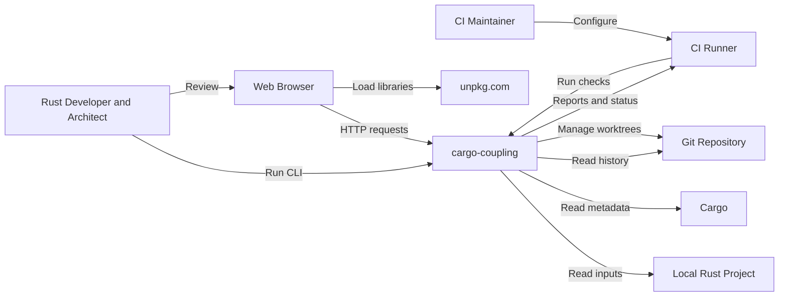
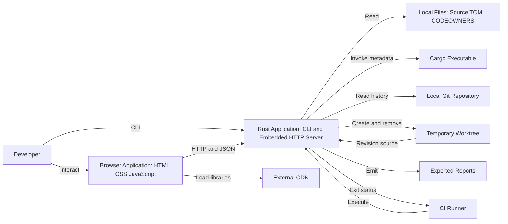
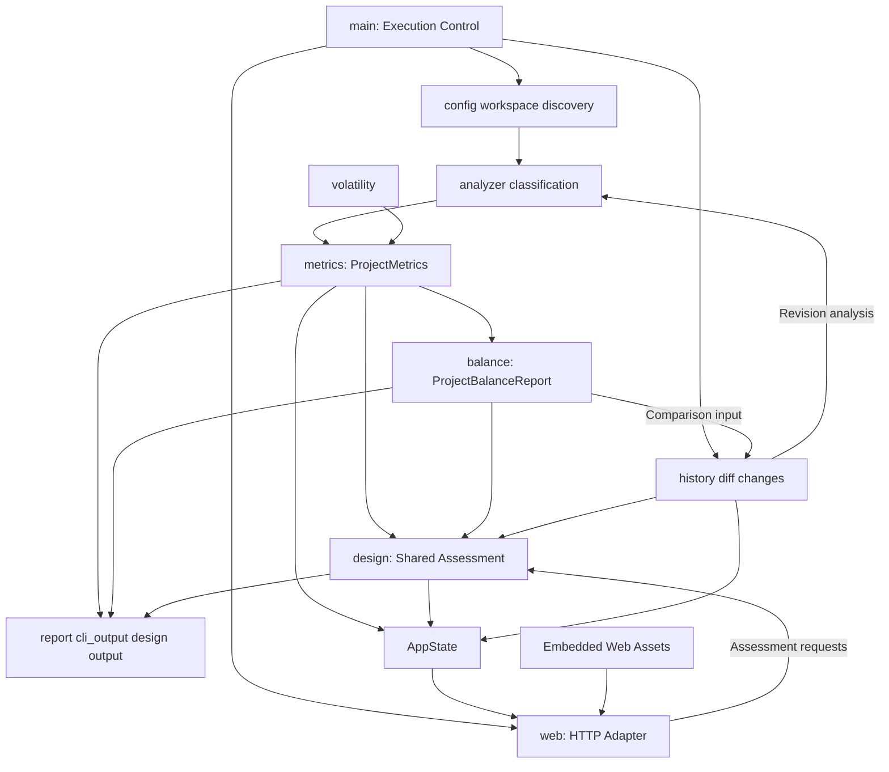
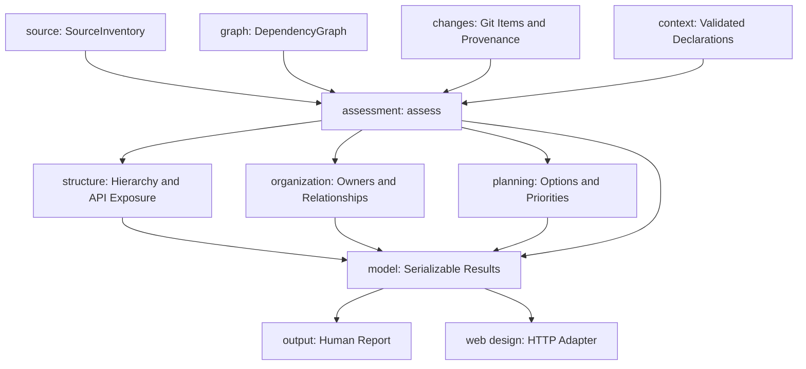
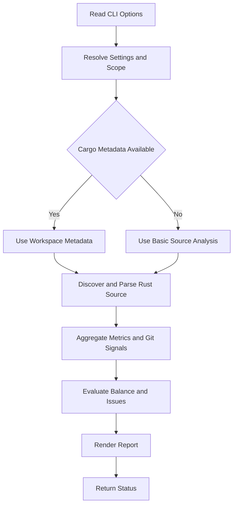
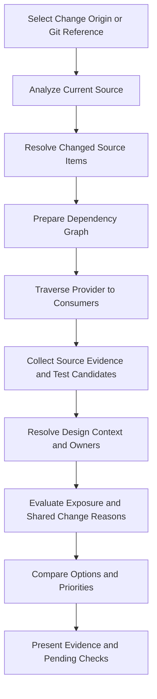
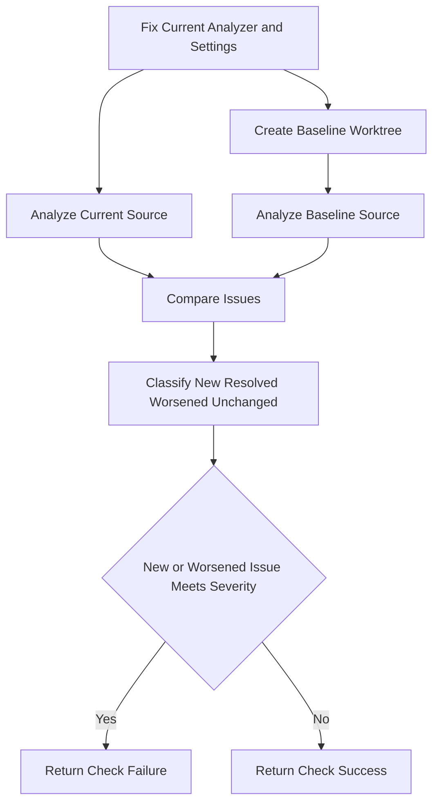
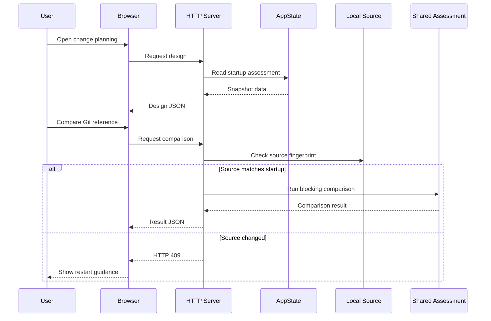
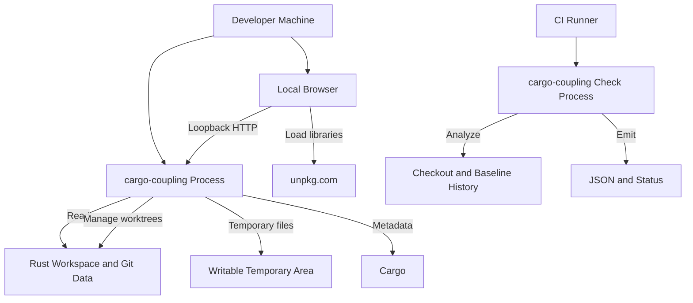

# アーキテクチャ概要

## 1. アーキテクチャ概要

### 1.1 目的と設計方針

cargo-couplingは、Rustプロジェクトの結合度を解析し、変更影響の調査、設計案の比較、CIでの品質確認を支援するCargoサブコマンドである。Rustソースの静的構造、Git履歴、利用者が明示した業務・組織の情報を組み合わせ、CLIとWeb画面で評価結果と根拠を提示する。

中核となる処理は、次の流れで構成される。

**構造の観測 → 共通指標への集約 → 結合バランスと問題の評価 → 変更計画・品質検査・可視化**

設計上の重要な方針は、以下のとおりである。

| 方針 | アーキテクチャへの反映 |
| --- | --- |
| 評価処理を共有する | CLIとWebが同じRustの設計評価を利用する |
| 観測と判断を分ける | 構文、Git履歴、利用者の宣言、推測、不明事項を区別する |
| 比較条件を揃える | 基準側と現在側を現在の解析器・設定・閾値で再解析する |
| 根拠を追跡できるようにする | ソース位置、リビジョン、解析条件、フィンガープリントを結果に含める |
| 人の設計判断を支援する | 影響経路や設計案を提示し、ソースの自動変更や業務上の意味の確定は行わない |

本書は、提示された研究報告と `docs/design-analysis.md` を統合したものである。実装に関する詳細は、静的なコード照合を行ったSystem Architecture Research Reportに基づく。本書作成時にはファイル確認、ビルド、テスト、サーバー起動を行っていない。配置上の差異も、実行による再現結果ではなく研究報告の静的所見として扱う。

### 1.2 アーキテクチャパターン

全体は、単一のRustパッケージに解析ライブラリ、CLI、組み込みHTTPサーバーをまとめた**モジュール型モノリス**である。

通常のCLI実行では、解析してレポートと終了ステータスを返す。Webモードでは同じプロセスが解析結果を保持し、HTTP APIと画面資材を配信する。ブラウザ上のJavaScriptは別の実行環境で動作するが、独立したバックエンド製品を必要としない。

評価と表示には責務分離がある。ただし、JSON出力が根拠の生成に `design::graph` を利用するなど、依存方向は厳密な一方向の階層ではない。完全なポートとアダプター方式や、独立サービスからなる構成として説明する根拠はない。

### 1.3 技術スタック

| 技術 | 用途 | 設計上の特徴 |
| --- | --- | --- |
| Rust | 解析ライブラリ、CLI、HTTPサーバー | 評価ロジックを同じ型と実装で共有する |
| `syn` | Rust構文解析 | コンパイラによる完全な意味解析には依存しない |
| Rayon | 解析処理の並列化 | ソース解析の処理時間を短縮する |
| Cargo / `cargo metadata` | ワークスペース、ターゲット、依存情報の取得 | Cargoが利用できない場合は基本解析へ切り替わる |
| Git | 変更頻度、同時変更、差分、過去ソースの取得 | 一部の履歴解析では一時worktreeを作成する |
| Axum / Tokio | 組み込みHTTPサーバー | Web APIと非同期の要求処理を担う |
| HTML / CSS / JavaScript | Web画面 | 構造、依存行列、2D・3Dグラフ、変更計画を表示する |
| TOML | 解析設定と設計コンテキスト | ソースから分からない情報を明示的に与える |
| JSON | 機械可読レポート、Webとのデータ交換 | スキーマ版と解析来歴を保持する |
| unpkg.com | ブラウザ向け外部ライブラリ配信 | Web利用時のネットワーク依存となる |

## 2. システムコンテキスト

### 2.1 利用者と提供価値

| 利用者 | 主な利用場面 | 得られる判断材料 |
| --- | --- | --- |
| Rust開発者 | 改修、リファクタリング、外部クレートの置き換え | 影響経路、候補テスト、利用箇所、公開APIの露出 |
| アーキテクト・技術リーダー | 責務分割、設計レビュー、改善作業の選定 | 構造上の境界、業務ルール、担当者、設計案、優先順位 |
| リポジトリ・CI管理者 | 継続的な品質確認 | 新規・悪化した問題、重大度、JSON、終了ステータス |

優先順位やスコアは、調査対象を絞るための相対的な指標である。削減できる工数や、実際に変更が必要な箇所を保証するものではない。

### 2.2 システムコンテキスト図

図の矢印は、利用またはアクセスの方向を示す。



CDNへのアクセスはブラウザが行う。提供資料には、解析結果を外部解析サービスへ送信する構成は示されていない。

### 2.3 外部システムとの連携

| 外部システム | 連携内容 | 前提・制限 |
| --- | --- | --- |
| ローカルRustプロジェクト | ソース、Cargoマニフェスト、設定、CODEOWNERSの読込 | 選択した解析範囲と探索結果が後続評価に影響する |
| Cargo | ワークスペース構成と依存情報の取得 | 取得失敗時の基本解析は、Cargo情報を使う解析と同等とは限らない |
| Git | 履歴、差分、過去ソース、一時worktree | 比較には対象リビジョンと必要な書込権限が必要 |
| Webブラウザ | HTTP APIの呼出し、対話的な可視化 | 起動時の解析スナップショットを利用する |
| CI基盤 | CLI実行、JSONと終了ステータスの取得 | 特定のCI製品に依存する構成は確認されていない |
| unpkg.com | 可視化ライブラリなどの取得 | オフライン動作と資材の再現性に影響する |

### 2.4 システム境界

対象範囲には、ソース探索、構文解析、結合評価、Git比較、変更影響の追跡、設計情報の統合、レポート、品質ゲート、Web表示が含まれる。

以下は対象外である。

- 解析対象アプリケーションの実行、運用、実行時トレースの収集
- 完全な型解決、マクロ展開、有効な `cfg` 分岐の判定
- 動的ディスパッチと再エクスポートの完全な解決
- 業務ドメインや共有要件の自動確定
- ソースの自動修正、Webからの設計コンテキスト編集
- 候補テストの実行と変更影響の完全性保証
- Gitホスティング、CI基盤、専用データベースの提供

## 3. コンテナビュー

### 3.1 実行単位

C4のコンテナは、アプリケーションやデータストアの実行・保存単位を表す。Dockerコンテナと同義ではない。

cargo-couplingでは、Rustアプリケーションとブラウザアプリケーションが主要な実行単位となる。`metrics`、`balance`、`design` はRustアプリケーション内部のコンポーネントであり、個別に配置するサービスではない。



通常のCLIモードではブラウザアプリケーションとHTTPサーバーは不要である。Webモードでも解析エンジンは同じRustプロセス内で動作する。

### 3.2 機能領域の分割

| 機能領域 | 主なモジュール | 入力 | 出力 |
| --- | --- | --- | --- |
| 構造・結合の把握 | `workspace`、`discovery`、`analyzer`、`classification`、`metrics` | ソース、Cargo情報、解析設定 | 共通指標、依存関係 |
| 結合バランス・健全性評価 | `balance` | 指標、変動性、閾値 | スコア、問題、重大度、グレード |
| 変更履歴・品質差分管理 | `volatility`、`history`、`diff`、`design::changes` | Git履歴、比較対象、評価結果 | 変更情報、同時変更、問題差分 |
| 変更影響・設計判断支援 | `design` | 指標、問題、変更、設計コンテキスト | 影響経路、設計案、優先順位、判断状態 |
| 分析結果の活用 | `main`、`report`、`cli_output`、`web` | 共通評価結果、利用者の指定 | CLI出力、JSON、HTTP応答、終了ステータス |

この分割は機能上の整理であり、DDDの境界づけられたコンテキストや独立したデータ所有を宣言するものではない。履歴関連処理や品質ゲートは複数モジュールにまたがる。

### 3.3 保存設計

専用の永続DBやメッセージキューは確認されていない。

| データ | 保存・保持場所 | ライフサイクル |
| --- | --- | --- |
| RustソースとCargo情報 | 解析対象プロジェクト | 利用者が管理する |
| `.coupling.toml` | ローカル設定ファイル | 解析条件として読み込む |
| `.coupling-context.toml` | ローカル設計情報ファイル | Gitで版管理でき、Webでは編集しない |
| 履歴・過去ソース | Gitリポジトリ | 比較や変動性の根拠となる |
| 共通指標・設計評価 | プロセスメモリ | CLI終了またはWebサーバー停止まで保持する |
| Web状態 | `Arc<AppState>` | 起動時の指標、設計評価、履歴などを共有する |
| 過去リビジョンの展開 | 一時worktree | 履歴解析で作成・削除する |
| レポート | 標準出力、利用者が保存したファイル | 後日の確認やCI成果物として利用できる |

履歴解析は一時領域だけでなくGit管理情報への書き込みを伴う。そのため、製品全体を読み取り専用ツールとして運用できるとは限らない。

### 3.4 領域間通信

Rust内部の連携は、関数呼出しと型付きデータの受け渡しが中心となる。共通指標から結合評価を生成し、それらを設計評価や出力処理へ渡す。

ブラウザとの境界ではHTTPとJSONを使い、CargoやGitとの境界では外部コマンドを呼び出す。内部領域間にネットワーク通信やメッセージ配送を挟まないため、配置は簡素になる一方、解析負荷とHTTP要求処理は同一プロセスの資源を共有する。

## 4. コンポーネントビュー

### 4.1 Rustアプリケーション内部

以下は主要なデータフローであり、すべてのコード依存を表す図ではない。



### 4.2 中核コンポーネントの責務

| コンポーネント | 責務 | 境界上の注意 |
| --- | --- | --- |
| `workspace` / `discovery` | クレート、ターゲット、モジュール、ソースを特定する | Cargo情報の有無とパッケージ選択が解析範囲を変える |
| `analyzer` / `classification` | 構文から依存と使用文脈を抽出し、強さと距離を分類する | 構文上の解決とRustの完全な型解決を区別する |
| `metrics` | 関係・モジュールの観測を `ProjectMetrics` に集約する | 後続評価が参照する共通データを担う |
| `balance` | スコア、問題、重大度、健全性の理由を生成する | 数値スコアと問題ベースのグレードを分ける |
| `history` / `diff` | 過去ソースを再解析し、問題差分を生成する | 過去の公表スコアを読み戻す方式ではない |
| `design` | 構造と明示された前提から変更計画を評価する | 不足情報を推測で埋めない |
| `web` | 共通評価をHTTPへ適応する | ブラウザ側に独自の採点処理を持たせない |
| `cli_output` / `report` | 結果を人向け・機械向けの形式へ変換する | 人向けの省略とJSONの詳細保持を使い分ける |

### 4.3 設計評価コンポーネント

設計評価の中心は `design::assessment::assess` である。観測、グラフ、変更、組織情報を統合し、計画の評価へ渡す。



`source` は構文とソース位置を観測し、`graph` はモジュール別名の解決と決定的な経路探索を担う。`structure` は階層と外部API露出、`organization` は担当者とライフサイクル・実行時の宣言、`planning` は設計案・優先順位・既存判断を扱う。

### 4.4 プロジェクト構造

研究資料で確認された主要構造を示す。網羅的なファイル一覧ではない。

```text
cargo-coupling/
├── src/
│   ├── main.rs                 CLI、実行制御、品質ゲート
│   ├── lib.rs                  ライブラリ公開窓口
│   ├── config.rs               解析設定
│   ├── workspace.rs            Cargoワークスペースの把握
│   ├── discovery.rs            ソース探索
│   ├── analyzer.rs             構文解析と依存抽出
│   ├── classification.rs       結合の分類
│   ├── metrics/                関係・モジュール・プロジェクト指標
│   ├── balance/                スコア、問題、重大度、健全性
│   ├── volatility.rs           変更頻度と同時変更
│   ├── history.rs              過去リビジョンの解析
│   ├── diff.rs                 問題差分
│   ├── design/                 変更影響と設計評価
│   ├── report.rs               レポート
│   ├── cli_output.rs
│   ├── cli_output/             JSON、影響、改善候補などの出力
│   └── web/                    HTTPサーバー、ルート、設計API
├── web-assets/
│   ├── index.html
│   ├── js/                     可視化、変更計画、画面制御
│   └── css/                    表示スタイル
├── tests/                      解析、比較、履歴、Web構造などの検証
└── docs/
    ├── design-analysis.md
    └── v0.4.0-verification.md
```

配置関連にはDockerfileとCompose設定が存在する。独立したADR文書は研究報告の確認範囲では見つかっていない。設計コンテキストの `decisions` は解析対象プロジェクトの判断を記録する機能であり、cargo-coupling自身のADRとは区別する。

## 5. 主要プロセス

### 5.1 通常解析

入口は `cargo coupling .` である。CLIが条件を読み込み、`analyze_workspace_with_config` を通じて解析を開始する。



ソースは `syn` で解析し、依存の使用文脈、モジュール階層、可視性を使って分類する。設定と利用可能なGit情報に応じて変動性を加え、共通指標から問題と健全性を生成する。

Cargoメタデータ取得失敗時には解析を継続できるが、ワークスペース情報の網羅性が変わり得る。結果の解釈には適用範囲と利用できた情報の確認が必要となる。

### 5.2 変更影響と設計案の比較

代表的な入口は次のとおりである。

```text
cargo coupling --changed-since main --impact-depth 4 .
cargo coupling --impact analyzer --impact-depth 3 --json .
```

`--changed-since` は、選択範囲内のコミット済み、ステージ済み、未ステージ、未追跡の変更を含む。パッケージ選択では、探索された `#[path]` のソースも対象となる。削除要素には元のリビジョンと行番号を保持する。



依存関係は「利用側から提供側」、変更影響は「変更された提供側から利用側」へ進む。深度未指定では到達可能な全モジュールを探索し、正の深度を指定した場合は省略経路の有無を報告する。

比較時には過去と現在の関係を影響探索用に合わせる処理があり、削除要素に由来する影響も扱う。到達可能性は調査候補を示すもので、すべての利用側に修正が必要であることを証明しない。

### 5.3 設計コンテキストの解決

既定では親ディレクトリへ向かって `.coupling-context.toml` を探索する。`--context` では指定したファイルを読む。`--context` と `--changed-since` は、`--design` がなくても設計出力を選択する。

| 条件 | 動作 |
| --- | --- |
| 既定のコンテキストが存在しない | 不明なコンテキストとして継続する |
| 明示指定したファイルが存在しない | エラーにする |
| 未対応の版、未知フィールド、不正値 | エラーにする |
| セレクターが解析範囲に一致しない | 適用範囲の注記にする |
| 担当者や判断に必要な根拠がない | 不明・未確認事項として残す |

担当者は明示指定を優先する。CODEOWNERSは `.github/CODEOWNERS`、ルート、`docs/CODEOWNERS` の順に探索し、ファイル内では最後に一致する指定が優先される。未対応のパターン形式は適用範囲の注記となる。

### 5.4 基準比較と品質ゲート

`cargo coupling --check --baseline main .` は、現在側と基準側を同じ条件で解析し、新規・悪化した問題を検査する。



`history::analyze_ref` は一時worktreeで過去ソースを解析する。比較は現在の解析器、採点方式、閾値、有効設定を両側に適用するため、過去に保存したスコアの再現とは目的が異なる。

基準付き検査では、変化していない既存の問題だけでは新規・悪化の失敗条件に該当しない。具体的な終了コードの数値や、他の検査オプションとの判定順序は提供資料では確定していない。

### 5.5 Webレビューとスナップショット整合性

Webモードは起動時に指標と設計評価を準備し、`Arc<AppState>` で共有する。変更計画は履歴タイムラインとは独立して、起動時の作業ツリーを基準とする。



Git比較を伴う要求は `spawn_blocking` で処理する。起動時の指標と変更後・追加後のソースを混在させる比較はHTTP 409で拒否する。これは自動再解析ではなく、不整合のある比較を防ぐ仕組みであり、ソース編集後はサーバー再起動が必要となる。

ソース表示は解析対象ワークスペース内に限定される。削除済み要素は元のGitリビジョンで参照し、過去のディレクトリが現在存在しない場合も対象範囲を守る。

## 6. 技術実装

### 6.1 コードビュー：主要型とインターフェース

Rustの構造体と関数が主要な設計単位となる。以下は研究資料で確認された名前と責務であり、未確認のフィールドや関数シグネチャは補っていない。

| 型・関数 | 主な役割 | 接続先 |
| --- | --- | --- |
| `analyze_workspace_with_config` | 設定付きのワークスペース解析 | CLIから構造解析への入口 |
| `ProjectMetrics` | 関係・モジュール・プロジェクト指標の集約 | `balance`、`design`、出力 |
| `ProjectBalanceReport` | バランス、問題、健全性の集約 | 設計評価、比較、表示 |
| `CouplingIssue` | 問題、重大度、識別情報の表現 | 問題差分、品質ゲート |
| `SourceInventory` | 構文要素とソース位置の観測 | 根拠表示、露出評価、変更対応付け |
| `DependencyGraph` | 依存関係と決定的な経路探索 | 変更影響、JSON根拠、設計評価 |
| `design::assessment::assess` | 設計評価の統合 | CLIとWebが共有する |
| `history::analyze_ref` | 過去リビジョンの再解析 | 基準比較、履歴 |
| `AppState` / `Arc<AppState>` | Web起動時の解析状態の共有 | HTTPハンドラー |

`lib.rs` は解析機能と主要型の公開窓口を担う。出力処理を分割した箇所では公開再エクスポートを使い、既存の呼出し経路を維持している。

### 6.2 結合バランスと健全性

正規化した強さ、距離、変動性に対し、共通式を適用する。

```text
balance = max(abs(strength - distance), 1 - volatility)
methodology = khononov-compensation-v2
```

計算は `balance/score.rs` が担い、設計案の仮想評価でも共有する。旧来の乗算方式によるスコアとは直接比較できない。

健全性グレードは検出問題と重大度に基づく別の評価である。採点対象外の診断はグレードの説明からも除外し、評価に寄与した内容と説明を一致させる。

変動性についても、次の三つを分ける。

- 本質的な変動性
- Gitで観測した変更頻度
- 強い依存経路を通じて受ける変化への露出

設計コンテキストはGitの観測値を上書きしない。本質的な変動性やサブドメインの設定は `.coupling.toml` が担う。

### 6.3 グラフと構文上の根拠

`design::graph` はモジュール別名を解決し、循環と探索深度を扱いながら決定的な経路を生成する。JSONの根拠生成ではレポートごとに依存グラフを再利用する。

境界の評価には、公開シグネチャへの型の露出、同形レコード、単純な委譲、同一本文などを使う。

| 観測 | 条件・制限 |
| --- | --- |
| 同一本文 | モジュール間で24以上の正規化トークンを必要とする |
| 同形レコード | 2つ以上の一致フィールドを必要とする |
| 公開API露出 | インポート別名も構文上で調べる |
| 候補テスト | 名前の一致と到達可能なモジュールなどを利用する |
| テスト除外 | 候補テストの網羅性が下がる |

これらは自明な一致を減らす条件であり、意味的な重複や共有すべき業務要件を確定するものではない。

### 6.4 設計案、優先順位、既存判断

代替案は、方向を持つモジュールの組ごとに最もバランスの悪い観測を使用する。宣言したシナリオは一致した観測の平均を使い、同じ次元への指定が重なる場合は後の宣言を適用する。一致する観測がなければ結果は `null` となる。

優先順位は次式に基づく。

```text
priority =
  (severity_weights
   + reachable_consumers
   + inherited_paths
   + planned_bonus
   + frozen_bonus)
  * business_value
```

重大度の重みはCritical / High / Medium / Lowで8 / 4 / 2 / 1、変更予定と凍結状態の加点はそれぞれ4である。工数が明示されていれば `value_per_effort` を出力する。Webで工数当たりの優先順位を使う場合も、未見積もりの作業を非表示にしない。

既存判断は、変更予定、チーム間関係、ソース変更、新規・悪化した問題、コンテキスト変更などを条件に再評価する。必要な比較情報が欠けている場合は、維持が妥当だと確定せず未確認事項を残す。

### 6.5 データ形式と解析来歴

| 項目 | 版・内容 |
| --- | --- |
| 汎用JSON | スキーマ版2 |
| `design` | スキーマ版1 |
| 設計コンテキスト | `version = 1` |
| 採点方式 | `khononov-compensation-v2` |

設計評価には、解析器と採点方式の版、解析範囲、リビジョン、作業ツリー状態、ソース・設定・コンテキストのフィンガープリント、有効設定、Git対象期間、テスト除外、閾値、探索深度を記録する。

フィンガープリントは決定的な内容識別子であり、暗号学的な署名ではない。保存した判断のフィンガープリント自体はコンテキストのハッシュ対象から除外され、判断を保存しただけで直ちに変更扱いになることを防ぐ。

人向けレポートは長い節を省略する場合がある。JSONは報告された観測を保持するため、詳細確認と後日の追跡に適する。

### 6.6 Web APIと表示

| API | 主な用途 |
| --- | --- |
| `/api/graph` | 依存グラフ |
| `/api/report` | 解析レポート |
| `/api/history` | 履歴表示 |
| `/api/design` | 設計評価と比較 |
| `/api/impact` | 変更影響 |
| `/api/source` | ソース上の根拠 |

HTTPメソッドや要求・応答の全フィールドは提供資料では確定していない。

依存行列は行が列へ依存し、件数は異なるモジュールの組を表す。2D・3Dでは関数、メソッド、型のプレビュー数を制限し、完全な名前はインスペクターで保持する。ラベルの衝突を抑え、構造カードからも対象を選べる。

3Dの初期配置は安定した格子状のレイアウトであり、結合指標の測定値ではない。測定された次元は **Dimension-Space** で確認する。英語・日本語の画面表示に対応するが、詳細な診断説明や利用者が与えた根拠は元の言語を保持する。

### 6.7 性能と拡張性

確認されている性能上の工夫は、Rayonによる並列解析、JSON生成でのグラフ再利用、Web起動時スナップショットの再利用、Git比較の `spawn_blocking` 化、表示件数とラベルの制御である。

主な負荷要因は、ソース数、依存関係数、履歴解析数、到達可能な影響範囲、ブラウザで描画するグラフの規模となる。実測の処理時間やメモリ使用量は提供されていない。

拡張時は、以下の境界を活用できる。

| 拡張対象 | 主な変更箇所 | 開発時の注意 |
| --- | --- | --- |
| 新しい構文観測 | `analyzer`、`design::source` | 根拠と未対応範囲を結果へ残す |
| 問題検出 | `balance` | 問題識別、重大度、グレード説明の整合を保つ |
| 設計情報 | `context`、`organization`、`model` | 版、値検証、適用範囲を扱う |
| 設計案 | `planning` | 共通採点を使い、仮定とトレードオフを示す |
| 出力・画面 | `cli_output`、`web`、`web-assets` | 評価処理を複製せず共通結果を利用する |

大規模対象ではパッケージ選択と探索深度が調査範囲の制御点となる。ただし、範囲を狭めた結果をプロジェクト全体の評価として扱わないことが必要である。

## 7. デプロイメントアーキテクチャ

### 7.1 実行環境と配置

標準的な配置は、開発者の端末またはCI実行環境上での単一プロセス実行である。



Webサーバーの標準待受先は `127.0.0.1:3000` である。研究報告では待受アドレスがループバックに固定されている。

| 実行方式 | 必要な条件 |
| --- | --- |
| ローカルCLI | 実行可能バイナリ、解析対象への読取権限 |
| Cargo情報を使う解析 | Cargoの実行環境 |
| 履歴・基準比較 | Git、対象リビジョン、一時領域とGit管理情報への必要な書込権限 |
| Web | 上記の解析環境、ブラウザ、ローカルHTTP接続 |
| CI | チェックアウト、比較に必要な履歴、設定、出力の保存方法 |

### 7.2 コンテナ配置で確認された差異

以下は研究報告で静的に確認された事項であり、修正済みとはされていない。

| 項目 | 確認事項と影響 | 改善の方向 |
| --- | --- | --- |
| Webの到達性 | READMEとComposeはポート3000の公開を案内するが、サーバーは `127.0.0.1` に待ち受ける。通常のコンテナネットワークではポート公開だけでホストから到達できない | コンテナ用の待受指定または提供方法を整備する |
| Cargo不足 | 両Dockerfileの実行段階にCargoの導入がなく、基本解析へ切り替わる可能性がある | イメージごとの解析能力を明記する |
| 履歴解析の書込権限 | Composeの解析対象は読み取り専用マウントだが、一時worktree操作はGit管理情報への書き込みを伴う | 必要な作業領域と権限を配置設計に含める |
| 外部CDN | 自前資材は埋め込まれるが、可視化ライブラリなどはCDNから取得する | オフライン要件があれば同梱を検討する |
| ライブラリ版 | `3d-force-graph` のURLに版指定がない | 再現性のために版を固定する |

これらの条件を解決した実行検証がないため、既存のコンテナ設定をローカル実行と同等の配置として扱うことはできない。

### 7.3 セキュリティ境界

確認された保護には、ループバック待受、ワークスペース内に限定したソース参照、設計コンテキストの厳格な検証、Web比較時のスナップショット整合性確認がある。

| 境界 | 確認された動作 | 運用上の意味 |
| --- | --- | --- |
| HTTP公開範囲 | 標準でループバック待受 | ローカル利用を前提とした配置となる |
| ソース参照 | 解析対象ワークスペース内に限定 | 対象外のファイル参照を制限する |
| 設計コンテキスト | 未知フィールド、不正値、重複IDなどを拒否 | 不正な宣言による評価の曖昧さを減らす |
| Web比較 | ソース変更時にHTTP 409 | 古い指標と新しいソースの混在を防ぐ |
| CDN | ブラウザが外部スクリプトを取得 | 可用性と配布元への依存が残る |

認証、TLS、複数利用者のアクセス制御は提供資料では確認できない。待受範囲を拡大して共有サービスとして公開する場合は、ローカル運用とは別のアクセス制御設計と検証が必要になる。

### 7.4 運用と可観測性

主な運用上の観測点は、CLI出力、終了ステータス、JSONの解析来歴、Webの **Coverage & conditions**、比較時のHTTP 409である。専用の監視基盤、分散トレース、メトリクス公開は確認されていない。

CIでは、基準リビジョン、重大度、解析範囲、有効設定を明示し、JSONを成果物として保存すると追跡しやすい。失敗時には、品質条件への違反と、設定・Git・解析環境の不備を分けて調べる。

通常の `.coupling.toml` は、読込エラー時に空設定へ置き換えられ、詳細表示時だけ理由を示すと報告されている。設計コンテキストの不正はエラーになるため、二つの設定経路は同じ失敗動作ではない。自動評価では有効設定を確認し、意図した条件で実行されたことをJSONから追跡する必要がある。

Web利用では、編集後の再起動をレビュー手順に含める。履歴タイムラインで選んだリビジョンと、変更計画の起動時スナップショットを混同しないことも重要となる。

### 7.5 検証状況と技術判断

研究報告では、設計評価、基準比較、履歴、解析範囲、Web構造などのテストと、ソース変更検知のモジュール内テストが確認されている。ただし、本書は現在のテスト成功や性能を保証しない。

| 設計上の選択 | 利点 | 制約 |
| --- | --- | --- |
| 単一Rustプロセス | 導入と評価共有が簡素 | 解析負荷とHTTP処理が資源を共有する |
| 構文中心の解析 | 対象を実行せず構造を観測できる | 完全な型解決と実行時の意味を扱えない |
| 起動時スナップショット | 表示間の一貫性と再利用性を保つ | ソース編集後に再起動が必要 |
| 現在条件での基準再解析 | ソース差分を同じ条件で評価できる | 過去の公表スコアは再現しない |
| 明示的な設計コンテキスト | 業務・組織の前提を評価へ加えられる | 宣言の根拠と鮮度を人が維持する必要がある |
| 外部CDNの利用 | 一部の画面資材を外部配信できる | オフライン動作と再現性に制約がある |

`docs/design-analysis.md` と研究報告の実装所見は、共通評価、責務分割、採点方式、比較条件、解析来歴について整合している。今後の技術判断では、コンテナ配置の実行条件、通常設定の読込失敗、ブラウザ資材の版管理を明確にし、解析結果の一貫性を運用環境でも維持することが主要な課題となる。
