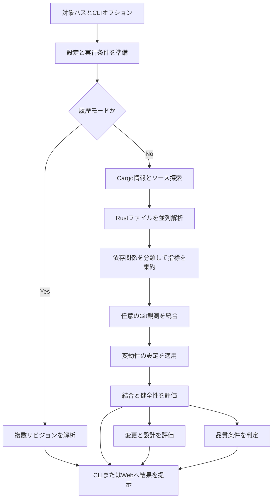
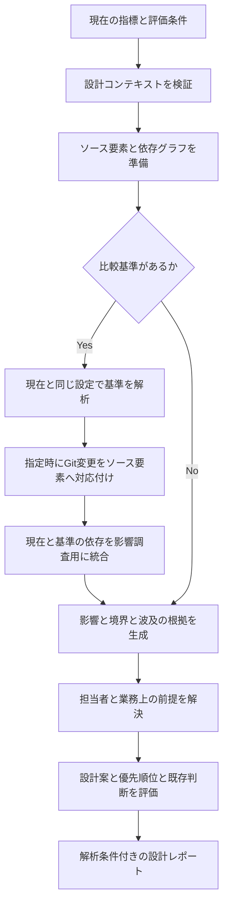
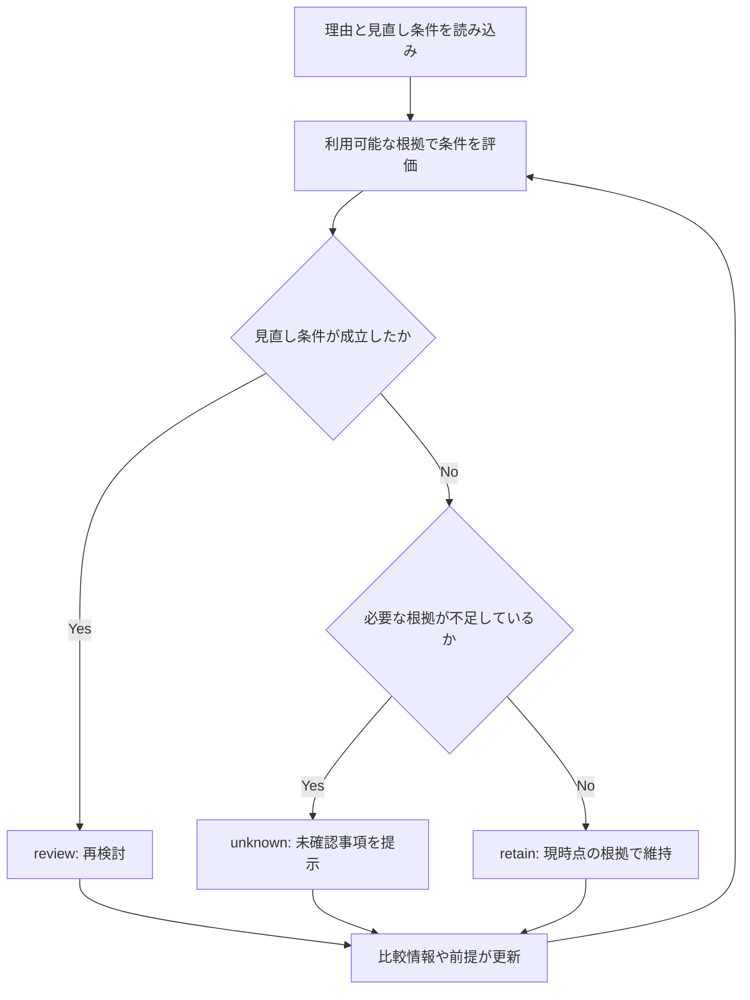
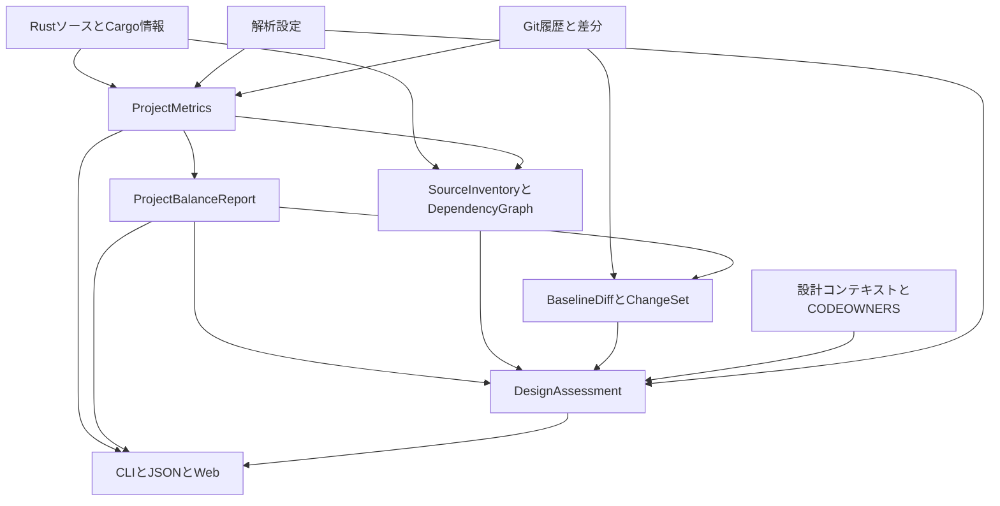
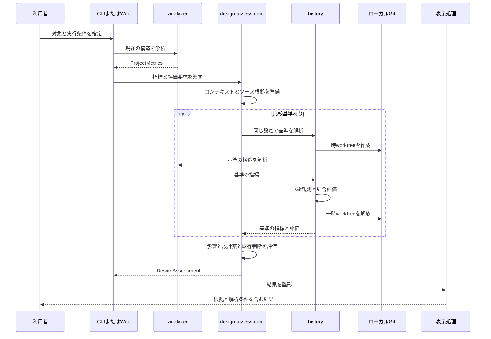

# ワークフロー

## 1. ワークフロー概要

cargo-couplingは、Rustプロジェクトの静的構造、Git履歴、明示された設計情報を組み合わせ、結合の状態と変更の影響範囲を提示するCargoサブコマンドである。開発者の変更調査、技術リーダーの設計レビュー、CIでの品質確認を支援する。

処理の中心は、**ソースの観測 → 指標の集約 → 結合評価 → 変更・設計評価 → 表示または品質判定**という流れである。CLIとWebは共通のRust評価処理を利用する。

本書は、提供された調査資料、[設計分析ドキュメント](../design-analysis.md)、プロジェクト内の実装を根拠とする。生成時の実装確認はファイルの読み取りによるもので、コマンドの動作検証やサーバー起動は行っていない。生成後に行ったCLI実行の確認は[実行記録](../litho-run.md)へ記載した。

### 1.1 主要ワークフローと利用者

| ワークフロー | 主な利用者 | 入力 | 成果物 |
| --- | --- | --- | --- |
| 結合と健全性の確認 | Rust開発者、技術リーダー | ソース、解析設定、任意のGit履歴 | 結合指標、スコア、グレード、問題と改善候補 |
| 変更影響と設計案の比較 | Rust開発者、アーキテクト | 指定モジュールまたはGit基準、設計コンテキスト | 影響経路、変更要素、候補テスト、設計案、優先順位 |
| 品質ゲート | CI管理者、開発者 | 検査条件、任意の基準リビジョン | 成否、失敗理由、終了コード |
| 履歴の確認 | 技術リーダー、保守担当者 | Git期間、最大サンプル数 | リビジョン別の健全性推移、解析できなかった時点 |
| Webによる変更レビュー | 開発者、レビュー担当者 | 起動時の解析結果、画面上の選択 | 構造、グラフ、ソース根拠、変更計画、JSON |

ツールは判断材料を提供する。ソースの自動修正、候補テストの実行、実行時トレースの収集、業務上の意味の自動確定は処理範囲に含まれない。

### 1.2 中核となる実行経路

次の図は主要なデータ依存を示す。履歴モードは通常の現在ソース解析より前に分岐し、独立して完了する。



### 1.3 モジュール間の役割分担

| 処理領域 | 主な実装 | 後続処理へ渡す情報 |
| --- | --- | --- |
| 実行制御 | `src/main.rs` | 有効設定、閾値、対象範囲、表示・比較条件 |
| 構造の探索 | `workspace.rs`、`discovery.rs` | ワークスペース、ターゲット、対象ファイル、モジュール名 |
| 構文解析と分類 | `analyzer.rs`、`classification.rs` | 利用関係、可視性、依存先、ソース位置 |
| 指標集約 | `src/metrics/` | `ProjectMetrics`、関係・モジュール単位の指標 |
| Git観測と比較 | `volatility.rs`、`history.rs`、`diff.rs` | 変更回数、同時変更、過去の評価、問題差分 |
| 結合評価 | `src/balance/` | `ProjectBalanceReport`、問題、重大度、評価理由 |
| 設計判断支援 | `src/design/` | 構造、影響、組織情報、設計案、判断の見直し結果 |
| 結果の提示 | `report.rs`、`cli_output/`、`src/web/`、`web-assets/` | テキスト、Markdown、JSON、HTTP応答、画面表示 |

これらは同一アプリケーション内の責務分割であり、独立サービス間の分散処理ではない。

## 2. メインワークフロー

### 2.1 プロジェクトの結合と健全性を確認する

実行例：

```sh
rtk proxy cargo coupling .
rtk proxy cargo coupling --json .
```

#### 2.1.1 設定と解析範囲の準備

`main.rs::run_coupling`がCLI引数を受け取り、Rayonのスレッド数、解析設定、問題検出の閾値を準備する。

設定の優先順位は、対応する項目について次のとおりである。

1. CLIの明示指定。
2. `.coupling.toml`の設定。
3. 組み込みの既定値。

`--exclude-tests`は読み込んだ設定に適用される。依存先数・利用側数の上限もCLI指定を優先する。既定ではLowの問題を除外し、`--all`で表示対象を広げる。

一般の解析設定は、読み込みに失敗すると`CompiledConfig::empty()`へフォールバックする。詳細モード以外では失敗理由が表示されない場合があるため、設定が適用されたかは有効設定や詳細ログで確認する必要がある。設計コンテキストの厳格な検証とは動作が異なる。

#### 2.1.2 Cargo情報とソースの探索

`analyze_workspace_with_config`は`WorkspaceInfo::from_path`からCargoメタデータを取得する。取得できれば、ワークスペース所属、ターゲットのソースルート、クレート間の依存関係を利用する。

ワークスペース解析では次の順序でファイルを確定する。

1. 各対象メンバーのソースルートを走査する。
2. 除外パターンと、入れ子になった別パッケージの境界を適用する。
3. 正規化したパスで重複を除く。
4. `#[path]`が見つかったメンバーではモジュール宣言をたどり、通常の走査で見つからなかったファイルを追加する。
5. パッケージ指定かソース配下指定かに応じて範囲を絞る。

パッケージ全体の選択には、そのパッケージで探索された`#[path]`のソースも含まれる。通常のディレクトリ走査とモジュール宣言の両方で発見されたファイルは、走査由来の名前を維持する。

Cargoメタデータを取得できない場合は理由を表示し、基本的なRustファイル解析に切り替える。この場合、Cargo情報を使ったクレート構造の解釈には制限が生じる。

#### 2.1.3 構文解析と指標の組み立て

ファイル単位の解析はRayonで並列に行う。各処理は、構文上の依存、型の可視性、要素間の関係、モジュール情報を独立した結果として返す。

全ファイルの結果を収集した後、プロジェクト全体で情報を統合する。先に型と可視性を登録することで、後続の依存先解決がファイルの解析順序だけに依存しない構成になっている。

関係単位の`CouplingMetrics`には、依存元・依存先、結合の強さ、距離、変動性、可視性、ソース位置、観測した利用方法が保持される。`ProjectMetrics`はこれをモジュール情報とともに集約する。

#### 2.1.4 Git観測と設定による補正

`--no-git`が指定されていなければ、構造解析後にGit履歴を調べる。

1. Rustファイルごとの変更回数を集計する。
2. 同一コミットで変更されたファイルの組を集計する。
3. `file_changes`と`temporal_couplings`を指標へ渡す。
4. Git由来の変動性を更新する。
5. `.coupling.toml`の変動性指定とサブドメイン設定を適用する。

この順序により、履歴で観測した変更と、設定に基づく評価上の扱いを両方保持できる。設計コンテキストの業務価値や担当者指定は、Git変更回数や本質的な変動性の分類を上書きしない。

#### 2.1.5 評価と出力

`balance/project.rs`は、関係単位の評価、モジュールの結合パターン、Rust固有のパターン、時間的結合、変動性に関する診断をまとめる。

成果物には次が含まれる。

| 成果物 | 用途 |
| --- | --- |
| 関係ごとのバランス | 個々の依存の組み合わせを調べる |
| プロジェクト平均スコア | 全体傾向を把握する |
| 問題と重大度 | 対応すべき箇所と理由を特定する |
| 健全性グレードと説明 | 問題の分布をプロジェクト単位で理解する |
| 解析条件と制限 | 結果が対象全体をどこまでカバーしているか確認する |

平均スコアと健全性グレードは算定方法が異なる。高いスコアだけで問題が存在しないと判断せず、解析対象数と不足情報も確認する。

### 2.2 変更影響を追跡し、設計案を比較する

実行例：

```sh
rtk proxy cargo coupling --design .
rtk proxy cargo coupling --changed-since main --impact-depth 4 .
rtk proxy cargo coupling --impact analyzer --impact-depth 3 --json .
```

`--design`は設計評価全体、`--impact`は指定モジュールの影響調査に使う。`--changed-since`または`--context`は、`--design`を省略しても設計出力を選択する。



#### 2.2.1 変更の特定

`design/assessment.rs::assess`は現在のソース要素と依存グラフを準備し、比較基準があれば基準側も解析する。`--changed-since`が指定された場合、`design/changes.rs`が変更をソース要素へ対応付ける。

対象は選択範囲内の次の変更である。

- 基準から現在までのコミット済み変更。
- ステージ済み変更。
- 未ステージ変更。
- 未追跡ファイル。

削除された要素は、元のリビジョンと行番号を保持する。変更影響用の指標には基準側のモジュールと依存関係も加えるため、現在のソースから消えた依存も調査材料になる。この統合は保守的な影響調査のためであり、現在の構造がそのまま過去の構造を含むという意味ではない。

#### 2.2.2 利用側への影響追跡

依存と影響では矢印の向きが逆になる。

```text
依存: 利用側 → 提供側
影響: 変更された提供側 → 影響を受けうる利用側
```

`DependencyGraph`は入方向・出方向の隣接関係を保持する。影響探索では入方向をたどり、利用側を幅優先探索する。

深度未指定なら到達可能なモジュール全体を対象にする。正の深度を指定すると、その深度まで探索し、さらに未探索の到達先がある場合は`truncated`を設定する。

探索済み集合によって循環を打ち切る。返される経路は、到達先ごとの代表的な経路であり、存在するすべての経路の列挙ではない。

#### 2.2.3 根拠の整理

設計評価は次の情報を別々に扱う。

| 情報 | 根拠 | 読み方 |
| --- | --- | --- |
| 本質的な変動性 | 解析設定、サブドメイン分類 | 責務の性質に関する評価条件 |
| 観測した変更 | Git履歴 | 指定期間中に起きた編集 |
| 依存経路から受ける影響 | 結合の強さとグラフ | 自身が安定していても依存先から受けうる影響 |
| 共有する変更理由 | 類似性、同時変更、宣言された業務ルール | 同時に変更する理由を確認する材料 |
| 候補テスト | 名前、ソース情報、到達可能性 | 実際に確認すべきテストの候補 |

公開シグネチャへの型の露出、同形レコード、単純な委譲も境界の評価に利用する。外部依存の置き換えでは、公開APIでの使用箇所、利用モジュール、露出経路から、変更範囲と境界候補を調べる。外部クレートの利用状況を中心に見る場合は`--deps`を使える。

#### 2.2.4 設計案と優先順位

`design/planning.rs`は、現状維持、知識の隠蔽、責務の近接配置、責務分離などを比較する。仮想的な次元変更を評価する処理であり、ソース編集は行わない。

方向を持つモジュールの組に複数の観測がある場合、代替案は最もバランスの悪い観測を使う。宣言シナリオは一致した観測を平均し、同じ次元を複数回指定した場合は後の指定を適用する。一致する観測がなければ、スコアは`null`になる。

優先順位は次式で計算する。

```text
優先度 =
  (重大度の重み合計
   + 到達可能な利用側数
   + 継承した影響経路数
   + 変更予定があれば4
   + 凍結中なら4)
  × 業務価値
```

重大度の重みはCritical／High／Medium／Lowが8／4／2／1である。明示された工数があれば`value_per_effort`も提供する。これは相対的な着手順の指標であり、削減工数の予測ではない。

### 2.3 設計コンテキストを取り込み、既存判断を再評価する

既定では親ディレクトリへ向かって`.coupling-context.toml`を探索する。`--context`では指定ファイルを読み込む。

| 条件 | 処理 |
| --- | --- |
| 既定ファイルがない | 業務・組織情報が不明として継続 |
| 明示指定したファイルがない | エラー |
| 未知のフィールド、未対応バージョン、不正なglob | エラー |
| 重複ID、コンポーネント割当の重なり | エラー |
| 不適切な業務価値・工数、範囲外の次元値 | エラー |
| 選択範囲に一致しない宣言 | 適用範囲の注記 |

担当者は明示指定を優先する。CODEOWNERSは`.github/CODEOWNERS`、ルート、`docs/CODEOWNERS`の順で探索し、ファイル内では最後に一致した指定を使う。未対応のパターンは注記し、担当者を推測で埋めない。

実行時の関係として、順序、タイミング、トランザクション、共有状態、同期、非同期を宣言できる。評価するのは提供された根拠であり、Git同時変更から実行順序を推定したり、非同期という宣言だけで結合が弱いと判断したりしない。

既存判断の見直しには、変更予定、チーム間の関係、実際の変更、新規・悪化した問題、コンテキストの変化を使う。



担当者や比較情報が不足している場合、見直し条件が成立しなかったことだけを理由に維持を確定しない。

### 2.4 CIで品質を判定する

#### 2.4.1 基準を使わない検査

```sh
rtk proxy cargo coupling --check .
```

追加の品質条件がない場合の既定値は次のとおりである。

| 条件 | 既定値 |
| --- | --- |
| 最低グレード | C |
| Criticalの最大件数 | 0 |
| 代表的な循環経路の最大件数 | 0 |
| 指定重大度以上での失敗 | 未指定 |

`--min-grade`、`--max-critical`、`--max-circular`、`--fail-on`のいずれかを指定すると、指定された条件だけで`CheckConfig`を構成する。例えば`--fail-on high`は、既定の全条件にHigh検査を追加する動作ではない。

最低グレード比較ではSをAと同等に扱う。循環件数は代表的な循環経路の数であり、すべての単純閉路の総数ではない。

#### 2.4.2 基準付きの悪化検査

```sh
rtk proxy cargo coupling --check --baseline main --fail-on high .
```

現在側を解析した後、基準側を一時的なGit worktreeで解析する。両側に現在の解析器、スコア方式、閾値、有効設定を適用し、ソース差分による違いを評価する。

比較結果は次のように分類する。

| 区分 | 判定 |
| --- | --- |
| 新規 | 現在側だけに問題識別子が存在 |
| 解消 | 基準側だけに存在 |
| 悪化 | 同じ識別子で重大度、バランス、対象の広がりが悪化 |
| 継続 | 両側に存在し、悪化条件に該当しない |

基準付きゲートは、指定重大度以上の新規・悪化した問題があれば失敗する。重大度の既定値はHighである。変化していない既存の問題は、このゲートの失敗条件に含めない。

基準付きの分岐では`--fail-on`を使う。通常検査の最低グレードや件数上限を併せて適用する処理ではない。

#### 2.4.3 終了コードと出力優先順位

通常の品質ゲートと基準付きゲートは、成功時に`0`、失敗時に`1`を返す。`main`へ伝播した実行エラーも`1`を返すため、終了コードだけでは品質違反と解析エラーを区別できない。レポートと標準エラー出力を併せて確認する。

**現在の実装では、`--json`が`--check`より先に処理される。** `--json --check`や`--json --check --baseline main`は、JSON生成に成功すると`0`を返し、品質ゲートによる終了コードを返さない。

CIでは、ゲート判定とJSON保存を別の実行に分ける。表示モードの重複には警告を出して優先順位で処理する組み合わせもあり、すべてが引数エラーになるわけではない。

### 2.5 履歴から健全性の推移を確認する

```sh
rtk proxy cargo coupling --history 12 .
```

`history.rs::analyze_history`は、指定期間のコミット一覧から最大件数まで均等にサンプリングし、各時点を順番に解析する。

各リビジョンの処理は次のとおりである。

1. 一時的なdetached worktreeを作成する。
2. 現在の解析範囲をworktree内の相対位置へ対応付ける。
3. 設定の基準パスをworktree側へ置き換える。
4. 構造、Git変動性、設定補正、結合評価を実行する。
5. 結果のソースパスを元のリポジトリ側へ対応付ける。
6. worktreeを解放する。

ある時点の解析に失敗しても、理由を`skipped`へ記録し、ほかの時点を処理する。成功した点だけで傾向を判断せず、省略されたリビジョンも確認する。

`--history`と`--baseline`は併用できない。履歴モードでは`--no-git`を指定しても、警告したうえで履歴解析を行う。

### 2.6 Webで構造を探索し、変更レビューを行う

通常の利用時は次のように起動する。

```sh
rtk proxy cargo coupling --web --context ./design-context.toml --no-open .
```

起動処理は現在の指標に加え、履歴と設計評価を準備してからHTTP待受を開始する。待受アドレスは`127.0.0.1`である。

レビューは次の順で進める。

1. **Structure**でディレクトリ、モジュール、依存行列を確認する。行列は行が列に依存し、件数は異なるモジュールの組を表す。
2. **Inspect connections**で周辺の2Dグラフへ絞る。
3. **Plan a change**で起点と深度を指定し、**Trace impact**を実行する。
4. **Compare changes**でGit基準との差分、変更要素、候補テストを確認する。
5. **Read source**で根拠を読む。削除された要素は元のリビジョンを参照する。
6. 設計案、シナリオ、担当者、実行時の前提、既存判断を確認する。
7. **Coverage & conditions**を確認し、必要ならJSONを保存する。

履歴タイムラインと変更計画は別の状態を使う。タイムラインで過去のグラフを表示しても、変更計画の起点は起動時の作業ツリーである。

3Dグラフの初期座標は配置用であり、測定値を表す座標ではない。結合の各次元は**Dimension-Space**で確認する。

## 3. フローの連携と制御

### 3.1 共通データを介した連携



構文解析と設計評価では必要な観測粒度が異なる。`ProjectMetrics`が依存評価の共通入力となり、`SourceInventory`が要素名、シグネチャ、本文、ソース位置などの詳細な根拠を補う。

CLIとWebの設計評価は`assess`へ集約され、`design/model.rs`のシリアライズ可能な型を介して表示される。表示側で独自に設計判断を再計算する構成を避けている。

### 3.2 CLIとWebの呼び出し関係



Webでは現在の指標を起動時に準備し、要求ごとに共有する。上図は共通処理の関係を示しており、すべてのHTTP要求が現在の指標を作り直すという意味ではない。

### 3.3 状態管理と整合性

CLIの解析状態は基本的にプロセス内で保持される。Webは`Arc<AppState>`で次の情報を共有する。

- 起動時の`ProjectMetrics`と閾値。
- 有効設定、解析パス、ソース参照範囲。
- 事前計算した履歴。
- 起動時の`DesignAssessment`。

Git基準付きの`/api/design`は、比較前にソースを再探索・再解析し、起動時のソースフィンガープリントと照合する。不一致ならHTTP `409`を返し、再起動を求める。新規ファイルも検出対象になる。

この照合は基準付き比較の経路にある。基準なしの設計取得は保存済み評価を返し、影響取得も起動時の指標を使う。自動更新される画面として扱わず、ソース編集後は再起動する。

### 3.4 再現性と比較条件

設計評価には、解析器とスコア方式の版、対象範囲、リビジョン、作業ツリーの変更状態、ソース・設定・コンテキストのフィンガープリント、有効設定、Git期間、テスト除外、閾値、探索深度を記録する。

コンテキストのフィンガープリントからは、既存判断に保存したフィンガープリント欄自体を除外する。保存操作だけで直ちにコンテキスト変更と判定されることを防ぐためである。

汎用JSONのスキーマ版は2、設計評価は1である。フィンガープリントは内容の同一性を識別する値であり、暗号学的な署名ではない。

過去のソースを現在の条件で再解析する比較と、過去に保存したレポートの再現は目的が異なる。範囲、設定、スコア方式が異なる保存結果は、そのままスコア比較に使わない。

## 4. 例外処理と復旧

### 4.1 エラーと縮退動作

| 発生箇所・条件 | 現在の処理 | 確認・復旧方法 |
| --- | --- | --- |
| 無効な解析パス | 解析エラーを返す | パスと対象範囲を修正 |
| Cargoメタデータ取得失敗 | 基本解析へ切り替える | Cargo構成と取得失敗理由を確認 |
| 一部ファイルの読み取り・構文解析失敗 | 警告し、そのファイルを除外して継続 | `parse_failures`と対象ファイルを確認 |
| 一般の解析設定読み込み失敗 | 既定設定へ切り替える | 詳細ログと有効設定を確認 |
| 設計コンテキストの形式不正 | エラー | 指摘された宣言を修正 |
| Git変動性解析失敗 | 構造解析の結果で継続 | Git利用状態と期間を確認 |
| 同時変更解析失敗 | 同時変更情報なしで継続 | 詳細ログを確認 |
| 基準リビジョン解析失敗 | 比較を失敗として返す | 参照、対象ディレクトリ、worktree作成条件を確認 |
| 履歴中の一時点の解析失敗 | 理由付きでスキップ | `skipped`を確認 |
| Web用履歴全体の取得失敗 | 警告し、空の履歴で起動を継続 | Git情報を確認 |
| 出力ファイル作成・書き込み失敗 | エラーを伝播 | 保存先や出力先の状態を確認 |
| ブラウザを開けない | URLを表示して継続 | 表示されたURLを手動で開く |

部分的な解析失敗で処理を継続するため、成功終了は全ファイルの解析成功を保証しない。`parse_failures`、`skipped_crates`、境界で除外したファイル、未解決のグラフ端点、設定の未一致項目を確認する。

### 4.2 Web APIのエラー

| HTTP状態 | 代表的な条件 | 対応 |
| --- | --- | --- |
| `400` | 深度0、無効なGit基準、評価要求の不備 | 入力を修正 |
| `403` | 許可されたソース参照範囲外 | ワークスペース内の対象へ限定 |
| `404` | モジュールが存在しない・曖昧、ソースがない | 完全なモジュール名やリビジョンを確認 |
| `409` | 基準付き比較で起動時と現在のソースが不整合 | サーバーを再起動 |
| `500` | 評価タスクやレポート生成の内部エラー | サーバーログと入力条件を確認 |

履歴上のソースも解析ワークスペース内に制限する。現在は削除されているディレクトリを参照する場合も、この範囲確認が必要になる。

### 4.3 再試行と資源の解放

確認した主要経路には、汎用的な自動再試行や指数バックオフはない。入力不備は修正して再実行し、スナップショット不整合は再起動によって解消する。

一時worktreeは`Drop`で削除を試みる。ただし、削除コマンドの失敗は伝播しないため、異常終了や削除失敗では残存する可能性がある。履歴解析の障害時は、エラー内容に加えて一時ディレクトリとworktreeの状態を調べる。

Git変動性解析は、読み取りに失敗した行をスキップし、子プロセスの最終終了ステータスを検査していない。取得成功とされても履歴情報の完全性まで保証されるわけではない。この点は現行実装の制限として扱う。

### 4.4 問い合わせ時の確認順序

運用上は次の順で原因を絞るとよい。

1. 対象パス、選択範囲、出力モードを確認する。
2. 有効設定とCargo情報の取得状態を確認する。
3. 解析成功ファイル数と、失敗・除外の注記を確認する。
4. Git参照、対象期間、履歴の省略を確認する。
5. スコア方式と比較条件が揃っているか確認する。
6. Webでは起動後の編集とHTTP状態を確認する。
7. CIでは品質違反か実行エラーかを出力内容から区別する。

## 5. 主要処理の実装

### 5.1 結合スコアと健全性評価

`balance/score.rs`の共通式は次のとおりである。

```text
balance = max(abs(strength - distance), 1 - volatility)
```

各次元は正規化され、スコアは高いほどバランスがよい。方式識別子は`khononov-compensation-v2`であり、観測と仮想シナリオが同じ計算を使う。

| スコア | 解釈 |
| --- | --- |
| 0.8以上 | Balanced |
| 0.6以上0.8未満 | Acceptable |
| 0.4以上0.6未満 | NeedsReview |
| 0.2以上0.4未満 | NeedsRefactoring |
| 0.2未満 | Critical |

プロジェクト平均は、実装上`Distance::DifferentCrate`に分類された関係を除いて算出する。対象となる関係がなければ`1.0`を返す。このため、対象範囲が狭すぎたり解析に失敗したりしていないか、件数と合わせて解釈する必要がある。

問題は重大度、スコア、安定した識別情報で整列し、同じ問題識別子を重複排除する。健全性グレードは診断を除いた問題から計算し、グレードの説明も同じ対象に揃える。

一方、表示用の重大度別件数には診断も含まれる。品質ゲートの重大度判定はこれらの件数や問題一覧を参照するため、グレードへ寄与しない診断が、指定重大度によるゲートに影響する場合がある。

### 5.2 問題差分のアルゴリズム

`diff.rs`は、問題種別・依存元・依存先からなる`IssueKey`を比較の基礎にする。

同じキーを持つ問題について、次のいずれかが成立すると悪化に分類する。

- 重大度が上がった。
- バランススコアが下がった。比較には`1e-9`の許容差を使う。
- 入出方向の高結合問題で、依存先数または利用側数が増えた。

集合差で新規と解消を求め、共通キーから悪化を除いたものを継続件数とする。継続には、同じ問題が残りつつ改善した場合も含まれる。

平均スコア差は現在値から基準値を引いて表示するが、基準付きゲートの成否は平均スコア差そのものではなく、新規・悪化した問題で決まる。

### 5.3 決定的な影響探索

`design/graph.rs`は`BTreeMap`と`BTreeSet`を使い、走査順序を安定させる。

処理は次の順で行う。

1. モジュール名を登録する。
2. 依存元・依存先を既知の名前へ解決する。
3. 入方向と出方向の隣接集合を構築する。
4. 未解決の端点を記録する。
5. 起点を解決し、キューと訪問済み集合で幅優先探索する。
6. 到達先ごとの経路と、深度による省略状態を返す。

短い名前が複数モジュールに一致する場合は曖昧として扱う。CLIやWebでは完全名を指定する。`Distance::DifferentCrate`の関係はこの内部影響グラフから除外されるため、外部依存の置き換え調査では公開API露出などの別の根拠も使う。

### 5.4 並列処理と性能上の特徴

| 対象 | 実装上の仕組み | 効果と制限 |
| --- | --- | --- |
| ファイル解析 | Rayonの`par_chunks` | ファイル間でCPU処理を分散 |
| スレッド数 | 既定は利用可能コア数、`--jobs`で指定 | CIの資源に合わせて調整可能 |
| 集約処理 | 並列結果を収集後、順次登録・分類 | 全体情報を使えるが、集約は直列区間 |
| ファイル探索 | パス重複排除、必要時だけモジュール宣言を探索 | 重複解析と余分な探索を抑制 |
| Git変更回数 | Rustパスに限定し、64 KiBバッファで逐次読取 | Git出力全体の保持を避ける |
| Git同時変更 | 1コミット50ファイル超を組の集計から除外 | 大量変更による組数増加とノイズを抑制 |
| 履歴 | 均等サンプリングし、各時点を順次解析 | 解析量を制限するが、起動・比較コストが積み重なる |
| JSON根拠生成 | レポート内で依存グラフを再利用 | 重複構築を抑制 |
| WebのGit比較 | `spawn_blocking`へ移動 | 重い同期処理を非同期要求処理から分離 |
| 過去のグラフ表示 | 必要時に取得し、ブラウザでリビジョン別にキャッシュ | 同じ履歴表示の再取得を抑制 |

ファイル数を`F`、スレッド数を`T`とすると、チャンクサイズは概ね次のように決まる。

```text
F < 2T の場合: 1
それ以外: max(floor(F / (4T)), 1)
```

小さいファイル群では細かく分散し、大きいプロジェクトではチャンク化で管理コストを抑える。スレッドプールの設定に失敗した場合は警告して継続する。

同時変更解析はストリームから読み取るが、対象コミットのファイル一覧をメモリに保持してから組を集計する。50ファイル上限は組の生成量を制限するもので、履歴読取全体のメモリ上限ではない。

### 5.5 性能改善と計測の指針

現在の実装から、次の箇所が性能調査の候補になる。

| 調査対象 | 現状 | 改善を検討する条件 |
| --- | --- | --- |
| Web起動 | 履歴と設計評価を待受前に計算 | 履歴件数に応じて起動が遅い場合 |
| 過去グラフAPI | 非同期ハンドラー内から同期的にリビジョン解析 | 複数要求で応答性が低下する場合 |
| ソース読取 | 基本解析と設計根拠抽出で追加読取がある | 大規模ソースでI/O負荷が高い場合 |
| 影響探索 | 起点ごとの探索と経路保持 | 多数の起点や密なグラフで評価が遅い場合 |
| 同時変更解析 | コミットのファイル一覧を保持 | 長い履歴でメモリ使用量が増える場合 |

これらは改善候補であり、未実装の最適化を示すものではない。まず解析範囲、Git期間、履歴サンプル数、影響深度、`--jobs`を調整し、不足した範囲を注記から確認する。

`--timing`で表示される構造解析時間は、後続のGit解析や設計評価全体を表さない。遅延調査では、ソース探索・構文解析、Git、基準解析、設計評価、表示変換を分けて測る必要がある。

### 5.6 評価を利用するときの限界

構文解析はRustコンパイラによる型検査と同等ではない。マクロ展開、有効な`cfg`分岐、動的ディスパッチ、完全な再エクスポート解決には制限がある。

同一本文の検出はモジュール間で24以上の正規化トークン、同形レコードは2つ以上の一致フィールドを条件とする。これは単純な一致を減らすための閾値であり、業務上の重複を証明しない。

到達可能性は影響の可能性を示し、候補テストにも誤検出や不足がありうる。テスト除外時は候補の範囲がさらに狭くなる。設計レビューでは、ソース位置、担当者、共有要件、実際のテスト結果を組み合わせて判断する。

提供資料に対して実装確認で補足できた主要点は、終了コード、JSON優先によるゲートの省略、一般設定のフォールバック、履歴解析の逐次処理、一時worktreeの利用、Web比較の`409`による整合性保護である。これらの動作を踏まえて実行条件と不足情報を記録することで、結果を開発・レビュー・CIの間で一貫して利用できる。
