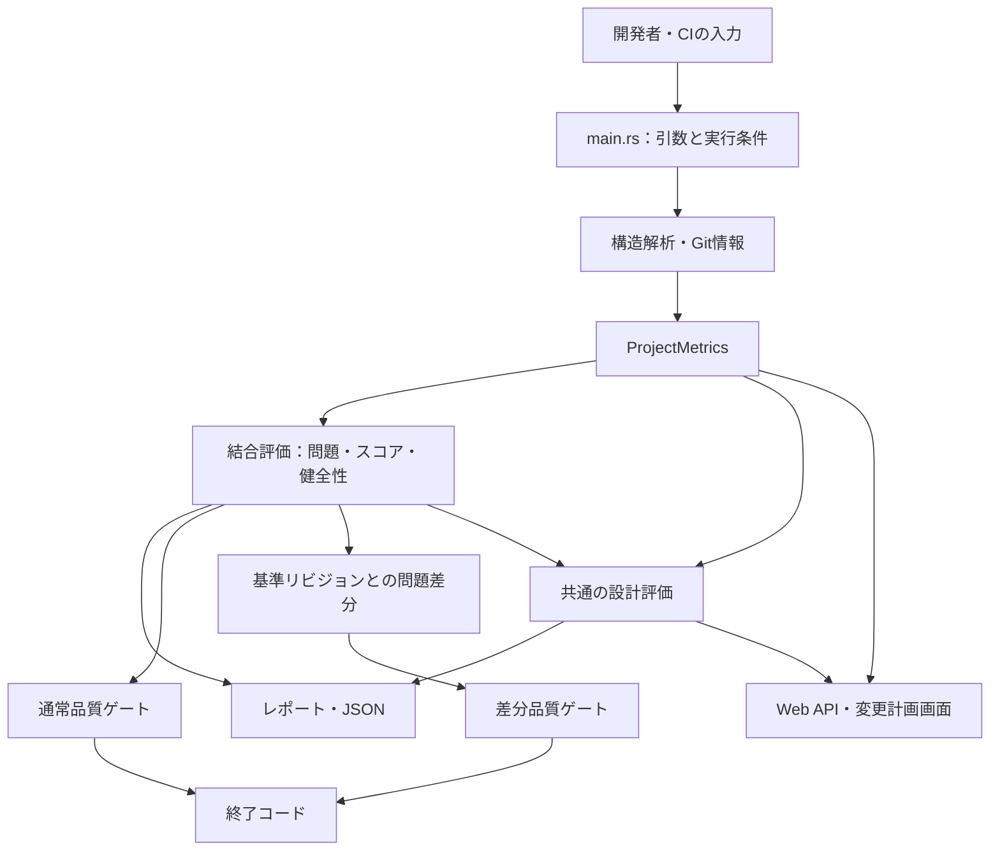

**分析結果の活用・品質ゲート**

cargo-couplingの利用層は、共通の解析結果を開発者向けレポート、CIの品質判定、Webでの構造探索へ展開する。CLIが実行条件と終了ステータスを制御し、レポート層が結果を整形する。設計レビューではCLIとWebが同じRust評価処理を利用する。

本書は、提供資料とプロジェクト内の実装を静的に照合した技術文書である。ビルド、テスト、サーバー起動による動作確認は実施していない。

**責務とデータの流れ**

| 実装 | 主な責務 |
|---|---|
| `src/main.rs` | Clapによる引数解析、設定の適用、解析起動、出力分岐、品質ゲート、終了コード |
| `src/lib.rs` | 解析機能と主要な型の公開 |
| `src/report.rs` | 詳細・概要・AI向けレポート、説明と解析上の制限の提示 |
| `src/cli_output.rs` | 品質判定、基準比較、履歴などの出力 |
| `src/cli_output/hotspots.rs` | 改善候補の集計と順位付け |
| `src/cli_output/impact.rs` | モジュール変更の直接・推移的な影響の提示 |
| `src/cli_output/json.rs` | 指標、問題、根拠、基準差分のJSON変換 |
| `src/design/output.rs` | 共通設計評価の文章出力 |
| `src/web/*` | 共有状態、HTTP API、静的資産、設計評価のHTTPへの適応 |
| `web-assets/*` | 構造、グラフ、履歴、設計評価を操作するブラウザ画面 |



品質ゲートは検出問題と集計値を利用する。設計評価の優先順位や仮想シナリオを、そのままCIの合否条件として使う構成ではない。

**CLIの実行条件と出力選択**

解析対象にはワークスペース、パッケージ、ソースディレクトリ、ソースファイル、`Cargo.toml`を指定できる。パス省略時の既定値は`./src`である。CIでは対象範囲を明確にするため、`.`などを明示するとよい。

依存数の閾値は、CLI指定、設定ファイル、既定値の順で優先する。`--exclude-tests`は設定側のテスト除外を有効にする。Gitの参照期間は既定で6か月となる。

| 利用目的 | 主な指定 |
|---|---|
| 通常の詳細レポート | `cargo coupling .` |
| 短い概要 | `--summary` |
| AI向け出力 | `--ai` |
| 構造化レポート | `--json` |
| 改善候補 | `--hotspots`、`--hotspots=10` |
| 外部クレートへの依存状況 | `--deps` |
| 変更影響 | `--impact <MODULE>`、`--impact-depth <N>` |
| 関数・型の依存追跡 | `--trace <ITEM>` |
| Git履歴 | `--history`、`--history=12` |
| 設計レビュー | `--design`、`--context <PATH>`、`--changed-since <REF>` |
| 品質判定 | `--check` |
| ファイル出力 | `--output <PATH>` |

`--context`または`--changed-since`だけでも設計出力が選ばれる。`--design`、`--context`、`--changed-since`は`--check`と競合する。また、`--changed-since`と`--baseline`は同時に指定できない。

出力指定の競合は、すべてが引数エラーになるわけではない。実装には優先するモードを警告し、ほかを無視する分岐がある。特に、**`--json`は`--check`より先に処理されるため、JSON生成と品質判定は別々に実行する必要がある。** `--baseline --json --check`も基準差分のJSONを生成して正常終了する経路となり、品質ゲートを実行しない。

**通常品質ゲート**

`src/cli_output.rs`の`run_check`が、`ProjectMetrics`、`IssueThresholds`、`CheckConfig`を受け取って評価する。結果の`CheckResult`には、合否、グレード、平均スコア、重大度別件数、循環経路数、失敗理由が格納される。

条件を付けずに`--check`を実行すると、次の3条件をすべて検査する。

| 条件 | 既定値 | 失敗条件 |
|---|---|---|
| 最低健全性グレード | C | C未満 |
| Criticalの最大件数 | 0 | 0件を超える |
| 代表的な循環経路の最大件数 | 0 | 0件を超える |

循環の件数は`detect_circular_dependencies()`が返す代表的な経路数であり、すべての循環の総数や循環に参加するモジュール数ではない。

**ゲート用オプションを1つでも指定すると、既定の3条件は補完されず、指定した条件だけが有効になる。**

```sh
# 既定の3条件を検査
cargo coupling --check .

# High以上の問題が存在するかだけを検査
cargo coupling --check --fail-on high .

# 必要な条件をすべて明示
cargo coupling --check \
  --min-grade C \
  --max-critical 0 \
  --max-circular 0 \
  --fail-on high .
```

`--fail-on`は`critical`、`high`、`medium`、`low`を受け付け、指定以上の重大度の問題が1件でもあれば失敗する。最低グレードの解析は`S`も受け付けるが、合否比較ではSとAを同等に扱う。

既定ではLowの問題が評価レポートから除外される。Lowまで検査する場合は、次のように`--all`を併用する。

```sh
cargo coupling --check --all --fail-on low .
```

**基準比較による品質ゲート**

`--check --baseline <REF>`は、既存の課題を残しながら追加の悪化を防ぐ差分ゲートである。通常ゲートとは判定経路が異なる。

```sh
cargo coupling --check --baseline main --fail-on high .
```

現在側と基準側を同じ解析器、評価方式、閾値、有効設定で評価し、`src/diff.rs`が問題を比較する。保存済みJSONを基準として読み込む方式ではなく、指定したGitリビジョンのソースを再解析する。

| 分類 | 判定 |
|---|---|
| 新規 | 現在側にだけ存在する問題 |
| 解消 | 基準側にだけ存在する問題 |
| 悪化 | 同じ識別キーで、重大度・バランス・対象件数のいずれかが悪化 |
| `unchanged` | 両側に存在し、悪化に分類されなかった識別キーの件数 |

`unchanged`には改善した既存問題も含まれ得るため、「内容が完全に同一の問題数」とは解釈しない。

問題の識別には`IssueKey`を使う。基本となるのは問題種別、依存元、依存先であり、依存数を扱う問題には件数の変化を比較できるようにする正規化がある。

悪化条件は次のいずれかである。

- 重大度が上がった。
- バランススコアが`1e-9`を超えて低下した。
- High Efferent／High Afferent Couplingの依存数・被依存数が増えた。

差分ゲートは、新規と悪化の問題を合わせ、**現在側の重大度が`--fail-on`以上か**を判定する。省略時はHigh以上となる。既存問題だけの場合や、全体の平均スコアが低下しただけの場合は、それ自体を失敗条件にしない。

この経路では`--min-grade`、`--max-critical`、`--max-circular`を判定に使わない。全体品質と差分品質の両方を求める場合は、通常ゲートと差分ゲートを独立したCIステップとして実行する。

**終了ステータスとCIへの組み込み**

| 終了コード | 意味 |
|---|---|
| `0` | 品質ゲート合格、または選択した出力処理の正常終了 |
| `1` | 品質ゲート不合格、または実行中のエラー |
| `2` | Clapによる不正な引数・競合などの入力エラー |

品質違反と解析失敗は、どちらも`1`になり得る。CIでは終了コードに加え、ゲートの失敗理由と標準エラー出力を保存する。

以下は別々のCIステップとして使う例である。

```sh
# 比較結果の保存
cargo coupling --baseline main --json --output coupling-report.json .

# 合否判定
cargo coupling --check --baseline main --fail-on high .
```

比較対象のGit参照がローカルに存在することが必要である。また、過去リビジョンの解析は一時worktreeの作成・削除を伴うため、一時領域とGit管理情報への書き込みが必要になる。

解析範囲、テスト除外、Git期間、閾値、ツールのバージョンはCIで揃える。通常の`.coupling.toml`読み込みは、失敗時に空設定へ切り替わり、理由は`--verbose`時だけ表示される実装である。設定の読み込み失敗を常に検査失敗として扱うわけではない点に注意する。

**レポートとJSONの利用**

人向けレポートは、問題の説明、推奨対応、変動性、解析上の制限を提示する。長い節や一覧には省略があるため、根拠の保存にはJSONを併用する。

通常JSONの主な構成は次のとおりである。

| フィールド | 用途 |
|---|---|
| `schema_version`、`analyzer_version`、`scoring_version` | 出力形式と評価方式の識別 |
| `summary` | グレード、スコア、モジュール数、問題件数 |
| `grade_rationale` | グレードの説明と寄与した問題種別 |
| `analysis_manifest` | 解析で扱えない領域と注記 |
| `issues` | 問題ID、種別、重大度、対象、説明、改善案、根拠 |
| `diff` | 基準比較時の新規・解消・悪化・継続件数 |
| `hotspots` | 改善候補 |
| `modules` | モジュール単位の指標 |
| `external_dependencies` | 外部クレートへの依存状況 |
| `circular_dependencies`、`temporal_couplings` | 循環経路とGit同時変更 |

`issues[].evidence`にはソース位置、観測した使用方法、推定した強度、制限を保持する。位置や使用方法が得られない場合もあるため、すべての問題に完全なソース証拠が付くとは限らない。

通常JSONはスキーマ版2、設計評価は版1である。設計JSONでは通常出力に`design`を追加する。一方、`--impact --json`、`--deps --json`、履歴JSONは用途別の形式となるため、すべてのJSON出力を同じ構造として処理しない。

設計評価の`provenance`には、対象範囲、リビジョン、作業ツリー状態、設定、探索深度、各種フィンガープリントなどを記録する。フィンガープリントは内容の識別値であり、暗号学的署名ではない。

JSONも用途別に集計・選別された結果である。例えば通常JSONの`hotspots`は実装上、上位10件を生成する。

**評価値を改善判断へつなげる**

バランススコアは正規化した強さ・距離・変動性から算出する。

```text
balance = max(abs(strength - distance), 1 - volatility)
```

評価方式は`khononov-compensation-v2`である。旧来の乗算式によるスコアとは直接比較できない。健全性グレードは検出問題に基づく別の評価であり、平均スコアの表示から機械的に決まるものではない。

設計評価の優先順位は、重大度の重み、到達可能な利用側、影響経路、変更予定、凍結状態、業務価値から求める。明示した工数がある場合は`value_per_effort`も出力する。これは相対的な着手順の目安であり、削減工数の予測ではない。

設計案やシナリオは仮想的な次元変更を評価する。該当する観測がないシナリオのスコアは`null`となる。数値の改善だけで抽象化や責務分離を決定せず、公開APIの露出、共有する業務要件、担当者、リリース単位と合わせて判断する。

**Webによる構造探索と変更レビュー**

WebはAxumとTokioを使用し、`Arc<AppState>`に起動時の指標、閾値、履歴、解析設定、設計評価を保持する。待受先は`127.0.0.1`で、既定ポートは3000である。

| API | 主な役割 |
|---|---|
| `/api/graph` | グラフ用データ |
| `/api/report` | レポート |
| `/api/history` | 履歴 |
| `/api/design` | 設計評価とGit比較 |
| `/api/impact` | 変更影響 |
| `/api/source` | ソース参照 |
| `/api/module` | モジュール詳細 |
| `/api/config` | フロントエンド設定 |
| `/api/health` | HTTPサービスの稼働確認 |

`/api/health`の応答はCLI品質ゲートの合格を意味しない。

レビューはStructureから対象を選び、依存行列と周辺グラフを確認し、Plan a changeで影響経路、変更要素、候補テスト、設計案、既存判断へ進む。依存行列では行が列に依存する。変更影響の矢印は、依存の矢印とは逆に、変更された提供側から利用側へ向かう。

Git比較を伴う設計要求は`spawn_blocking`で処理する。現在のソースフィンガープリントが起動時と異なる場合はHTTP `409 Conflict`を返し、再起動を案内する。通常の設計表示と影響表示は起動時スナップショットを使い、履歴タイムラインの選択とは独立している。

2D・3Dの要素プレビュー、ラベル配置、選択状態はブラウザ側の各モジュールが連携して扱う。3Dネットワークの初期座標は表示用であり、測定値はDimension-Spaceで確認する。画面の案内は日本語と英語に対応するが、診断の詳細や入力された根拠は元の言語を保持する。

**適用範囲と検証上の限界**

品質ゲートが保証するのは、選択した解析条件で検出された問題が指定条件を満たすことである。構文解析には、マクロ展開、有効な`cfg`分岐、動的ディスパッチ、完全な型解決などの制限がある。変更影響は候補範囲であり、すべての利用側に修正が必要だという証明ではない。候補テストも自動実行されない。

実装には、通常ゲートの既定値、明示条件だけの適用、不正なグレード・重大度、差分ゲートの既定重大度、問題の悪化分類、Web比較時のソース変更検知を確認するテストがある。本書ではその存在とコード上の条件を確認しており、現在のテスト成功を示すものではない。
