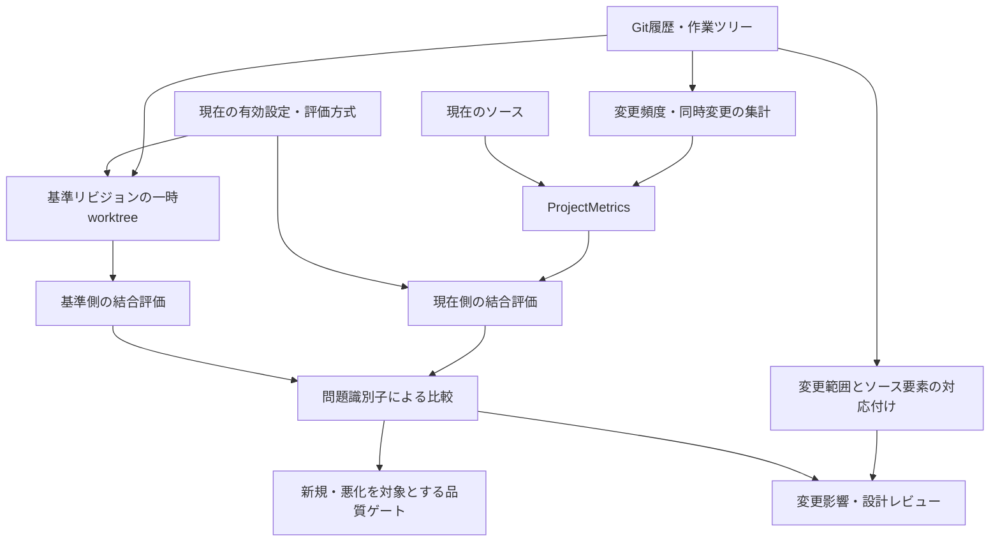

**変更履歴・品質差分管理**

cargo-couplingの変更履歴・品質差分管理は、Gitから変更頻度・同時変更・変更範囲を取得し、過去リビジョンとの品質比較と設計レビューに利用する機能群である。基準比較では現在の解析器・評価方式・有効設定を両側に適用し、新規問題、解消した問題、既存問題の悪化を区別する。

本書は提供資料とプロジェクト内の実装を静的に照合して記述した。コマンド例は利用方法を示すものであり、本調査では解析実行、テスト、ファイル変更、サーバー起動を行っていない。

**責務とデータの流れ**

| モジュール | 主な型・関数 | 責務 |
|---|---|---|
| `src/volatility.rs` | `VolatilityAnalyzer`、`TemporalCoupling` | Git履歴から変更回数と同時変更を集計する |
| `src/history.rs` | `analyze_history`、`analyze_ref`、`RefAnalysis` | 一時worktreeで過去のソースを再解析する |
| `src/diff.rs` | `diff_reports`、`BaselineDiff` | 問題の識別子に基づいて品質差分を判定する |
| `src/design/changes.rs` | `read_changes`、`ChangeSet`、`Provenance` | 変更範囲をソース要素へ対応付け、解析条件を記録する |
| `src/design/assessment.rs` | `assess` | 品質差分・変更要素・依存グラフを設計評価へ統合する |
| `src/main.rs`、`src/cli_output.rs` | CLI分岐、`generate_ratchet_check_output` | 比較結果を表示し、品質ゲートの成否を返す |



専用の永続データベースはこの処理に登場しない。Gitとローカルファイルを入力とし、解析結果をメモリ上の型やJSONレポートとして扱う。ただし、過去リビジョンの解析では一時領域とGitのworktree管理情報への書き込みが発生する。

**変更頻度と同時変更の集計**

`VolatilityAnalyzer::analyze`は、Gitリポジトリであることを確認した後、次の条件で履歴を読み取る。

```text
git log --pretty=format: --name-only --diff-filter=AMRC \
  --since=<期間> months ago -- "*.rs"
```

対象は追加・変更・改名・コピーされたRustファイルであり、削除は集計対象から外れる。標準出力を64 KiBの`BufReader`で逐次読み取り、パスごとの出現回数を`file_changes: HashMap<String, usize>`へ加算する。これは変更行数ではなく、履歴中でファイルが変更対象として現れた回数である。

| 変更回数 | `Volatility` | 数値 |
|---|---|---:|
| 0〜2回 | `Low` | 0.0 |
| 3〜10回 | `Medium` | 0.5 |
| 11回以上 | `High` | 1.0 |

記録のないパスに対する`get_change_count`は0、`get_volatility`は`Low`を返す。一方、`statistics`の集計対象は`file_changes`に存在するファイルだけであり、プロジェクトの全Rustファイルを分母にするわけではない。統計には対象ファイル数、延べ変更回数、最大・最小・平均変更回数、分類別件数が含まれる。

`analyze_temporal_coupling`はコミットごとにファイルをまとめ、同じコミットで変更された組を数える。対象Rustファイルが2件未満のコミットは組を生成せず、50件を超えるコミットも組の集計から除外する。大量整形などによるノイズと、組数の二次的な増大を抑えるためである。

同時変更が3回以上の組について、次の比率を計算する。

```text
coupling_ratio =
  min(1.0, 同時変更回数 / max(1, min(Aの変更回数, Bの変更回数)))
```

`TemporalCoupling::is_strong`の判定は **0.5以上**である。結果は同時変更回数、比率の降順、最後にファイル名で整列する。比率の分母に使う変更回数は、先に`analyze`で収集しておく必要がある。

同時変更は編集履歴の関連を示す。共有する業務ルールや実行時依存を直接証明するものではない。また、Gitで観測した変更頻度と、設定で指定する本質的な変動性は区別して扱う。

実装上、履歴読み取り中の行エラーは読み飛ばし、起動した`git log`の最終終了ステータスも検証していない。そのため、空の集計だけを根拠に「変更がなかった」と断定することはできない。

**過去リビジョンの解析と履歴レポート**

`analyze_ref`は指定したブランチ、タグ、コミットを一時worktreeへ展開し、現在と同じ解析処理で評価する。主な処理順序は次のとおりである。

1. Gitルートを特定し、解析対象の相対パスを求める。
2. `git worktree add --detach`で基準側のソースを展開する。
3. 現在の設定を複製し、リポジトリ内の設定ルートをworktree側へ付け替える。
4. 構造解析を実行し、必要に応じてGit変更頻度と同時変更を統合する。
5. 設定による変動性・サブドメインの指定を適用し、結合評価を生成する。
6. モジュールと結合のソース位置を、元リポジトリ上のパスへ戻す。

過去のソースに現在の設定を適用すると、現在の設定パターンが一致しない場合がある。この不一致を現在の設定の陳腐化と誤認しないよう、過去解析では`dead_config_patterns`を消去する。

`RefAnalysis`には、参照名、`ProjectMetrics`、完全な結合評価、ファイル数・モジュール数・結合数を保持する。解析対象が過去に存在しない場合やモジュールが見つからない場合は解析エラーとなる。

worktreeは`Worktree`の`Drop`で`git worktree remove --force`を呼び出して削除する。ただし削除結果は検証しないため、異常終了や削除失敗時の残存まで防ぐ仕組みではない。

履歴全体を扱う`analyze_history`は、期間内にRustファイルへ変更を加えたコミットを古い順に列挙し、コミット列のインデックス上で均等に抽出する。暦上の等間隔サンプリングではない。上限が2以上なら両端を含め、1なら最新のコミットだけを選ぶ。

| 型 | 保持する情報 |
|---|---|
| `HistoryPoint` | 短縮コミットID、コミッター日付、グレード、平均スコア、結合数、モジュール数、Critical・High件数 |
| `SkippedRevision` | 解析できなかったコミット、日付、理由 |
| `HistoryReport` | 古い順の成功点、スキップ一覧、指定期間 |

コミットがなければ`NoCommits`となる。個別の解析失敗は`skipped`へ記録して継続するため、履歴レポートの取得成功は、全サンプルの解析成功を意味しない。

Git履歴の期間指定は実行時点からの`--since=<N> months ago`であり、各履歴点の日付を基準にした移動窓ではない。このため履歴スコアは、過去に公表した値の再現として扱わない。

**品質差分の識別と悪化判定**

`diff_reports`は基準側と現在側の`ProjectBalanceReport`を受け取り、`IssueKey`で問題を対応付ける。

```text
IssueKey = (issue_type, source, target)
```

重大度、説明文、スコアは識別子に含まれない。依存件数を表す問題では、件数が変わっても同じ問題として追跡できるよう、次の正規化を行う。

| 問題種別 | 正規化 |
|---|---|
| `HighEfferentCoupling` | `target`の`3 dependencies`などを`<dependency-count>`へ変換 |
| `HighAfferentCoupling` | `source`の`3 dependents`などを`<dependent-count>`へ変換 |
| その他 | `source`と`target`をそのまま使用 |

たとえば依存先が3件から5件に増えた場合、古い問題の解消と新規問題の発生には分割せず、同一問題の悪化として評価できる。一方、通常のモジュール名などが変わればキーも変わるため、コードの意味に基づく改名追跡ではない。

| 結果 | 判定 |
|---|---|
| `new_issues` | 現在側だけに存在するキー |
| `resolved_issues` | 基準側だけに存在するキー |
| `worsened_issues` | 両側に存在し、悪化条件のいずれかを満たすキー |
| `unchanged` | 両側に存在し、悪化と判定されなかったキーの件数 |

悪化条件は以下の論理和である。

```text
現在の重大度 > 基準の重大度
または
現在のbalance_score + 1e-9 < 基準のbalance_score
または
現在の依存先・依存元件数 > 基準の件数
```

件数比較は`HighEfferentCoupling`と`HighAfferentCoupling`に限られる。ある側面が改善していても、別の側面が悪化すれば`worsened_issues`に入る。

`unchanged`は「全フィールドが同一」という意味ではない。同じキーを保ったまま重大度やスコアが改善した問題も含まれる。独立した改善済み一覧は持たない。

各差分一覧では同じキーの重複を除外する。ただし基準側の対応表は同じキーが複数あると最後の問題を保持するため、重複観測を最大重大度などへ集約して比較する実装ではない。

`BaselineDiff`は加えて、基準・現在のグレードと次のスコア差を保持する。

```text
score_delta = 現在の平均スコア - 基準の平均スコア
```

バランスの評価方式は`khononov-compensation-v2`であり、正規化された次元へ次式を適用する。

```text
balance = max(abs(strength - distance), 1 - volatility)
```

健全性グレードは検出問題に基づく別の評価である。平均スコアが改善していても、品質ゲート対象の問題が新規発生することはある。

**変更範囲とソース要素の対応付け**

`read_changes`は指定参照を`<reference>^{commit}`として解決し、比較基準のコミットIDを固定する。Git呼び出しではパスを文字どおり扱い、差分取得では外部diffとtextconvを無効にする。

追跡済みファイルは基準コミットと現在の作業ツリーを比較する。したがって、コミット済み・ステージ済み・未ステージの変更を含む最終的な差分が対象となる。それぞれの段階を独立した変更履歴として保存するわけではなく、相殺された変更は現れない。未追跡ファイルは`git ls-files --others --exclude-standard`で別途追加する。

解析範囲は選択パスを基本とし、`Cargo.toml`指定時は親ディレクトリを使う。選択ディレクトリ外でも、探索されたソースが同じGitルート内にあれば追加する。設計評価側は現在と基準の両方のソースパスを渡すため、削除済みのソースも範囲判定に利用できる。

| 型 | 主なフィールド |
|---|---|
| `ChangedRange` | 旧側・新側それぞれの開始行と行数 |
| `ChangedFile` | パス、改名前のパス、Gitステータス、変更範囲、対応する`SourceItem` |
| `ChangeSet` | 解決済み基準コミット、変更ファイル一覧、注記 |

対応付けには`--unified=0`のパッチを使用する。ハンクの新側範囲と現在のソース要素の行範囲が交差すれば、その要素を変更対象として追加する。行数0の範囲は交差とみなさない。未追跡ファイルでは、そのファイル内の解析済み要素をまとめて関連付ける。

削除行がある場合は`git show <baseline>:<path>`で旧ソースを読み、旧側範囲と交差する要素を調べる。現在側に同じモジュール名・要素名がなければ、基準コミットを`SourceItem.revision`へ設定して追加する。これにより、ファイルの一部だけを削除した場合も、削除要素の元の行番号とリビジョンを参照できる。

変更ファイル一覧にはRust以外のファイルも入り得るが、ソース要素との対応はRustの構文解析で得られた範囲に限られる。

**設計評価と来歴の統合**

`design::assessment::assess`は基準側の再解析結果を使い、品質差分と変更影響を同じ評価へ組み込む。影響探索用には現在側と基準側のモジュール・結合を合わせたグラフを構築し、削除によって現在のグラフから消えた関係も追跡対象にする。

変更影響の方向は「変更された提供側から利用側」であり、依存関係の方向とは逆になる。深度未指定では到達可能な範囲を探索し、深度を指定した場合は省略の有無を報告する。到達可能性と候補テストは確認対象を示すものであり、修正の必須性やテストの十分性を保証しない。

`Provenance`は次の解析条件を保持する。

| 分類 | 内容 |
|---|---|
| 実装・評価 | 解析器バージョン、評価方式 |
| 対象状態 | 解析範囲、HEADリビジョン、作業ツリーの変更有無 |
| 内容識別 | ソース、設定、設計コンテキストのフィンガープリント |
| 有効条件 | 実効設定、Git期間・使用指定、テスト除外、探索深度、依存件数の閾値 |

`dirty`はGitルートで取得した状態であり、選択パッケージだけの変更状態ではない。Git情報を取得できない場合、リビジョンや変更状態は`None`になり得る。

ソースフィンガープリントは、順序付けされたファイルパスと各内容ハッシュを連結し、FNV-1a 64ビットで計算する。表記は`fnv1a64:<16桁の16進数>`であり、暗号学的な署名ではない。

汎用JSONのスキーマ版は2、設計評価のスキーマ版は1である。比較時はスキーマに加えて、対象範囲、設定、評価方式、Git期間も確認する。異なる条件で保存したレポートをそのまま比較せず、条件を揃えて再解析する。

設計コンテキストの既存判断には`changed`、`new-issue`、`worsened-issue`、`context-changed`などの再評価条件を指定できる。`context-changed`では以前の`context_fingerprint`を保存して照合する。保存用フィンガープリント自体はハッシュ対象から除外されるため、値を保存しただけで再評価条件が成立することはない。

Webの変更計画は起動時の作業ツリースナップショットを使用し、履歴タイムラインの選択とは独立している。ソース編集後のGit比較で起動時との不整合を検出した場合はHTTP 409を返し、再起動を促す。削除要素は保持されたリビジョンから元のソースを確認する。

**CLIと品質ゲートの運用**

```sh
# 基準との品質差分を表示
rtk proxy cargo coupling --baseline main .

# High以上の新規・悪化した問題を検出
rtk proxy cargo coupling --check --baseline main --fail-on high .

# 比較結果をJSONで取得
rtk proxy cargo coupling --baseline main --json .

# 過去6か月から最大12点を抽出
rtk proxy cargo coupling --history=12 --git-months 6 .

# 変更要素と深度4までの影響を確認
rtk proxy cargo coupling --changed-since main --impact-depth 4 .
```

`--history`の件数を省略すると最大12点になる。0はエラーで、`--baseline`との併用もできない。履歴モードでは`--no-git`を指定しても警告のうえGit履歴を使用する。

基準付き品質ゲートは、`new_issues`と`worsened_issues`から指定重大度以上の問題を選ぶ。既定の重大度は`High`で、該当なしなら終了コード0、該当ありなら1を返す。変化していない既存問題は、このゲートの失敗要因にならない。

現行実装には、CIで区別すべき条件がある。

| 条件 | 実装上の動作 |
|---|---|
| `--check --baseline` | 新規・悪化した問題の重大度で判定する |
| 基準付き検査に`--min-grade`、`--max-critical`、`--max-circular`を追加 | 基準比較の分岐ではこれらの絶対条件を評価しない |
| `--check --baseline`に`--json`を追加 | JSON出力が優先され、正常出力後は0を返す。品質ゲートを実行しない |
| 入力不備・解析失敗 | エラーを報告して終了コード1を返す |

したがって、CIで終了ステータスによる検査とJSON保存の両方が必要な場合は、検査用とJSON出力用を分けて実行する。品質違反と実行エラーはどちらも1なので、判別には出力内容も必要になる。

**確認範囲と実装上の限界**

`src/diff.rs`には識別子の正規化、重複排除、重大度による絞り込み、悪化判定のテストがある。`src/history.rs`にはサンプリングの端点・順序・境界値、`src/design/changes.rs`には削除要素の来歴とパッチ範囲の解析を確認するテストがある。`tests/baseline_e2e.rs`と`tests/history_e2e.rs`には実際のGitリポジトリを用いる統合テストも存在する。本書では実行結果までは確認していない。

変更範囲の対応付けと影響探索は構文と依存グラフに基づく。マクロ展開、有効な`cfg`分岐、動的ディスパッチ、完全な型解決は網羅しない。品質差分を判断する際は、問題の種類・重大度・ソース位置に加えて、解析条件、履歴の欠落、スキップされたリビジョンを確認する必要がある。
