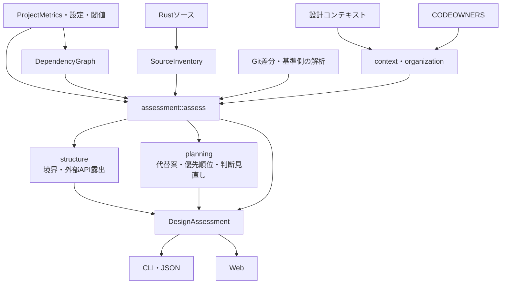

# 変更影響・設計判断支援

cargo-couplingの`design`モジュールは、RustソースとGit履歴から得た観測に、業務・担当者・実行時の前提を組み合わせ、変更箇所の調査と設計案の比較を支援する。変更によって影響を受ける可能性があるモジュール、確認すべきテスト、依存関係の根拠、改善の優先順位、既存判断の見直し条件を共通の`DesignAssessment`にまとめる。

CLIとWebの「Plan a change」は同じRust評価処理を利用する。評価結果は設計判断の材料であり、ソースの自動修正、変更必須箇所の確定、テストの実行、削減工数の予測は行わない。

本書は提供資料とプロジェクト内の実装を静的に照合したものである。コマンド例は利用方法を示しており、今回の調査では解析コマンド、テスト、Webサーバーを実行していない。

## 1. モジュール構成と評価の入口

| 実装 | 主な責務 |
|---|---|
| `src/design/assessment.rs` | 入力、観測、比較結果、設計情報を統合して評価結果を生成する |
| `src/design/source.rs` | Rust構文、ソース位置、公開シグネチャ、呼び出し、類似形状を観測する |
| `src/design/graph.rs` | モジュール名の解決、依存方向・影響方向の決定的な経路探索を提供する |
| `src/design/changes.rs` | Git差分をソース要素へ対応付け、削除要素の元の位置と解析来歴を保持する |
| `src/design/structure.rs` | 要素・モジュール・パッケージ・解析範囲の境界と外部API露出を整理する |
| `src/design/context.rs` | TOML形式の設計情報を読み込み、構造と値を検証する |
| `src/design/organization.rs` | 担当者、ライフサイクル、実行時関係を解釈する |
| `src/design/planning.rs` | 代替案、シナリオ、優先順位、既存判断の見直しを評価する |
| `src/design/model.rs` | CLIとWebで共有する直列化可能な結果型を定義する |
| `src/design/output.rs`、`src/web/design.rs` | 共通評価を人向けレポートとHTTP応答へ変換する |

評価の入口は次の関数である。

```rust
pub fn assess(
    metrics: &ProjectMetrics,
    config: &CompiledConfig,
    thresholds: &IssueThresholds,
    request: AssessmentRequest<'_>,
) -> io::Result<DesignAssessment>
```

`AssessmentRequest`は解析対象の`path`、任意の`context_path`、`changed_since`、`baseline`、`max_depth`、Git観測期間の`git_months`、Git変動性を利用したかを示す`git_used`を受け取る。基本解析から渡される`ProjectMetrics`を利用し、設計評価に必要な構文観測とグラフを追加する。



`assess`は設計情報の読み込み後、ソース一覧、グラフ、解析来歴を準備する。比較指定があれば基準側を再解析し、変更影響、依存辺の証拠、変動性への露出、共有変更の理由を評価する。その後、構造、組織情報、計画評価を結果へ組み込む。

## 2. ソース観測と境界の把握

### 2.1 ソース要素の記録

`SourceInventory`は、メトリクスに含まれるソースファイルを重複排除し、`syn`で構文解析する。`SourceItem`には次の情報を保持する。

- モジュール名、要素名、種別、ファイルパス、開始・終了行
- 元のリビジョン、公開状態、テストかどうか
- シグネチャ中の型、呼び出し名、フィールド名と型
- 本文のフィンガープリント、トークン数、単純な転送先

読み取り・構文解析の失敗は`notes`へ記録し、最終的な`coverage`で確認できる。要素はファイルパス、行番号、名前の順に整列する。

### 2.2 抽象化を確認するための検出

| 検出種別 | 実装上の条件・観測 | 確認すべき点 |
|---|---|---|
| `identical-logic` | テスト以外の本文で、24以上の正規化トークンを持つ同一本文が異なるモジュールに存在する | 同じ要件によって変更されるのか |
| `mirrored-record` | 2フィールド以上を持つ同一のフィールド名・型の列が複数あり、少なくとも一つが公開されている | 変換境界が知識を隠しているか |
| `forwarding-layer` | テスト以外の関数が引数を転送するだけの形になっている | 安定した名称、互換性、可視性などの役割があるか |
| `implementation-type-exposure` | 公開シグネチャに内部型らしい名前や非公開構造体への言及がある | 実装知識が公開面へ漏れていないか |

同形レコードの判定は、任意の2フィールドが部分的に一致するだけでは成立しない。実装ではフィールド名・型の列をまとめて比較する。

これらは構文上の兆候である。同じコードや形状であっても、所有者、検証、シリアライズ、独立した変更要求によって分離が妥当な場合がある。

### 2.3 階層と内部接続

`structure::hierarchy`は、`item`、`module`、`package`、`workspace`の各レベルで`BoundarySummary`を生成する。

各サマリーには構成要素、内部依存、外部からの依存、外部への依存、内部の接続グループを含める。内部グループは依存の方向を外して求めた連結成分であり、強連結成分ではない。

要素間の呼び出しは、名前から対象を一意に選べる場合に接続として採用する。複数グループへの分離は責務を調べる入口になるが、一つのグループであることも単一責務の証明にはならない。パッケージを依存メトリクスから特定できない場合は`selected-sources`としてまとめる。

## 3. 変更影響の探索

### 3.1 依存方向と影響方向

依存辺は「利用側から提供側」、変更影響はその逆方向をたどる。

```text
依存関係: checkout → service → policy
変更影響: policy   → service → checkout
```

`DependencyGraph`は次の二つの隣接関係を保持する。

| フィールド・操作 | 意味 |
|---|---|
| `outgoing`／`dependencies()` | 利用側から依存先へ進む |
| `incoming`／`impact()` | 提供側から利用側へ進む |
| `unresolved` | メトリクス内のモジュールに対応しない端点 |
| `select()` | モジュール名に対してglobを適用する |

`from_metrics`は`Distance::DifferentCrate`に分類された辺を除外する。外部クレートへの露出は別の分析で扱うため、通常の影響グラフと外部依存の一覧を同一視しない。

### 3.2 名前解決と決定性

`resolve()`は完全一致を優先する。続いて、修飾された入力名に一致する最長の既知モジュール名を選び、短い名前の場合は候補が一つに定まるときだけ解決する。

探索には`VecDeque`による幅優先探索と、`BTreeMap`・`BTreeSet`による順序付きコレクションを使う。訪問済み集合で循環を抑止するため、循環依存があっても探索は終了する。

結果は**到達先ごとに一つの最短経路**であり、すべての経路の列挙ではない。同じ長さの経路が複数あれば、順序付きの隣接関係に従って選ばれる。

### 3.3 深度と打ち切り

`Reachability`は`paths`、`max_depth`、`truncated`を保持する。

- 深度未指定では、グラフ上の到達可能なモジュールを探索する。
- 正の深度を指定した場合は、その辺数まで到達先を記録する。
- 境界の先に未訪問ノードが残る場合、`truncated = true`となる。

したがって、`truncated = false`は設定したグラフの探索状況を示す値であり、静的解析で見落とした依存がないことを保証する値ではない。

### 3.4 Git差分から変更起点を作る

`--changed-since`では、選択範囲内のコミット済み、ステージ済み、未ステージ、未追跡の変更をソース要素へ対応付ける。パッケージ選択では探索済みの`#[path]`ソースも対象となる。削除された要素には元のリビジョンと行番号を残す。

比較時の影響グラフは、現在側と基準側のモジュール・依存を合わせて構築する。これにより、現在のソースだけでは消えてしまう削除要素や依存辺も調査できる。一方、設計案や優先順位などの通常評価は現在側の観測を利用する。

### 3.5 テスト候補

`change_impact`は現在のソース一覧から、次のいずれかを満たすテストを候補にする。

1. 呼び出し名の末尾が変更要素名と一致する。
2. 変更元のモジュールに所属する。
3. 推移的に影響を受けるモジュールに所属する。

`TestCandidate`には要素、選定理由、経路を含める。名前一致は完全な名前解決ではなく、候補には誤検出があり得る。テストを除外した解析では候補の網羅性が低下し、その制限を`coverage`へ記録する。

## 4. 変動性と共有する変更理由

### 4.1 強い依存を通じた露出

`InheritedExposure`は次の情報を分けて保持する。

| 情報 | 意味 |
|---|---|
| `essential_volatility` | サブドメイン分類から得る本質的な変動性。分類がなければ不明 |
| `observed_changes` | Gitから観測した変更回数。Git未利用なら不明 |
| `upstream_volatility` | 依存先に関係する観測から得る変動性 |
| `path_strength` | 報告経路における結合強度の最小値 |

実装は、正規化された結合強度が`0.75`以上の辺だけでグラフを作り、依存先方向へ探索する。通常グラフで最短の経路が弱い場合でも、別の強い経路があれば検出対象になる。

経路上の各モジュール対では最大の観測強度を採用し、その最小値を`path_strength`とする。依存先の変動性がゼロの場合は露出結果を生成しない。この値は障害確率ではなく、露出の検出によって対象モジュール自身の本質的な変動性を書き換えることもない。

### 4.2 同時に変更する理由

`shared_reasons`は三つの情報源を区別する。

| `origin` | 情報源 | 解釈 |
|---|---|---|
| `declared` | 設計コンテキストの業務ルール | 人が明示した共通要件 |
| `syntax-similarity` | 異なるモジュールの同一本文 | 共通要件を確認するきっかけ |
| `git-co-change` | 強い同時変更として分類された履歴 | 繰り返し同時編集された事実 |

Gitの同時変更には、整形、生成コード、配線変更なども含まれ得る。構文の類似性と履歴だけで共有化を決定せず、業務ルールとの対応を確認する。

## 5. 設計コンテキストと組織情報

### 5.1 読み込みと検証

既定では解析対象から親ディレクトリへ向かって`.coupling-context.toml`を探索する。`--context`指定時はそのパスを読む。

| 状況 | 動作 |
|---|---|
| 既定ファイルがない | 空の設計情報で継続し、不足情報を記録する |
| 明示指定したファイルがない | エラー |
| TOMLや値が不正 | エラー |
| セレクターが選択範囲に一致しない | 適用範囲の注記 |
| 一つのモジュールが複数コンポーネントに割り当たる | 評価時にエラー |

対応版は`version = 1`である。未知フィールド、不正glob、各種宣言内の重複ID・名前、必須値の空欄を拒否する。`business_value`と`effort_days`は有限の正数、シナリオの各次元は`[0, 1]`でなければならない。

設計コンテキストは観測済みのGit変更頻度や本質的な変動性を上書きしない。サブドメインと変動性の設定は`.coupling.toml`が担う。

### 5.2 宣言例

以下は価格計算モジュールと利用側を想定した例である。`modules`には実際のJSON階層に出力される名前を使用する。

```toml
version = 1

[[components]]
name = "pricing"
modules = ["*policy"]
owners = ["@pricing"]
planned_changes = "地域別価格を導入する"
business_value = 3
effort_days = 2
release_unit = "shop"

[[components]]
name = "quotes"
modules = ["*service"]
owners = ["@checkout"]
release_unit = "shop"

[[rules]]
id = "regional-pricing"
modules = ["*policy", "*service"]
description = "地域別価格の規則を両モジュールで一致させる"

[[relationships]]
id = "quote-consistency"
source = "*service"
target = "*policy"
kind = "transaction"
origin = "declared"
evidence = "見積もり処理中は一貫した価格リビジョンを使う"

[[scenarios]]
name = "価格計算の責務を近づける"
description = "責務を同じ境界へ配置する場合を比較する"

[[scenarios.changes]]
source = "*service"
target = "*policy"
distance = 0.0

[[decisions]]
id = "keep-together"
modules = ["*policy", "*service"]
reason = "同じ単位でリリースする"
review_on = ["planned-change", "cross-team", "changed", "new-issue"]
```

### 5.3 担当者とライフサイクル

CODEOWNERSは`.github/CODEOWNERS`、ルートの`CODEOWNERS`、`docs/CODEOWNERS`の順で、最初に存在するファイルを読む。ファイル内は最後に一致する規則を優先する。コンポーネントの`owners`が空でなければ明示指定を優先する。

否定パターンや文字クラスなど未対応の形式は注記して適用しない。担当者が不明な場合は空の情報として残す。

`cross_team`は、依存の両端に担当者が存在し、共通する担当者が一人もいない場合に成立する。これは調整が必要な可能性を示す判定であり、組織間距離の実測ではない。

`build_unit`、`test_unit`、`release_unit`は同じ単位に所属するモジュールをまとめる。`pairs_without_code_edges`により、直接のコード依存がなくてもライフサイクルを共有する組を確認できる。

### 5.4 実行時の前提

| `kind` | 主な確認事項 |
|---|---|
| `sequence` | 呼び出し順序をAPIや型で保証できるか |
| `timing` | タイムアウト、遅延到着、時計への依存 |
| `transaction` | 原子性、不変条件、ロールバック・補償 |
| `shared-state` | 同一性、一貫性、所有権、並行制御 |
| `synchronous` | 可用性への波及と障害処理 |
| `asynchronous` | データ形式の変更、順序、重複配送 |

`origin = "observed"`は、トレースや障害記録など実際の観測を`evidence`に記述する場合に使う。ツール自身は実行時トレースを収集せず、宣言の事実性も検証しない。非同期通信の指定だけで知識の共有が弱いとは評価しない。

## 6. 設計案と優先順位の評価

### 6.1 共通スコア

観測と仮想評価は、正規化した強さ`S`、距離`D`、変動性`V`に対して同じ式を使用する。

```text
balance = max(abs(S - D), 1 - V)
```

評価方式は`khononov-compensation-v2`である。値が大きいほど、この方式ではバランスが良いと評価される。健全性グレードは検出問題に基づく別の評価であり、スコアだけで決まらない。旧来の乗算方式の値とは直接比較できない。

### 6.2 組み込みの代替案

`alternatives`は、バランスが`0.8`未満の観測を持つ有向モジュール対を対象とし、その組で最も低い観測値を代表に選ぶ。

| `action` | 仮定する変更 |
|---|---|
| `retain` | 現在の強さ・距離を維持する |
| `hide-knowledge` | 強さを`0.25`にする |
| `move-closer` | 距離を`0.25`にする |
| `separate-responsibilities` | 距離を`1.0`にする |

いずれも変動性は維持する。各案には成立条件とトレードオフが付く。たとえば知識の隠蔽は変換や保守の負担を増やし、責務の分離は調整や段階的リリースの負担を増やす可能性がある。

この計算は代表観測だけを対象とする仮定上の比較である。トレイトの追加だけで想定した強度低下が成立するわけではなく、実変更後には全体を再解析する必要がある。

### 6.3 宣言されたシナリオ

`scenarios`は、`source`と`target`のglobが一致する観測に、指定された次元だけを適用する。

- 同じ観測に複数宣言が一致した場合、次元ごとに後の指定が優先される。
- 未指定の次元は現在値を維持する。
- 平均対象は一致した観測だけであり、プロジェクト全体ではない。
- 一致数は`affected_edges`に記録する。
- 一致がなければ現在・仮想スコアは`null`となり、注記を残す。

シナリオは既存観測の数値を仮定して比較する機能であり、新しい依存辺の生成やソースの編集は行わない。

### 6.4 優先順位

優先順位は次の式で算出する。

```text
priority_score =
  (重大度重みの合計
   + 到達可能な利用側モジュール数
   + 継承的な露出経路数
   + 変更予定があれば4
   + 凍結理由があれば4)
  × business_value
```

重大度の重みはCriticalが8、Highが4、Mediumが2、Lowが1である。業務価値の既定値は`1.0`。工数がある場合は`value_per_effort = priority_score / effort_days`も出力する。

対象は問題、変更予定、凍結理由、露出のいずれかがあるモジュールである。利用側の件数は深度無制限で求めるため、画面上で指定した影響深度と一致するとは限らない。

標準ではスコア降順、同点はモジュール名順となる。Webでは工数当たりの優先度でも並べられ、工数未指定の対象も表示に残る。数値は相対的な調査順序であり、費用や削減効果の見積もりではない。

## 7. 既存判断の見直し

`decisions`は、保存された理由と見直し条件を現在の観測に照らして評価する。

| `review_on` | 発火条件・必要情報 |
|---|---|
| `planned-change` | 対象に変更予定がある |
| `cross-team` | 関連依存に共通担当者のない組がある。担当者不足は未確認事項 |
| `changed` | 対象が変更起点に含まれる。`--changed-since`が必要 |
| `new-issue` | 比較で対象に関係する新規問題がある |
| `worsened-issue` | 比較で対象に関係する悪化した問題がある |
| `context-changed` | 保存済みと現在のコンテキスト指紋が異なる |

結果は`DecisionReview`にまとめ、次の順に状態を決める。

1. 一つでも条件が発火したら`review`。
2. 発火せず、必要な証拠が不足していれば`unknown`。
3. 発火も不足もなければ`retain`。

対象モジュールが選択範囲にない場合も未確認事項を残す。`retain`は指定した条件の範囲で見直し理由が検出されなかった状態であり、設計全般の妥当性の保証ではない。

`context-changed`を利用するには、前回の`design.provenance.context_fingerprint`を判断の`context_fingerprint`へ保存する。指紋の計算から各判断の保存済み指紋自体を除外するため、その値を記録しただけでは変更扱いにならない。

## 8. 外部依存の置き換え支援

`structure::external_exposure`は、`DifferentCrate`に分類された依存から外部クレートを抽出し、次を`ExternalExposure`へまとめる。

- 公開シグネチャ中の型への言及：`public_items`
- 直接利用するモジュール：`direct_modules`
- 直接利用箇所から到達する利用側：`affected`
- 内部の利用側を持つ直接利用箇所：`replacement_boundaries`
- 型解決や解析範囲に関する制限：`unknowns`

`std`、`core`、`alloc`などは対象から除外する。複数の直接利用箇所から同じモジュールへ到達する場合は、短い影響経路を残す。

置き換え境界はレビュー候補である。アダプターを追加する際は、外部API固有の知識を隠せるかを確認する。インポート別名は構文上で調べるが、型エイリアスや再エクスポート、下流リポジトリの利用箇所まで完全には追跡できない。

## 9. 結果形式と比較条件

`DesignAssessment`の主なフィールドは次のとおりである。

| 分類 | フィールド |
|---|---|
| 評価条件 | `schema_version`、`provenance`、`coverage` |
| 変更と影響 | `changes`、`impact`、`baseline` |
| 依存と構造 | `edges`、`exposures`、`abstractions`、`shared_reasons`、`hierarchy` |
| 設計計画 | `alternatives`、`scenarios`、`priorities`、`decisions` |
| 外部・組織・実行時 | `external_interfaces`、`coordination`、`lifecycle`、`runtime` |

`EdgeEvidence`は観測された利用、推定強度、出所、理由、ソース位置、正規化値、不明事項を分けて保持する。人向け出力では長い節を省略する場合があるが、JSONには報告対象の観測を保持する。

汎用JSONのスキーマ版は2、`design`のスキーマ版は1である。`provenance`には解析器と評価方式の版、対象範囲、リビジョン、作業ツリーの変更状態、有効設定、Git観測期間、テスト除外、閾値、深度、各種フィンガープリントを記録する。

フィンガープリントはFNV-1a 64ビットで、`fnv1a64:`付きの文字列として出力する。内容の同一性を識別する値であり、暗号学的な署名ではない。

`--baseline`と`--changed-since`による比較は、両側のソースを現在の解析器、採点方式、閾値、有効設定で再解析する。過去に公開されたスコアの再現ではなく、条件を揃えたソース差分の評価である。

基準比較には新規・解消に加えて`worsened_issues`を含める。`--check --baseline`は指定重大度以上の新規・悪化した問題で失敗し、変わっていない既存問題はその失敗条件に含めない。

## 10. CLIとWebでの利用

### CLI

```sh
# 設計評価を表示
cargo coupling --design .

# JSONで評価を取得
cargo coupling --design --json .

# Git基準からの変更と影響を確認
cargo coupling --changed-since main --impact-depth 4 .

# 指定モジュールの影響を確認
cargo coupling --impact analyzer --impact-depth 3 --json .

# 基準との差分を品質ゲートで確認
cargo coupling --check --baseline main .
```

`--changed-since`または`--context`の指定は、`--design`なしでも設計出力を選択する。

### Web

```sh
cargo coupling --web --context ./design-context.toml --no-open .
```

標準的な変更レビューは次の順に進める。

1. **Structure**で対象を選び、依存行列と周辺の接続を確認する。行列は行が列に依存し、件数は異なるモジュール対を表す。
2. **Plan a change**で起点と深度を指定し、**Trace impact**で利用側への経路を追う。
3. **Compare changes**でGit基準との差分、変更要素、候補テスト、ソースを確認する。削除要素は元のリビジョンを参照する。
4. **Design options**と**Scenarios**を比較し、担当者、ライフサイクル、実行時関係、**Retained decisions**を確認する。
5. **Coverage & conditions**で不足情報と条件を確認し、JSONを保存する。

`web::design`は`GET /api/design`と`GET /api/impact`を提供する。変更計画は起動時の作業ツリースナップショットを使い、履歴タイムラインとは独立している。Git比較時に起動後のソース変更や新規ファイルとの不整合を検出すると、HTTP 409と再起動案内を返す。

Webは設計コンテキストのTOMLを編集しない。また、3Dグラフの配置座標は表示用であり、測定値は**Dimension-Space**で確認する。

## 11. 解析上の制限と検証範囲

| 制限 | 結果の利用方法 |
|---|---|
| マクロ展開、有効な`cfg`選択、完全な型解決、動的ディスパッチ、再エクスポート解決が不完全 | 重要な依存をソースとコンパイラーの情報で確認する |
| 経路は構文から得たグラフ上の到達可能性 | 到達した利用側すべてに変更が必要とは判断しない |
| 名前一致・同一本文・同形レコードは意味を確定しない | 共有要件と独立した変更理由を確認する |
| 実行時情報は入力された証拠に限定される | 観測記録と宣言の内容をレビューする |
| 不明な情報は`null`、空の情報、注記として残る | ゼロや問題なしへ読み替えない |
| 仮想案は既存観測の次元変更を評価する | 実装後に全体を再解析する |

実装内には、深度制限と循環、曖昧な名前解決、強い迂回経路、代替案の入力順序への非依存、証拠不足時の`unknown`、CODEOWNERSの優先順位を確認するテストがある。`tests/design_e2e.rs`には設計情報の統合、3段階の変更影響、候補テスト、削除要素のリビジョン保持、不正コンテキストの拒否を扱うテストがあり、Web側には起動後の変更を拒否するテストがある。

今回確認したのは実装とテストの記述であり、これらのテストの実行結果は確認していない。
