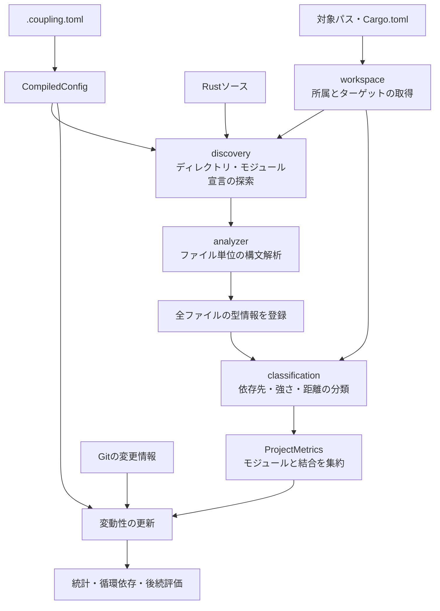

# 構造・結合の把握

cargo-couplingの構造解析は、Rustプロジェクトのソース配置、モジュール階層、構文上の依存関係を観測し、結合の強さ・距離・変動性を `ProjectMetrics` に集約する。後続のバランス評価、変更影響の追跡、CLIレポート、Web可視化は、この共通データを利用する。

本領域が示すのは、コードから観測できる構造と分類結果である。業務上の責務、共有すべき要件、実行時の依存関係は、ソースの配置や名前だけでは確定しない。

本文は、提供資料と現行ソースの静的確認に基づく。ビルド、テスト、解析コマンドの実行、サーバー起動は行っていない。

## 1. モジュール構成と処理の流れ

| 実装 | 主な責務 | 主要な型・関数 |
|---|---|---|
| `src/workspace.rs` | Cargoメタデータから所属パッケージ、ターゲット、クレート依存を取得する | `WorkspaceInfo`、`CrateInfo` |
| `src/discovery.rs` | ソースファイルを探索し、ファイルとモジュール名を対応付ける | `file_path_to_module_path`、モジュール木探索 |
| `src/config.rs` | TOML設定を読み込み、パターンをコンパイルする | `CouplingConfig`、`CompiledConfig` |
| `src/analyzer.rs` | Rust構文から依存、利用文脈、定義情報、ソース位置を抽出する | `CouplingAnalyzer`、`Dependency`、`UsageContext` |
| `src/classification.rs` | 依存先を解決し、結合の強さと構造的距離を分類する | `resolve_target_module`、`strength_for_dependency` |
| `src/metrics/dimensions.rs` | 強さ、距離、可視性、サブドメインの分類を定義する | `IntegrationStrength`、`Distance`、`Visibility` |
| `src/metrics/coupling.rs` | 個々の結合と、その観測根拠を保持する | `CouplingMetrics`、`CouplingLocation` |
| `src/metrics/module.rs` | モジュール内の定義、利用件数、要素間依存を保持する | `ModuleMetrics`、`TypeDefinition` |
| `src/metrics/project.rs` | プロジェクト全体の集約、変動性更新、統計、循環検出を担う | `ProjectMetrics` |
| `src/metrics/mod.rs` | 指標関連の型を再公開する | 指標モデルの公開窓口 |

次の図は主なデータの流れを示す。Git情報と設定による変動性の更新は、構文解析で生成した指標を補完する処理である。



## 2. 解析範囲とソースの特定

### 2.1 Cargoメタデータによる構造把握

`WorkspaceInfo::from_path` は `Cargo.toml` を探し、`cargo_metadata::MetadataCommand` でメタデータを取得する。`WorkspaceInfo` は次の情報を保持する。

- ワークスペースのルートとメンバー名
- パッケージごとのマニフェスト、ソース探索ルート、ターゲットのルートファイル
- 通常依存と開発用依存
- クレートの依存グラフと逆依存グラフ

解析対象のターゲット種別は、ライブラリ系、手続きマクロ、バイナリである。探索にはターゲットの実際の `src_path` を使うため、標準の `src/lib.rs` や `src/main.rs` 以外の配置にも対応する。重複するパスや、別の探索ルートに包含されるルートは整理される。

`CrateInfo::src_path` は互換性のために残るフィールドであり、内部の探索では `source_roots` と `crate_roots` が使われる。

公開入口は次の関数である。

```rust
pub fn analyze_workspace_with_config(
    path: &Path,
    config: &CompiledConfig,
) -> Result<ProjectMetrics, AnalyzerError>
```

メタデータの取得に失敗すると、理由を標準エラー出力へ表示し、`analyze_project_parallel_with_config` による基本解析へ切り替える。この場合も解析は継続できるが、Cargo情報に基づく所属判定や探索範囲と同等にはならない。

### 2.2 ディレクトリ探索とモジュール宣言の併用

`discovery` は、次の二つの方法を組み合わせる。

1. ターゲットのソースルート以下から `.rs` ファイルを探索する。
2. クレートルートから `mod` 宣言をたどり、`#[path]` を含む参照先を解決する。

両方で見つかったファイルには、ディレクトリ探索で得たモジュール名を優先する。したがって、表示名が常にRustの論理的なモジュール名と完全一致するとは限らない。

ファイルパスからの変換例は次のとおりである。

| ソースルート | ファイル | 変換結果 |
|---|---|---|
| `src` | `src/utils.rs` | `utils` |
| `src` | `src/level/mod.rs` | `level` |
| `src` | `src/level/enemy/spawner.rs` | `level::enemy::spawner` |
| `src` | `src/lib.rs`、`src/main.rs` | 空文字列。解析側でルート名を補う |

通常の探索では隠しディレクトリと `target` を除外する。ワークスペース用の探索では、入れ子の別パッケージや、マニフェスト直下の `tests`、`examples`、`benches`、`build.rs` も除外する。モジュール宣言の参照先が許可されたパッケージ・ワークスペース境界を越えた場合は、解析に取り込まず件数を記録する。

ディレクトリ探索も併用するため、解析対象はコンパイラが有効なモジュール宣言から到達するファイルだけに限定されない。

### 2.3 設定の役割

`CouplingConfig` は読み込み時の設定を表し、`CompiledConfig` はコンパイル済みglob、設定ファイルの基準ディレクトリ、変動性の検索キャッシュなどを保持する。

| 設定領域 | 用途 |
|---|---|
| `analysis.exclude` | 指定パスを解析対象から除外する |
| `analysis.exclude_tests` | テスト除外の実効設定を保持する |
| `analysis.prelude_modules` | 多数の利用側を持つことが想定されたモジュールを指定する |
| `volatility.high / medium / low` | 変動性を明示する |
| `subdomains.core / supporting / generic` | 業務上の分類を明示する |
| `thresholds` | 後続評価の依存数・被依存数の閾値を指定する |

パスの除外はファイル探索に適用される。一方、テスト関連の設定と構文上のテスト識別情報は、それぞれの処理段階で利用されるため、設定項目の存在だけから「構文解析前にすべてのテストが消える」と解釈してはならない。

設定パターンの照合では、読み込んだ設定ファイルのディレクトリを基準にする。対象に一致しなかった設定は `dead_config_patterns` に記録されるが、部分解析の範囲外に向けた設定を誤って未使用と判定しないための条件が設けられている。

## 3. 依存関係の抽出と名前解決

### 3.1 構文解析と二段階の集約

`CouplingAnalyzer` は `syn` の構文木を訪問し、依存パス、使用文脈、定義、行番号などを抽出する。ファイル単位の解析はRayonで並列化され、結果の集約では次の順序を取る。

1. 解析に成功した全ファイルから、型名・所属モジュール・可視性を登録する。
2. 各ファイルの依存を解決し、分類した `CouplingMetrics` を追加する。

型情報を先に揃えることで、後から処理されるファイルの型も名前解決に利用できる。

ファイルの読み取り・解析に失敗した場合は警告を表示してそのファイルをスキップする。`total_files` は解析成功数、`parse_failures` は発見したファイル数との差を保持する。解析結果が返っても、対象全体を解析できたとは限らない。

### 3.2 依存の種類と使用文脈

`Dependency` は次の情報を保持する。

| フィールド | 内容 |
|---|---|
| `path` | 観測した依存パス |
| `kind` | インポート、トレイト実装、固有実装、型参照など |
| `line` | 観測したソース行 |
| `usage` | 呼び出し、型引数、フィールドアクセスなどの使用文脈 |

強さの分類では、粗い依存種別だけでなく `UsageContext` を使う。同じ型への参照でも、トレイト境界、関数引数、構造体生成では異なる分類になり得る。

`Self` 参照や局所変数らしい名前などは、`is_valid_dependency_path` のヒューリスティックで除外する。この処理は誤検出を減らす一方、依存の完全な抽出を保証しない。

### 3.3 依存先の解決順序

`resolve_target_module` は、おおむね次の順序で依存先を決める。

1. `crate::`、`self::`、`super::` などをモジュール相対のパスへ変換する。
2. パスの最長の接頭部分から、既知のモジュール名を探す。
3. 対象となる名前では、型レジストリから所属モジュールを探す。
4. 解決できなければ、パスの先頭の有効な要素を候補にする。

型レジストリは型名をキーにする。同名の型が複数ある場合は、公開型を優先し、それでも同条件ならモジュール名の辞書順で選ぶ。この規則は結果を決定的にするためのもので、Rustコンパイラのスコープ解決を再現するものではない。

一部の非修飾型名や再公開された型は補助的に解決できるが、完全な再エクスポート解決や型推論には対応しない。

## 4. 結合の分類モデル

### 4.1 結合の強さ

強さは、利用側が提供側のどの情報に依存するかを四段階で表す。

| 分類 | 数値 | 主な使用文脈 |
|---|---:|---|
| `Contract` | 0.25 | トレイト境界・トレイト実装 |
| `Model` | 0.50 | インポート、型引数、公開型に対するデータ操作 |
| `Functional` | 0.75 | 関数・メソッド呼び出し、関数引数型、戻り値型 |
| `Intrusive` | 1.00 | 固有実装、非公開または可視性不明のデータ操作 |

フィールドアクセスと構造体生成には補正がある。対象型の可視性が `Public` と確認できれば `Model`、それ以外は `Intrusive` になる。

この判定は対象型の登録情報を使うため、個々のフィールドの公開範囲を完全に検査した結果とは異なる。また、`observed_usage` に記録される構文上の使用文脈と、そこから推定した強さは区別して読む必要がある。

### 4.2 構造的距離

| 分類 | 数値 | 分類上の意味 |
|---|---:|---|
| `SameFunction` | 0.00 | 同一関数・ブロックを表すモデル値 |
| `SameModule` | 0.25 | 同じモジュール、祖先・子孫、共通の非ルート親を持つ兄弟 |
| `DifferentModule` | 0.50 | 上記以外の同一クレート内関係、ワークスペース内の別クレート |
| `DifferentCrate` | 1.00 | ワークスペース外のクレート、内部と確認できない依存先 |

モジュール単位の分類関数は、同じファイル内の関係にも通常 `SameModule` を使う。`SameFunction` は型として存在するが、この分類処理で同一関数を細かく判定しているわけではない。

距離の解釈で特に重要なのは、次の二点である。

- `feature::read` と `feature::write` は、共通の親を持つため `SameModule` になり得る。ルート直下の `read` と `write` は `DifferentModule` になる。
- ワークスペース内の別クレートは `DifferentModule` として扱う。クレートが異なることだけを理由に値が `1.0` になるわけではない。

これらはコード上の近接性を表す規則であり、同じ業務責務を担うことの証明ではない。

### 4.3 可視性による実効強度

`CouplingMetrics::effective_strength` は、可視性から内部実装への依存と判定した関係を一段階強める。

```text
Contract → Model → Functional → Intrusive
```

すでに `Intrusive` なら変更しない。公開型への依存は補正せず、`pub(crate)` はクレート所属、その他の制限付き可視性は距離分類などを使って判断する。

ここでも、`pub(in path)` の許可範囲を完全に解決しているわけではない。また、`SameModule` に分類された構造的に近いモジュールも、この判定では同一モジュール相当として扱われる。

`Visibility::intrusive_penalty` も定義されているが、実効強度の計算はその係数の乗算ではなく、上記の段階補正である。

### 4.4 変動性

結合レコードの `volatility` は、**依存先の変動性**を表す。構文解析での初期値は `Low` であり、その後にGit情報と設定を反映する。

| 分類 | 数値 | `Volatility::from_count` の変更回数 |
|---|---:|---:|
| `Low` | 0.0 | 0〜2 |
| `Medium` | 0.5 | 3〜10 |
| `High` | 1.0 | 11以上 |

この回数は、供給されたGit集計期間内の値であり、日次の変更率ではない。

設定による解決の優先順位は、明示的な変動性、サブドメイン分類、Git由来の値の順である。サブドメインは `Core` が `High`、`Supporting` と `Generic` が `Low` に対応する。分類自体は利用者の宣言であり、自動推定しない。

Git情報がない場合に初期値が残ることもあるため、`Low` だけを見て安定性が確認されたと判断しない。

## 5. 指標の保持と集約

### 5.1 関係・モジュール・プロジェクトの三段階

`CouplingMetrics` は、依存元と依存先、三次元の分類、任意のクレート情報、対象の可視性、ソース位置、使用文脈を保持する。依存方向は一貫して **利用側 → 提供側** である。

`CouplingLocation` のファイルパスは省略可能だが、通常のファイル解析ではファイルパスと観測行を設定する。

`ModuleMetrics` は、型・関数・メソッドの定義、実装や呼び出しの件数、内部・外部依存、要素間依存、テスト識別情報、サブドメインを保持する。

`ProjectMetrics` はこれらをまとめ、さらに次の情報を持つ。

- 型レジストリとクレート依存
- ファイル変更回数と同時変更情報
- 解析失敗数、境界外としてスキップした参照数
- ソースを発見できなかったクレート
- 対象に一致しなかった設定パターン

### 5.2 件数・平均・分布の意味

`couplings` は観測レコードの `Vec` であり、`add_coupling` は追加時に重複を除かない。そのため、結合件数は異なるモジュールの組の数とは一致しない。

`ProjectMetrics::average_strength` と `average_distance` は、全結合レコードを母数とする算術平均である。結合がゼロなら `None` を返す。強さの平均には、可視性補正前の `strength_value()` を使う。

`calculate_dimension_stats` も、保存された分類を数える。距離の分布では `SameFunction` と `SameModule` を同じ区分にまとめ、バランスの分類件数も計算する。したがって、次の値は分けて扱う必要がある。

| 値 | 集計単位・意味 |
|---|---|
| 結合件数 | 観測レコード数 |
| グラフの接続数 | 重複を除いた有向の接続 |
| 平均強度 | 保存された強さの平均 |
| 実効強度 | 可視性を考慮した関係単位の強さ |
| 健全性グレード | 後続評価が検出問題から算出する評価 |

## 6. 循環依存の検出

`ProjectMetrics` 内部の `build_dependency_graph` は、`DifferentCrate` を除く結合からグラフを作る。隣接先を `BTreeSet` で保持し、同じ接続を重複排除する。

`detect_circular_dependencies` は、次の手順で循環を示す経路を求める。

1. 反復型のKosaraju法で強連結成分へ分割する。
2. 二つ以上のノードを持つ成分を対象にする。
3. 幅優先探索で戻り経路を求める。
4. 循環の開始位置を正規化し、重複を除いて返す。

全単純閉路の列挙は行わない。返されるのは、複数モジュールの循環に属する各内部エッジを少なくとも一つの経路で示す、決定的な循環経路の集合である。同一モジュールへの自己参照は、構造上の循環として報告しない。

このため、報告された循環数を、グラフに存在する全閉路の総数として解釈してはならない。

## 7. 後続評価と実務での利用

`balance` は `ProjectMetrics` を入力として、バランス、問題、重大度、健全性を評価する。正規化した三次元には次の共通式を用い、評価方式は `khononov-compensation-v2` で識別する。

```text
balance = max(abs(strength - distance), 1 - volatility)
```

指標層の単純平均、関係単位のバランス、問題に基づく健全性グレードは、それぞれ異なる評価である。

構造を確認するときは、次の順序で読むと判断根拠を追いやすい。

1. **解析範囲を確認する。** メタデータ取得の成否、除外設定、解析失敗、境界外参照を確認する。
2. **ディレクトリとモジュールを選ぶ。** WebのStructureや階層情報から対象を絞る。
3. **依存方向を読む。** 行列では行が列に依存する。件数は異なるモジュールの組を表す。
4. **ソース上の根拠を読む。** 使用文脈、可視性、観測行を確認し、分類が意図を表しているか判断する。
5. **変更影響へ進む。** 影響追跡の矢印は提供側から利用側へ向かい、依存の矢印とは逆になる。

2D・3Dグラフの配置上の距離は結合指標そのものではない。測定された次元はDimension-Spaceで確認する。

## 8. 解析上の限界と検証対象

本実装は構文解析を中心とし、マクロ展開、有効な `cfg` 分岐、動的ディスパッチ、完全な型解決・再公開解決を網羅しない。名前解決、局所変数の除外、可視性判定には簡略化があり、誤検出と見落としの両方があり得る。

保守時には、分類値だけでなく、探索範囲と観測根拠を合わせて確認する必要がある。既存のテストには次の観点が含まれる。

| 対象 | テストで扱う主な観点 |
|---|---|
| `src/analyzer.rs` | 構造的距離、同名型の選択、除外パターン |
| `src/discovery.rs` | ファイル配置、モジュールパス、`#[path]`、境界外参照 |
| `src/metrics/mod.rs` | 数値、可視性補正、変動性更新、循環の決定性 |
| `tests/layout_e2e.rs` | パッケージ・ソース配置を含む解析 |
| `tests/subdomain_e2e.rs` | サブドメイン設定の反映 |

これらは確認した検証コードの範囲であり、今回の調査でテストの成功を確認したものではない。実装変更では、名前解決や探索範囲の変化が、結合件数、距離分類、循環、後続の健全性評価まで波及する点を検証対象に含める必要がある。
