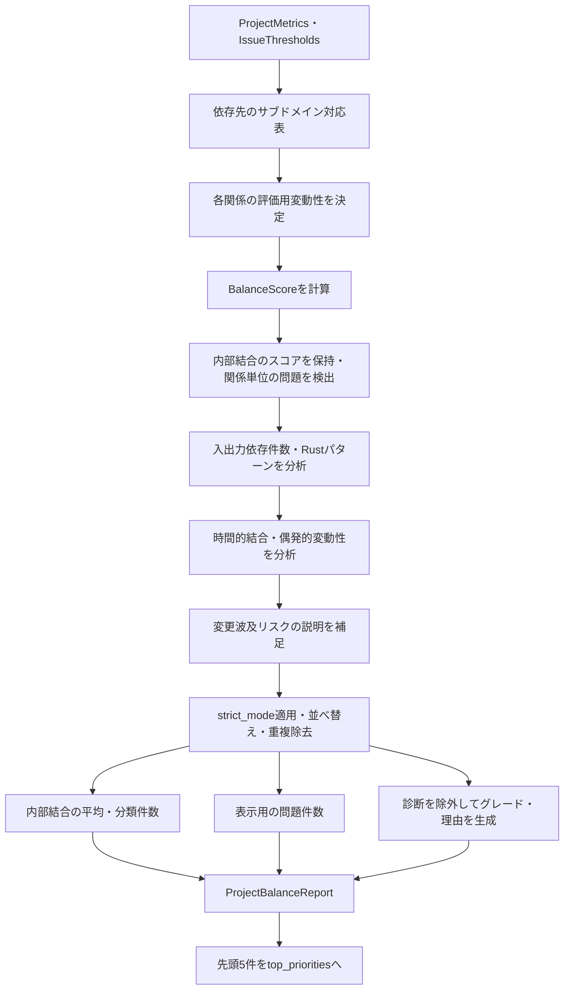

# 結合バランス・健全性評価

`balance` モジュールは、Rustプロジェクトの結合指標から、関係単位のバランススコア、設計上の問題、改善提案、プロジェクト全体の健全性グレードを生成する。

評価には三つの異なる結果がある。

| 評価結果 | 判断材料 | 用途 |
|---|---|---|
| バランススコア | 結合の強さ・距離・依存先の変動性 | 個々の関係とプロジェクト平均の把握 |
| 検出問題 | 関係の分類、依存件数、Rust構文、変更履歴 | 確認すべき箇所と改善候補の特定 |
| 健全性グレード | 採点対象となる問題の重大度別件数と密度 | プロジェクト全体の状態の要約 |

**健全性グレードは、平均バランススコアを文字へ変換したものではない。** また、評価理由の順位付けには重大度の重みを使うが、グレード自体は件数と密度の条件分岐で決定する。

本書は、提供資料とプロジェクト内の実装を静的に照合したものである。ビルド、テスト実行、サーバー起動は行っていない。

## 1. モジュール構成と公開インターフェース

| 実装ファイル | 責務 |
|---|---|
| `src/balance/score.rs` | 共通評価式、関係単位のスコアと解釈、閾値の定義 |
| `src/balance/project.rs` | プロジェクト評価の統合、問題の整理、平均値の計算 |
| `src/balance/subdomain.rs` | 依存先のサブドメイン解決と評価用変動性の補正 |
| `src/balance/coupling.rs` | 個々の結合関係からの問題検出 |
| `src/balance/patterns.rs` | 入出力依存件数とRust固有パターンの検出 |
| `src/balance/signals.rs` | 隠れた時間的結合と偶発的な変動性の検出 |
| `src/balance/external_crates.rs` | 外部クレートの分類と利用分散の評価 |
| `src/balance/issue.rs`、`issue_type.rs`、`severity.rs` | 問題、識別キー、問題種別、重大度 |
| `src/balance/action.rs` | 構造化した改善提案 |
| `src/balance/grade.rs`、`rationale.rs` | 健全性グレード、評価理由、レポートモデル |
| `src/balance/labels.rs` | 表示用ラベルと提案名の補助処理 |
| `src/balance/mod.rs`、`issues.rs` | 型・関数の公開と互換用の再公開 |

主要な入口は次のとおりである。

```rust
pub fn analyze_project_balance(
    metrics: &ProjectMetrics,
) -> ProjectBalanceReport;

pub fn analyze_project_balance_with_thresholds(
    metrics: &ProjectMetrics,
    thresholds: &IssueThresholds,
) -> ProjectBalanceReport;

pub fn calculate_project_score(
    metrics: &ProjectMetrics,
) -> f64;

pub fn identify_issues(
    coupling: &CouplingMetrics,
) -> Vec<CouplingIssue>;
```

`balance` は集約済みの `ProjectMetrics` を入力として評価する。ソース探索やGit履歴の取得は上流の責務であり、この評価処理がソースコードを修正することはない。

## 2. 評価処理の流れ

`analyze_project_balance_with_thresholds` は次の順に処理する。



内部結合の判定条件は `distance != Distance::DifferentCrate` である。ここでの「内部」はこの分類値に基づくため、実際の解析範囲は上流の距離分類にも依存する。

全関係についてスコアを計算するが、平均スコア、バランス別件数、関係単位の問題検出には内部結合のみを使用する。外部依存の分散評価は別の呼び出し経路で扱う。

## 3. バランススコア

### 3.1 入力となる三次元

`CouplingMetrics` は、依存元 `source`、依存先 `target`、強さ `strength`、距離 `distance`、依存先の変動性 `volatility` を保持する。ソース位置、可視性、構文上の利用形態などの補助情報も持つ。

各次元の数値は次のように定義される。

| 次元 | 分類 | 値 |
|---|---|---:|
| 強さ | `Intrusive`：内部実装への直接依存 | 1.0 |
| 強さ | `Functional`：関数シグネチャへの依存 | 0.75 |
| 強さ | `Model`：データモデルへの依存 | 0.5 |
| 強さ | `Contract`：トレイトなどの公開インターフェースへの依存 | 0.25 |
| 距離 | `SameFunction` | 0.0 |
| 距離 | `SameModule` | 0.25 |
| 距離 | `DifferentModule` | 0.5 |
| 距離 | `DifferentCrate` | 1.0 |
| 変動性 | `Low` | 0.0 |
| 変動性 | `Medium` | 0.5 |
| 変動性 | `High` | 1.0 |

`SameModule` には、分類上、親子や同じ親の下にある兄弟などの構造的に隣接するモジュールも含まれる。物理ファイルの一致だけを表す値ではない。

`CouplingMetrics` には可視性を考慮した `effective_strength_value()` もあるが、`BalanceScore::calculate` が直接参照するのは `strength_value()` である。スコア計算時に可視性による追加補正を行う実装ではない。

### 3.2 評価式

評価方式の識別子は `khononov-compensation-v2` である。

```text
alignment         = abs(strength - distance)
volatility_impact = 1 - volatility
balance           = max(alignment, volatility_impact)
```

強い結合を近くに置くこと、遠い関係では共有する知識を減らすこと、依存先が安定していることを評価する。`volatility_impact` は名称に反して減点量ではなく、安定性による補償値である。

この計算関数自体は値の範囲を丸めたり、入力を検証したりしない。通常の観測では列挙値の数値変換が範囲を保証し、設計シナリオでは入力側が次元を `[0, 1]` に制限する。

| 関係の例 | 計算 | スコア |
|---|---|---:|
| 安定した依存先 | `max(abs(s - d), 1)` | 常に1.0 |
| 内部実装への依存、同一関数、高変動性 | `max(abs(1 - 0), 0)` | 1.0 |
| 内部実装への依存、同一モジュール相当、高変動性 | `max(abs(1 - 0.25), 0)` | 0.75 |
| 内部実装への依存、別モジュール、高変動性 | `max(abs(1 - 0.5), 0)` | 0.5 |
| 内部実装への依存、別クレート、高変動性 | `max(abs(1 - 1), 0)` | 0.0 |

最後の例は関係単位では計算できるが、通常のプロジェクト平均には含まれない。

### 3.3 解釈とプロジェクト平均

| スコア範囲 | `BalanceInterpretation` |
|---|---|
| 0.8以上 | `Balanced` |
| 0.6以上0.8未満 | `Acceptable` |
| 0.4以上0.6未満 | `NeedsReview` |
| 0.2以上0.4未満 | `NeedsRefactoring` |
| 0.2未満 | `Critical` |

`is_balanced()` は `Balanced` と `Acceptable` を含む。`needs_refactoring()` は `NeedsRefactoring` と `Critical` を含む。

プロジェクト平均は、内部結合の各観測を等しく扱う算術平均である。

```text
average_score = 内部結合のスコア合計 / 内部結合の観測件数
```

内部結合がゼロ件なら `1.0` を返す。ただし、健全性グレードは情報不足を考慮して `B` になる。

スコアの平均では関係を一意なモジュール対へ集約しない。後述する問題一覧の重複除去とは集計単位が異なる。

## 4. 本質的な変動性と変更履歴

### 4.1 サブドメインによる評価値の補正

`coupling_with_essential_volatility` は、依存先のサブドメインを解決できた場合に、その期待変動性を評価へ適用する。

| サブドメイン | 評価に使う変動性 |
|---|---|
| `Core` | `High` |
| `Supporting` | `Low` |
| `Generic` | `Low` |
| 解決できない場合 | 元の `CouplingMetrics.volatility` |

たとえば、変更履歴が少ない `Core` でも評価上は高変動性となる。逆に、最近の変更が多い `Supporting` は低変動性としてスコアを計算し、その変更の多さを別の診断で報告する。

対応表にはモジュールのキー、名前、末尾名、ファイル名の拡張子を除いた部分、定義された型名・関数名を登録する。異なるサブドメインが同じ別名に対応した場合、その別名を曖昧として扱う。

解決は対象名全体を優先し、その後 `::` で区切った要素を末尾から調べる。名前に基づく補助解決であり、Rustの型解決ではない。

### 4.2 偶発的な変動性の診断

`AccidentalVolatility` は、安定しているはずの領域で変更が多いことを示す。

検出条件は次のとおりである。

- `file_changes` に4ファイル以上の情報がある。
- モジュールが `Supporting` または `Generic` に分類されている。
- 対応ファイルの変更回数が、上位四分位の閾値以上である。

閾値は変更回数を昇順に並べ、添字 `floor(件数 × 3 / 4)` の値を採用する。ただし最低値は3回である。

重大度は `Medium`、問題に付くスコアは固定値 `0.5` となる。これは報告対象だが、`IssueType::is_diagnostic()` により健全性グレードの対象から除外される。

## 5. 問題の検出条件

### 5.1 関係単位の検出

`identify_issues_with_thresholds` は `DifferentCrate` を除外し、次の条件を判定する。

| 問題種別 | 条件 | 重大度 |
|---|---|---|
| `GlobalComplexity` | `Intrusive`、`DifferentModule`、変動性 `Low` | `Low` |
| `GlobalComplexity` | 同上、変動性 `Medium` | `Medium` |
| `CascadingChangeRisk` | `Intrusive`、`DifferentModule`、変動性 `High` | `High` |
| `InappropriateIntimacy` | `Intrusive`、`DifferentModule`、スコアが0.5未満、同じ処理で `GlobalComplexity` が未検出 | `Medium` |

依存先がクレートルートの再公開ファサードと認識される場合、これらの検出を抑制する。ファサード判定は、`my-crate::my_crate` のような名前の形に基づく。

実装上、次の点に注意が必要である。

- `strong_coupling`、`far_distance`、`high_volatility` は `IssueThresholds` に存在するが、この関数では参照されない。現行の判定は列挙値の一致による。
- 現在の数値定義では、`Intrusive` と `DifferentModule` のスコアは最低でも0.5となる。そのため、`InappropriateIntimacy` の「0.5未満」は通常の入力では成立しない。
- `UnnecessaryAbstraction` の検出は無効化されている。

`CascadingChangeRisk` の説明には、依存先が `Core` か、それ以外かに応じた変動性の補足を付ける。ただし、`Core` 以外への説明文だけで実際の変更原因を確定できるわけではない。

### 5.2 入出力依存件数

モジュール単位の入出力依存は、内部結合レコードを依存元・依存先ごとに数える。異なる依存先や依存元を重複排除した件数ではない。

| 問題種別 | 既定の検出条件 | 通常の重大度 |
|---|---|---|
| `HighEfferentCoupling` | 出力依存件数が20件超 | 40件超なら `High`、それ以外は `Medium` |
| `HighAfferentCoupling` | 入力依存件数が30件超 | 60件超なら `High`、それ以外は `Medium` |

例外として、名前の末尾が `main` のモジュールは、アプリケーションの組み立て役とみなし、出力依存過多を `Low` にする。`Supporting`・`Generic` の入力依存過多も、安定した中心的な抽象として `Low` にする。

### 5.3 Rust固有のパターン

| 問題種別 | 検出条件 | 重大度 |
|---|---|---|
| `GodModule` | 関数30個超、型15個超、または実装20個超 | 関数60個超または型30個超なら `High`、それ以外は `Medium` |
| `PublicFieldExposure` | 公開型で、トレイトではなく、公開フィールドが1個以上 | `Low` |
| `PrimitiveObsession` | プリミティブ引数が3個以上で、全引数に占める割合が60%以上 | `Low` |

`GodModule` の実装数は、トレイト実装数と固有実装数の合計である。実装数だけが閾値の2倍を超えても `High` にはならない。

テスト除外指定がある場合、`GodModule` の関数数は `saturating_sub` でテスト関数数を差し引く。

公開フィールドの検出は、他モジュールから実際にアクセスされたかをこの処理内で確認しない。プリミティブ引数も、同じ型の繰り返しかどうかではなく個数と割合を使う。説明文より実際の検出条件の方が広いことに留意する。

### 5.4 隠れた時間的結合

`HiddenCoupling` は、明示的なコード依存がないのに同時変更が多いファイル対を検出する。

```text
coupling_ratio =
    同時変更回数 / 変更回数が少ない側のファイルの変更回数
```

比率が0.5以上の候補から、次を除外する。

- ファイルをモジュールへ対応付けられない。
- 同じモジュールである。
- どちらかの方向に明示的なコード依存がある。
- どちらかがエントリーポイント、`lib.rs`、構造的に隣接するモジュールである。

残った対について、比率が0.8以上かつ同時変更が8回以上なら `High`、それ以外は `Medium` とする。問題に付くスコアは `1 - coupling_ratio` である。対の順序を統一し、同じ対を重複報告しない。

同時変更は共有知識を調べる手掛かりであり、共通の抽象化が必要であることの証明ではない。

## 6. 外部クレートの扱い

通常の `ProjectBalanceReport` では、`DifferentCrate` の関係を平均スコアと関係単位の問題検出から除外する。一方、`external::analyze_external_dependencies` は外部依存をクレート単位に集約し、`ExternalDependencyReport` を返す。

外部依存の分散では、同じクレートを直接使用する**異なる内部モジュールの数**を `breadth` とする。

| `breadth` | `ScatteredExternalCoupling` |
|---|---|
| 3以下 | 検出しない |
| 4〜5 | `Medium` |
| 6〜9 | `High` |
| 10以上 | `Critical` |

```text
balance_score = 1 - min(breadth / 12, 1)
```

改善提案には、外部利用を集約するファサードやラッパーを示す。この結果は外部依存レポートに格納され、`analyze_project_balance_with_thresholds` 内では通常の問題一覧へ追加されない。

`CrateStability` は `Fundamental`、`Stable`、`Infrastructure`、`Normal` を定義し、`std`・`core`・`alloc` の除外や安定したクレートの重大度低減を判断する補助関数を提供する。ただし、分散検出関数自体はこれらを呼ばず、入力された `breadth` で判定する。分類ヘルパーの存在を、全評価経路への自動適用と解釈してはいけない。

## 7. 問題の整理と改善提案

`CouplingIssue` は次の情報を持つ。

| フィールド | 内容 |
|---|---|
| `issue_type` | 問題種別 |
| `severity` | `Low < Medium < High < Critical` |
| `source`、`target` | 対象となる名前、または件数を表す文字列 |
| `description` | 検出内容の説明 |
| `refactoring` | 構造化した改善提案 |
| `balance_score` | 関係スコア、または検出器固有の指標 |

`balance_score` は必ずしも三次元の共通式による値ではない。モジュール規模などの問題には固定値や件数由来の値を使う。

`RefactoringAction` はトレイト導入、近接配置、アダプター抽出、モジュール分割、循環解消、インターフェース安定化、getter追加、newtype導入などを表す。提案名やメソッドには雛形が含まれ、自動適用できる完成済みの修正を意味しない。

問題一覧は次のように整理される。

1. 既定で有効な `strict_mode` により `Low` を除外する。
2. 重大度の降順、問題スコアの昇順で並べる。
3. 同点では種別、依存元、依存先、説明、改善提案の文字列表現で順序を確定する。
4. `stable_key()` が同じ問題を重複除去し、先頭の問題を残す。
5. 整理後の先頭5件を `top_priorities` とする。

`stable_key()` は基本的に `(issue_type, source, target)` である。入出力依存過多では `"12 dependents"` や `"21 dependencies"` の件数部分を識別キー上で正規化し、件数増加を同じ問題の変化として追跡できるようにする。

この正規化はすべての件数表現へ適用されるわけではない。また、`top_priorities` は設計分析の業務価値・影響範囲・工数による優先順位とは別の並べ方である。

## 8. 健全性グレードと評価理由

### 8.1 グレードの算定

整理後の問題から診断を除外し、内部結合件数を `N`、重大度別件数を `critical`、`high`、`medium` とする。`Low` はグレードの算式では使用しない。

以下を上から順に判定し、最初に成立したグレードを返す。

| 順序 | 条件 | グレード |
|---:|---|---|
| 1 | `N == 0` | B |
| 2 | `critical > 3` | F |
| 3 | `critical > 0` または `high / N > 0.05` | D |
| 4 | `high > 0` または `medium / N > 0.25` | C |
| 5 | `medium / N > 0.10` または `(critical + high + medium) / N > 0.15` | B |
| 6 | `high == 0`、`medium / N <= 0.05`、`N >= 20` | S |
| 7 | `high == 0`、`medium / N <= 0.10`、`N >= 10` | A |
| 8 | 上記以外 | B |

`S` は実装上「過度な最適化への注意」を示す表示であり、単純な最高評価として設計されていない。ただし、問題密度が低いことだけで過剰設計を証明できるわけでもない。

たとえば内部結合100件の場合、`High` が1件なら `C`、6件なら `D`、`Critical` が4件なら `F` となる。内部結合15件で採点対象の問題がなければ `A`、100件でなければ `S` となる。

密度の分子は重複除去後の問題数、分母は内部結合の観測件数である。モジュール単位や時間的結合の問題も分子に入るため、「不良な結合の割合」と完全に一致する指標ではない。

### 8.2 評価理由

`GradeRationale` は要約、上位3種類の問題、最も寄与した次元、変動性の補足を保持する。

寄与の順位付けでは次の重みを使う。

| 重大度 | 重み |
|---|---:|
| Critical | 4 |
| High | 3 |
| Medium | 2 |
| Low | 1 |

主な次元への対応は次のとおりである。

| 次元 | 問題種別 |
|---|---|
| Strength | `InappropriateIntimacy`、`PublicFieldExposure`、`PrimitiveObsession`、`ShallowModule`、`PassThroughMethod` |
| Distance | `GlobalComplexity`、入出力依存過多、`GodModule`、`CircularDependency`、外部依存の分散など |
| Volatility | `CascadingChangeRisk`、`HiddenCoupling` |

問題種別の順位は重み合計、件数、種別名で確定する。次元の重みが同じ場合は `Volatility`、`Distance`、`Strength` の順で優先する。

`AccidentalVolatility` はグレードと主な理由の集計から除外し、採点していない診断として補足する。

ただし、`strict_mode` を無効にすると、グレードの算式に使われない `Low` が評価理由の重み付けには入る。診断の扱いは揃っているが、グレード算定と説明の集計は完全に同じではない。

## 9. レポートと比較機能への接続

`ProjectBalanceReport` の主要フィールドは次のように読む。

| フィールド | 集計範囲 |
|---|---|
| `total_couplings` | 外部を含む全結合件数 |
| `balanced_count` | 内部結合の `Balanced`・`Acceptable` 件数 |
| `needs_review` | 内部結合の `NeedsReview` 件数 |
| `needs_refactoring` | 内部結合の `NeedsRefactoring`・`Critical` 件数 |
| `average_score` | 内部結合の平均 |
| `issues_by_severity`、`issues_by_type` | フィルタ・重複除去後の問題。診断を含む |
| `health_grade` | 診断を除外した問題によるグレード |
| `top_priorities` | 整理後の先頭5件 |
| `grade_rationale` | グレードの説明 |

`total_couplings` とバランス別件数は対象範囲が異なるため、単純に割合を計算すると分母を取り違える。

基準比較を行う `diff_reports` は、安定した識別キーを用いて新規・解消・悪化・継続を区別する。同じキーについて次のいずれかが成立すれば悪化とする。

- 重大度が上がった。
- 問題スコアが `1e-9` の許容差を超えて下がった。
- 入出力依存過多の件数が増えた。

`--check --baseline` は、指定重大度以上の新規・悪化した問題を失敗対象とする。診断の採点除外はグレードの方針であり、差分の重大度フィルタが診断を一律に除外するわけではない。

設計案とシナリオの数値評価も共通の補償式を使う。評価方式が異なる旧スコア、とくに旧来の乗算方式とは直接比較できない。基準比較では現在の解析器・設定・閾値を両側へ適用し、同じ条件でソースの変化を評価する。

## 10. 利用例と評価の限界

通常の評価、JSONによる詳細確認、基準比較は次のように実行できる。

```sh
rtk proxy cargo coupling .
rtk proxy cargo coupling --json .
rtk proxy cargo coupling --check --baseline main --fail-on high .
rtk proxy cargo coupling --design --json .
```

結果を読む際は、平均値から個々の問題へ進み、依存先の変動性が履歴由来かサブドメイン由来かを確認する。公開フィールドや同時変更の検出など、構文・履歴上の条件と設計上の意味を区別することが重要である。

`IssueType` に列挙された種別が、すべて通常のプロジェクト評価で検出されるわけではない。たとえば `CircularDependency`、`ShallowModule`、`PassThroughMethod`、`HighCognitiveLoad` は型として存在するが、ここで確認した `project.rs` の処理では検出器を呼び出していない。

入力となる静的解析は、マクロ展開、有効な `cfg` 分岐、動的ディスパッチ、完全な型解決を網羅しない。スコアとグレードは、実行時の安全性、変更工数、業務上の責務分割を保証する値ではない。

実装内には、安定性による補償、サブドメイン優先、隠れた結合の除外条件、診断の採点除外、重複除去、グレード判定、問題悪化の比較を確認するテストが存在する。本書で確認したのはその実装と記述内容であり、現在のテスト成功や性能を示すものではない。
